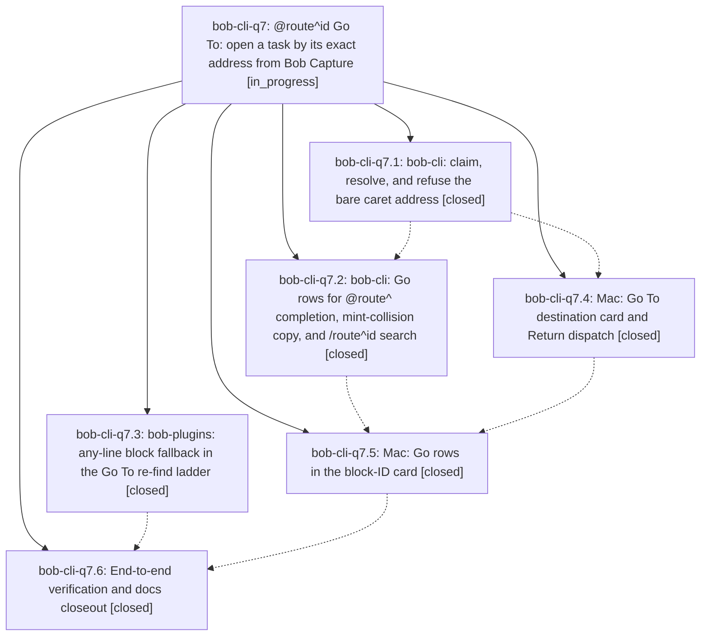

# Bead: bob-cli-q7 — @route^id Go To: open a task by its exact address from Bob Capture

[Bead Pages](../README.md) / bob-cli-q7

**Status:** ◐ in_progress · **Type:** ▸ plan · **Tier:** epic
**Owner:** `bryanbugyi34@gmail.com` · **Created by:** [bbugyi200.athena.1g6](https://github.com/bobs-org/bob-cli--agents/blob/main/sessions/bbugyi200.athena.1g6.md) · **Assignee:** `bob-cli-q7.land`
**Created:** 2026-11-25 15:25:24 EST
**Plan:** [202611/caret\_address\_goto\_capture.md](https://github.com/bobs-org/bob-cli--plans/blob/main/202611/caret_address_goto_capture.md)

<!-- sase:links:start -->

## Links

| Relation | Artifact | Why |
| --- | --- | --- |
| implemented-by | [plan:202611/caret_address_goto_capture.md][1] | derived from the plan's `bead_id:` frontmatter field |

_Plus 4 automatic references — see [Referenced By](#referenced-by)._

[1]: https://github.com/bobs-org/bob-cli--plans/blob/main/202611/caret_address_goto_capture.md

<!-- sase:links:end -->

## Description

A capture draft that is exactly one bare `@route^block-id` token resolves read-only to that block's line and, on Return, opens it in Obsidian through the same `obsidian://bob-goto-task` landing the `/` picker uses. The panel shows the destination before Return, typing `@route^` browses that note's IDs as Go rows, misses are calm did-you-mean states, nothing is ever written, and every other caret form keeps today's meaning byte for byte.

## Notes

[2026-11-25T23:09:11Z · bob-cli-pl.6.1.land] DISCOVERED ISSUE: Landing bob-cli-pl.6.1 found bob-cli just docs-check failing at 9dd67c62 on two reference pages that phase bob-cli-q7.1 commit 4d930129 (feat(capture): treat whole-draft @route^id as read-only Go To) pushed over the 6000-word reference cap. Measured with tools/docs bob_docs.markdown.count_words per commit: docs/reference/capture-syntax.md d67a5b7b=5998 -> 4d930129=6058; docs/reference/json-outputs.md d67a5b7b=6000 -> 4d930129=6007. Earlier crossings by bob-cli-pl.6.1.1 (json-outputs) and bob-cli-ph.6.1.3 (capture-syntax) had already been trimmed back under the cap (28e23886, d67a5b7b) before 4d930129. No existing task tracks either page (searched capture-syntax / json-outputs across all task statuses plus the last-week sweep). The docs closeout (bob-cli-q7.6) should trim both pages under 6000 while preserving the Go To and props-contract rows.

[2026-11-26T00:04:32Z · bob-cli-q5.1.1.land] DISCOVERED ISSUE (bob-cli-q5.1.1 snooze land triage, bob-cli master 6a3e5df6): (1) just lint / just check fail: clippy -D clippy::manual-contains rejects tests/cli/capture/complete_block_id.rs:292 `assert!(!ids.iter().any(|id| *id == "dup"), ...)` (help: `ids.contains(&"dup")`); the line came from d883e564 (SASE_BEAD bob-cli-q7.2) and the test "cli" target refuses to compile under clippy. (2) Building on note #1: d883e564 pushed docs/reference/capture-syntax.md further, 6058 -> 6086 (bob_docs count_words). (3) docs/reference/json-outputs.md is now 6032: the 6007 from 4d930129 plus a 25-word bob snooze index row from this snooze epic (6a3e5df6 added 37 words; the snooze lander trimmed the row to its minimum). q7.6's json-outputs trim must cover 32 words; reference other rows' prose was left alone.

## Phases

| Bead | Title | Status | Size | Created | Agents | Commits |
|---|---|---|---|---|---:|---:|
| [bob-cli-q7.1](bob-cli-q7.1.md) | bob-cli: claim, resolve, and refuse the bare caret address | ✓ closed | medium | 2026-11-25 | 1 | 1 |
| [bob-cli-q7.2](bob-cli-q7.2.md) | bob-cli: Go rows for @route^ completion, mint-collision copy, and /route^id search | ✓ closed | medium | 2026-11-25 | 1 | 1 |
| [bob-cli-q7.3](bob-cli-q7.3.md) | bob-plugins: any-line block fallback in the Go To re-find ladder | ✓ closed | small | 2026-11-25 | 1 | 1 |
| [bob-cli-q7.4](bob-cli-q7.4.md) | Mac: Go To destination card and Return dispatch | ✓ closed | medium | 2026-11-25 | 1 | 3 |
| [bob-cli-q7.5](bob-cli-q7.5.md) | Mac: Go rows in the block-ID card | ✓ closed | medium | 2026-11-25 | 1 | 1 |
| [bob-cli-q7.6](bob-cli-q7.6.md) | End-to-end verification and docs closeout | ✓ closed | small | 2026-11-25 | 1 | 1 |

## Lineage

## Agents

| Agent | Bead | Commits |
|---|---|---:|
| [bbugyi200.athena.bob-cli-q7.1](https://github.com/bobs-org/bob-cli--agents/blob/main/sessions/bbugyi200.athena.bob-cli-q7.1.md) | [bob-cli-q7.1](bob-cli-q7.1.md) | 1 |
| [bbugyi200.athena.bob-cli-q7.2](https://github.com/bobs-org/bob-cli--agents/blob/main/agents/bbugyi200.athena.bob-cli-q7.2/README.md) | [bob-cli-q7.2](bob-cli-q7.2.md) | 1 |
| [bbugyi200.athena.bob-cli-q7.3](https://github.com/bobs-org/bob-cli--agents/blob/main/agents/bbugyi200.athena.bob-cli-q7.3/README.md) | [bob-cli-q7.3](bob-cli-q7.3.md) | 1 |
| [bbugyi200.athena.bob-cli-q7.4](https://github.com/bobs-org/bob-cli--agents/blob/main/sessions/bbugyi200.athena.bob-cli-q7.4.md) | [bob-cli-q7.4](bob-cli-q7.4.md) | 3 |
| [bbugyi200.athena.bob-cli-q7.5](https://github.com/bobs-org/bob-cli--agents/blob/main/sessions/bbugyi200.athena.bob-cli-q7.5.md) | [bob-cli-q7.5](bob-cli-q7.5.md) | 1 |
| [bbugyi200.athena.bob-cli-q7.6](https://github.com/bobs-org/bob-cli--agents/blob/main/sessions/bbugyi200.athena.bob-cli-q7.6.md) | [bob-cli-q7.6](bob-cli-q7.6.md) | 1 |
| [bbugyi200.athena.bob-cli-q7.land](https://github.com/bobs-org/bob-cli--agents/blob/main/agents/bbugyi200.athena.bob-cli-q7.land/README.md) | [bob-cli-q7](README.md) | 0 |

## Commits

| Repo | Commit | Subject | Bead | Committed |
|---|---|---|---|---|
| bob-plugins | [`bob-plugins@1e726f3`](https://github.com/bobs-org/bob-plugins/commit/1e726f3adb01911c95a859e0eeb6f8b303ae5c43) | feat(navigation): re-find unique non-task ^block in Go To URI | [bob-cli-q7.3](bob-cli-q7.3.md) | 2026-11-25 15:37:07 EST |
| bob-cli | [`4d93012`](https://github.com/bobs-org/bob-cli/commit/4d93012907c8d8048e2a6498450f4a803763c66a) | feat(capture): treat whole-draft @route^id as read-only Go To | [bob-cli-q7.1](bob-cli-q7.1.md) | 2026-11-25 17:10:47 EST |
| bob-mac-capture | [`bob-mac-capture@fc0d455`](https://github.com/bobs-org/bob-mac-capture/commit/fc0d45515c8d86a33ab8b4ca46452f837eb3c490) | feat(capture): add caret Go To destination dispatch | [bob-cli-q7.4](bob-cli-q7.4.md) | 2026-11-25 18:03:57 EST |
| bob-cli | [`d883e56`](https://github.com/bobs-org/bob-cli/commit/d883e564ecac1aecc9c3b6d4a1c72517cae87379) | feat(capture): scoped browse block\_id.goto with archive rows, mint-collision hint, route^block-id search | [bob-cli-q7.2](bob-cli-q7.2.md) | 2026-11-25 18:16:48 EST |
| bob-mac-capture | [`bob-mac-capture@5d04d28`](https://github.com/bobs-org/bob-mac-capture/commit/5d04d286ffd485f2256bf7fc6dcb411a5dc2765e) | fix(ci): allow full Swift test suite to finish | [bob-cli-q7.4](bob-cli-q7.4.md) | 2026-11-25 18:35:40 EST |
| bob-mac-capture | [`bob-mac-capture@1e85be2`](https://github.com/bobs-org/bob-mac-capture/commit/1e85be2600e29b48a3feb98bc34e1e9b0b00c0f8) | fix(capture): preserve draft when opening similar tasks | [bob-cli-q7.4](bob-cli-q7.4.md) | 2026-11-25 19:06:15 EST |
| bob-mac-capture | [`bob-mac-capture@e6b22ed`](https://github.com/bobs-org/bob-mac-capture/commit/e6b22ed2709713be4444c2667dea0c1dd8652b2d) | feat(mac): turn block-ID card into scoped Go To browse | [bob-cli-q7.5](bob-cli-q7.5.md) | 2026-11-25 22:39:06 EST |
| bob-cli | [`8ee8d03`](https://github.com/bobs-org/bob-cli/commit/8ee8d03ca7e50f33cdf07f7b1d408a399e4da4bc) | docs(capture): reconcile caret Go To contract and Mac links | [bob-cli-q7.6](bob-cli-q7.6.md) | 2026-11-26 03:38:51 EST |

<!-- sase:referenced-by:start -->

## Referenced By

| Relation | Artifact | Why | Uses |
| --- | --- | --- | ---: |
| read-by | [agent:bob-cli-pl.6.1.land][1] | Need q7 children and notes | 2 |
| read-by | [agent:bob-cli-q5.1.1.land][2] | Check q7 notes for the manual_contains lint break and capture-syntax/json-outputs budget overages | 2 |
| read-by | [agent:bob-cli-q7.2][3] | Need parent epic context for phase q7.2 | 1 |
| read-by | [agent:bob-cli-q7.3][4] | Need parent epic DECISIONS and phase notes | 1 |

[1]: https://github.com/bobs-org/bob-cli--agents/blob/main/agents/bbugyi200.athena.bob-cli-pl.6.1.land/README.md
[2]: https://github.com/bobs-org/bob-cli--agents/blob/main/sessions/bbugyi200.athena.bob-cli-q5.1.1.land.md
[3]: https://github.com/bobs-org/bob-cli--agents/blob/main/agents/bbugyi200.athena.bob-cli-q7.2/README.md
[4]: https://github.com/bobs-org/bob-cli--agents/blob/main/agents/bbugyi200.athena.bob-cli-q7.3/README.md

<!-- sase:referenced-by:end -->
