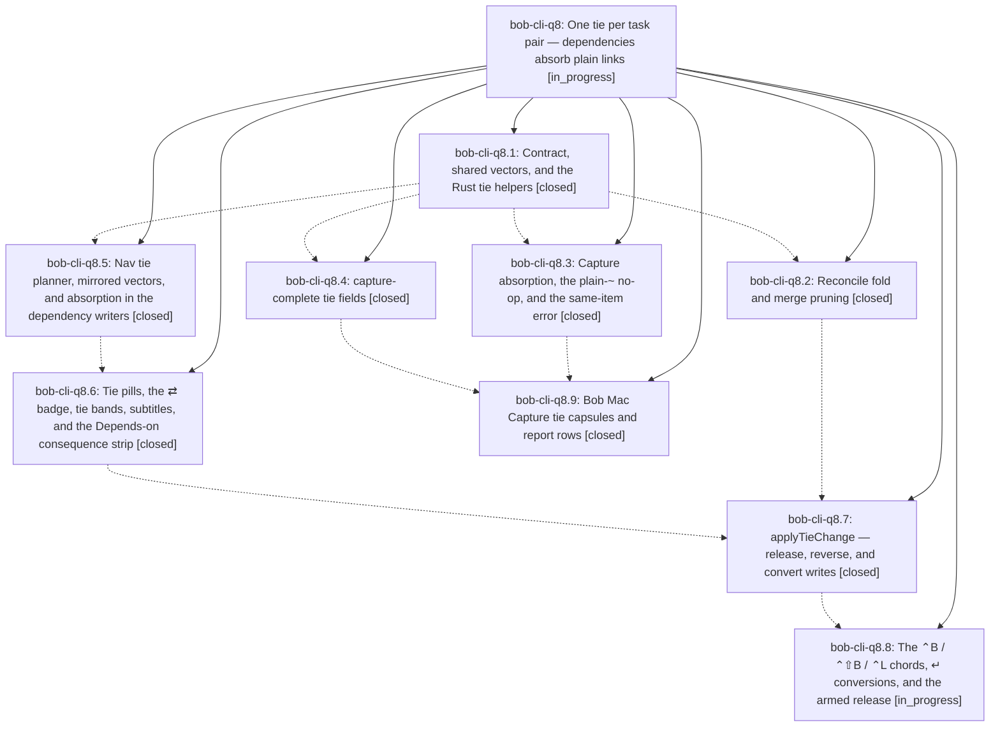

# Bead: bob-cli-q8 — One tie per task pair — dependencies absorb plain links

[Bead Pages](../README.md) / bob-cli-q8

**Status:** ◐ in_progress · **Type:** ▸ plan · **Tier:** epic
**Owner:** `bryanbugyi34@gmail.com` · **Created by:** [bbugyi200.apollo.research.6f.linker.w0](https://github.com/bobs-org/bob-cli--agents/blob/main/sessions/bbugyi200.apollo.research.6f.linker.w0.md) · **Assignee:** `bob-cli-q8.land`
**Created:** 2026-11-25 18:16:41 EST
**Plan:** [202611/plain\_link\_dependency\_ties.md](https://github.com/bobs-org/bob-cli--plans/blob/main/202611/plain_link_dependency_ties.md)

<!-- sase:links:start -->

## Links

| Relation | Artifact | Why |
| --- | --- | --- |
| implemented-by | [plan:202611/plain_link_dependency_ties.md][1] | derived from the plan's `bead_id:` frontmatter field |

_Plus 1 automatic references — see [Referenced By](#referenced-by)._

[1]: https://github.com/bobs-org/bob-cli--plans/blob/main/202611/plain_link_dependency_ties.md

<!-- sase:links:end -->

## Description

A task pair can hold a dependency or a plain (unlabelled) link, never both, in either direction. Every Bob writer enforces it. Reconcile heals hand edits in the dependency's favour. The four Obsidian relationship stages show each pair's tie at a glance and convert it with Ctrl plus the Task Card key, and capture plus Bob Mac Capture explain the rule.

## Phases

| Bead | Title | Status | Size | Created | Agents | Commits |
|---|---|---|---|---|---:|---:|
| [bob-cli-q8.1](bob-cli-q8.1.md) | Contract, shared vectors, and the Rust tie helpers | ✓ closed | medium | 2026-11-25 | 1 | 1 |
| [bob-cli-q8.2](bob-cli-q8.2.md) | Reconcile fold and merge pruning | ✓ closed | medium | 2026-11-25 | 1 | 1 |
| [bob-cli-q8.3](bob-cli-q8.3.md) | Capture absorption, the plain-~ no-op, and the same-item error | ✓ closed | medium | 2026-11-25 | 1 | 2 |
| [bob-cli-q8.4](bob-cli-q8.4.md) | capture-complete tie fields | ✓ closed | small | 2026-11-25 | 1 | 1 |
| [bob-cli-q8.5](bob-cli-q8.5.md) | Nav tie planner, mirrored vectors, and absorption in the dependency writers | ✓ closed | medium | 2026-11-25 | 1 | 2 |
| [bob-cli-q8.6](bob-cli-q8.6.md) | Tie pills, the ⇄ badge, tie bands, subtitles, and the Depends-on consequence strip | ✓ closed | medium | 2026-11-25 | 1 | 2 |
| [bob-cli-q8.7](bob-cli-q8.7.md) | applyTieChange — release, reverse, and convert writes | ✓ closed | medium | 2026-11-25 | 1 | 2 |
| [bob-cli-q8.8](bob-cli-q8.8.md) | The ⌃B / ⌃⇧B / ⌃L chords, ↵ conversions, and the armed release | ◐ in_progress | medium | 2026-11-25 | 1 | 0 |
| [bob-cli-q8.9](bob-cli-q8.9.md) | Bob Mac Capture tie capsules and report rows | ✓ closed | medium | 2026-11-25 | 1 | 0 |

## Lineage

## Agents

| Agent | Bead | Commits |
|---|---|---:|
| [bbugyi200.apollo.bob-cli-q8.1](https://github.com/bobs-org/bob-cli--agents/blob/main/agents/bbugyi200.apollo.bob-cli-q8.1/README.md) | [bob-cli-q8.1](bob-cli-q8.1.md) | 1 |
| [bbugyi200.apollo.bob-cli-q8.2](https://github.com/bobs-org/bob-cli--agents/blob/main/agents/bbugyi200.apollo.bob-cli-q8.2/README.md) | [bob-cli-q8.2](bob-cli-q8.2.md) | 1 |
| [bbugyi200.apollo.bob-cli-q8.3](https://github.com/bobs-org/bob-cli--agents/blob/main/agents/bbugyi200.apollo.bob-cli-q8.3/README.md) | [bob-cli-q8.3](bob-cli-q8.3.md) | 2 |
| [bbugyi200.apollo.bob-cli-q8.4](https://github.com/bobs-org/bob-cli--agents/blob/main/agents/bbugyi200.apollo.bob-cli-q8.4/README.md) | [bob-cli-q8.4](bob-cli-q8.4.md) | 1 |
| [bbugyi200.apollo.bob-cli-q8.5](https://github.com/bobs-org/bob-cli--agents/blob/main/agents/bbugyi200.apollo.bob-cli-q8.5/README.md) | [bob-cli-q8.5](bob-cli-q8.5.md) | 2 |
| [bbugyi200.apollo.bob-cli-q8.6](https://github.com/bobs-org/bob-cli--agents/blob/main/sessions/bbugyi200.apollo.bob-cli-q8.6.md) | [bob-cli-q8.6](bob-cli-q8.6.md) | 2 |
| [bbugyi200.apollo.bob-cli-q8.7](https://github.com/bobs-org/bob-cli--agents/blob/main/agents/bbugyi200.apollo.bob-cli-q8.7/README.md) | [bob-cli-q8.7](bob-cli-q8.7.md) | 2 |
| [bbugyi200.apollo.bob-cli-q8.8](https://github.com/bobs-org/bob-cli--agents/blob/main/agents/bbugyi200.apollo.bob-cli-q8.8/README.md) | [bob-cli-q8.8](bob-cli-q8.8.md) | 0 |
| [bbugyi200.apollo.bob-cli-q8.9](https://github.com/bobs-org/bob-cli--agents/blob/main/agents/bbugyi200.apollo.bob-cli-q8.9/README.md) | [bob-cli-q8.9](bob-cli-q8.9.md) | 0 |
| [bbugyi200.apollo.bob-cli-q8.land](https://github.com/bobs-org/bob-cli--agents/blob/main/agents/bbugyi200.apollo.bob-cli-q8.land/README.md) | [bob-cli-q8](README.md) | 0 |

## Commits

| Repo | Commit | Subject | Bead | Committed |
|---|---|---|---|---|
| bob-cli | [`a1caeef`](https://github.com/bobs-org/bob-cli/commit/a1caeefabef111947a17247c0af512868ba2a08c) | feat(relations): plain-link/dependency tie contract, PT vectors, and Rust tie helpers | [bob-cli-q8.1](bob-cli-q8.1.md) | 2026-11-25 19:51:06 EST |
| bob-cli | [`2880238`](https://github.com/bobs-org/bob-cli/commit/28802383d80b1665f59aa68b68406c25482adff8) | feat(capture-complete)!: report dependency tie on every candidate | [bob-cli-q8.4](bob-cli-q8.4.md) | 2026-11-25 20:35:44 EST |
| bob-cli | [`5d08882`](https://github.com/bobs-org/bob-cli/commit/5d088829b3f9cfb397aea7852d7be147d76b8b77) | feat(task-relations): fold dependency overlaps during reconcile and merge | [bob-cli-q8.2](bob-cli-q8.2.md) | 2026-11-25 20:45:50 EST |
| bob-cli | [`f6e333d`](https://github.com/bobs-org/bob-cli/commit/f6e333d58ce52291831aa668ac094da37f5f6d62) | feat(relations): publish plain-link tie vectors PT22-39 and writer absorption contract | [bob-cli-q8.5](bob-cli-q8.5.md) | 2026-11-25 21:21:16 EST |
| bob-plugins | [`bob-plugins@9ee4822`](https://github.com/bobs-org/bob-plugins/commit/9ee4822981650324ce391015bfc8fa2b6aa9bba8) | feat(nav): tie planner twins, planTieChange, and absorption in dependency writers | [bob-cli-q8.5](bob-cli-q8.5.md) | 2026-11-25 21:22:09 EST |
| bob-cli | [`974129e`](https://github.com/bobs-org/bob-cli/commit/974129e55c0814d2822ab1a1b12bb278ca7f4d8e) | feat(capture): handle dependency and plain link ties | [bob-cli-q8.3](bob-cli-q8.3.md) | 2026-11-25 21:25:01 EST |
| bob-plugins | [`bob-plugins@5067a37`](https://github.com/bobs-org/bob-plugins/commit/5067a37810610d7f53b8f4ba4f81067e964e2a93) | docs(plugins): update generated version metadata | [bob-cli-q8.3](bob-cli-q8.3.md) | 2026-11-25 21:25:54 EST |
| bob-cli | [`944a375`](https://github.com/bobs-org/bob-cli/commit/944a375f1c0daef2781697c180b13753e9181028) | docs(nav): document task tie visibility | [bob-cli-q8.6](bob-cli-q8.6.md) | 2026-11-25 22:33:16 EST |
| bob-plugins | [`bob-plugins@b26a38a`](https://github.com/bobs-org/bob-plugins/commit/b26a38a70dbf50f070f68258f6460370c6bd1a9b) | feat(nav): surface task tie relationships | [bob-cli-q8.6](bob-cli-q8.6.md) | 2026-11-25 22:34:04 EST |
| bob-cli | [`01dee47`](https://github.com/bobs-org/bob-cli/commit/01dee47a01b6b24aa35175370d50bbe7b5fd779c) | docs(tasks): document tie conversion writes | [bob-cli-q8.7](bob-cli-q8.7.md) | 2026-11-25 23:33:24 EST |
| bob-plugins | [`bob-plugins@6837edc`](https://github.com/bobs-org/bob-plugins/commit/6837edc9be160a6eb889607d91f5313422de6b01) | feat(nav): apply task tie changes atomically | [bob-cli-q8.7](bob-cli-q8.7.md) | 2026-11-25 23:34:19 EST |

<!-- sase:referenced-by:start -->

## Referenced By

| Relation | Artifact | Why | Uses |
| --- | --- | --- | ---: |
| read-by | [agent:bob-cli-q8.4][1] | epic context | 1 |

[1]: https://github.com/bobs-org/bob-cli--agents/blob/main/agents/bbugyi200.apollo.bob-cli-q8.4/README.md

<!-- sase:referenced-by:end -->
