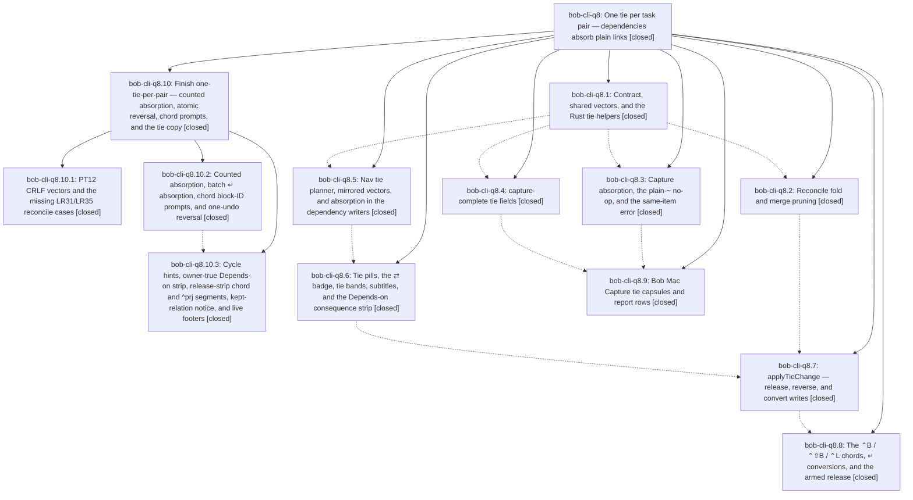

# Bead: bob-cli-q8 — One tie per task pair — dependencies absorb plain links

[Bead Pages](../README.md) / bob-cli-q8

**Status:** ✓ closed · **Resolution:** done · **Type:** ▸ plan · **Tier:** epic
**Owner:** `bryanbugyi34@gmail.com` · **Created by:** [bbugyi200.apollo.research.6f.linker.w0](https://github.com/bobs-org/bob-cli--agents/blob/main/sessions/bbugyi200.apollo.research.6f.linker.w0.md) · **Assignee:** `bob-cli-q8.land`
**Created:** 2026-11-25 18:16:41 EST · **Closed:** 2026-11-26 07:32:18 EST
**Plan:** [202611/plain\_link\_dependency\_ties.md](https://github.com/bobs-org/bob-cli--plans/blob/main/202611/plain_link_dependency_ties.md)

<!-- sase:links:start -->

## Links

| Relation | Artifact | Why |
| --- | --- | --- |
| implemented-by | [plan:202611/plain_link_dependency_ties.md][1] | derived from the plan's `bead_id:` frontmatter field |

_Plus 4 automatic references — see [Referenced By](#referenced-by)._

[1]: https://github.com/bobs-org/bob-cli--plans/blob/main/202611/plain_link_dependency_ties.md

<!-- sase:links:end -->

## Description

A task pair can hold a dependency or a plain (unlabelled) link, never both, in either direction. Every Bob writer enforces it. Reconcile heals hand edits in the dependency's favour. The four Obsidian relationship stages show each pair's tie at a glance and convert it with Ctrl plus the Task Card key, and capture plus Bob Mac Capture explain the rule.

## Notes

[2026-11-26T07:02:14Z · bob-cli-q8.land] LAND TRIAGE of child PROPOSED FOLLOW-UPs (bob-cli-q8.land): (1) q8.1#1: the two lib failures (three_component_marker_keeps_route_and_task_contexts, task_drawers_and_project_h2_drawers_resolve_for_merge) were already tracked in bob-cli-q7.2 notes and are now also in a DISCOVERED ISSUE on bob-cli-ph (drawer cutover). The docs-check lint-budget part is resolved: just docs-check passes on master. (2) q8.2#1, q8.4#1, q8.9#1, docs generated/inventory drift: resolved. just docs-check and bob-plugins npm run docs:check both pass, and the lander regenerated docs/reference/glossary.md. (3) q8.3#1, search-smoke '- #Section': resolved, test_search_smoke passes. (4) q8.5#1, writer-file suite red: upstream ec93b88c fixed the 16 non-q8 tests; the lander fixed q8's own DW20-DW22 (missing bindActiveMarkdownEditor). The remaining settle-harness failures in other files went to bob-cli-q4.10.1 as a DISCOVERED ISSUE (they reproduce pre-q8 at ec93b88c). (5) q8.5#2: the mount collision is resolved (docs-check passes) and the stale ledger bundle is resolved (build:check passes, 5b324dd3). The date-pinned cycler open-line tests went to bob-cli-q4 as a DISCOVERED ISSUE. (6) q8.5#3, another agent's vault deploy stamp: declined. It was transient deploy state; bob plugins sync now reports every plugin up to date. (7) q8.6#1, blocks-stage-view 11 failures: bob-cli-q4.10.1 DISCOVERED ISSUE (pre-q8 at ec93b88c). (8) q8.6#2: bob-cli-q4 DISCOVERED ISSUE. (9) q8.7#1, task-reqs vectors 24 failures: resolved upstream (2ba3315d/c3a9bdd9 bold-header fixtures), no longer failing. (10) q8.8#1, 27 failures, decomposed: DW20-22 is q8's, fixed by the lander; one q8.6 relation-stage-render expectation is q8's, fixed by the lander; PDL8-10 and blocks/dependency stage views go to the q4.10.1 note; task-reqs is resolved; vim/scaffold goes to the q4 note. (11) q8.9#2/#3, Mac drawer-casing failures: declined as already owned by in-progress bob-cli-ph.8.1. (12) q8.9#4, Mac convert keys: new task bob-cli-qb (feature, large; flags the R3 release-asymmetry policy question). DISCOVERED by lander: just check on master shows 97 non-q8 failures, mostly the drawer cutover; recorded as a DISCOVERED ISSUE on bob-cli-ph. The pre-existing q7.2 clippy manual_contains at tests/cli/capture/complete_block_id.rs:292 was fixed inline (one token) to unblock the lint gate.

[2026-11-26T07:05:34Z · bob-cli-q8.land] LAND VERIFICATION (bob-cli-q8.land, turn 1). Read all 9 phase beads and notes. Audited the plan against code: bob-cli a1caeefa/28802383/5d088829/974129e5 (+ docs f6e333d5/944a375f/01dee47a/57adf617), bob-plugins 9ee48229/b26a38a7/6837edc9/d1a25d90, bob-mac-capture 797313af. Rust tie helpers, reconcile fold + absorbed_plain_links, merge pruning (MG21), capture absorption/subsumed ~/dependency_and_plain_link (LX17-LX25), capture-complete dependency_tie/plain_link, nav planner twins (PT22-PT39), visibility, applyTieChange, chords (⌃⇧L routed per ctrl_shift_l=yes), and the Mac decode/capsules/report rows are present; no decisions record was written, per memory_decision_record=no. Integration: no post-start commit conflicts with ties (drawer cutover, snooze z:, note placement, bank/takeover commits checked). Settle work dbebfbd4/ec93b88c needed q8 test-harness updates. Lander fixes in this turn: clippy dead code (PairTies/TieKind now test-only), question_mark lint in task_status_hooks/relations.rs, items_after_test_module in capture/relations.rs, the pre-existing q7.2 manual_contains lint, DW20-DW22 active-editor binding, the relation-stage-render expectation with tie decoration, the triplicated glossary:task-relation sentence collapsed to one (decision memory_glossary_relation) plus docs-gen, ST20 direction, stale §12/§22 'later phases' notes, and task-merge §11 convergence. Results: just lint ok; just docs-check ok; bob-plugins build:check and docs:check ok; tie suites green (plain-link-ties 22, tie-change-writer 10, tie-chords 14, dependencies-writer 29/29, relation-stage-render 6/6, relation-links-stage 78); bob plugins sync up to date. just check fails 97 non-q8 tests (DISCOVERED ISSUE on bob-cli-ph); no tie, relation, merge, reconcile, or capture-complete test fails. Remaining epic-caused gaps (counted absorption, batch ↵ refusal, chord block-ID prompts, two-undo same-note reversal, missing strip/hint/notice copy, stale Depends-on footer, PT12 CRLF and LR31/LR35 coverage) go to child epic plan finish_plain_link_ties. Declined at landing: unifying capture dependency_joins_pair with reconcile dependency_direction (separate engine graphs over the same identity keys); reverse-case absorbed-row naming (truthful, matches Mac); regenerating old Mac fixtures (no generators; deliberate old-Bob cases); tie index in 306 rather than 427/590; Mac fixture/CI steps verified by q8.9 notes (exact-SHA run 45749289760). sase bead epic-symbols bob-cli-q8: none.

[2026-11-26T10:54:19Z · bob-cli-q8.10.land] CHILD LANDING UPDATE (q8.10): q8.10 remains open. Its three phases are closed and focused tests pass, but landing reproduced actual chord dispatch/prompt and same-note reversal side-effect gaps. The q8.10 LAND VERIFICATION note records exact source paths/evidence; a medium tale will repair them and finish q8.10 closeout, then re-audit all q8 descendants/notes/plan and post-child drift before closing q8 normally. No force closure or future-commit/CI dependency is appropriate.

[2026-11-26T12:32:18Z · bob-cli-q8.10.land] LAND VERIFICATION (q8): Re-read the prior LAND TRIAGE and LAND VERIFICATION notes, every q8.1–q8.9 and q8.10 descendant and note, and both linked plans. All ten children are now closed; q8.10 completed the remaining dispatch, ID-prompt, atomic-reversal, counted-writer, and copy gaps. No epic-symbol entries remain, and no symvision recipe exists. Re-audited post-start CLI, plugin, and Mac drift: CLI f32e774c adds agenda/snooze work only; plugin commits 3af803f9/313a8cac update Bank and Area pane ownership only; the Mac commits after q8.9 address caret/drawer work. None adds a tie writer or conflicts with q8.9. q8.9 run 45749289760 on 797313af completed red on the already-owned drawer failures; current Mac master 5949d253 run 45812847406 is green after the drawer fix. Primary just docs-check passes. Current just check run 74f5bfe0905709a5e4d67f1fbf20b74a passes fmt and gated Clippy and fails only lib/CLI with 42/55 tests; the failed-test-name sets exactly match the previously triaged 231f6b89bd79a9cbc17778a0ba1b3d92 baseline. No tie test failed. Plugin npm test/build and focused tie suites pass; bob plugins sync deployed the navigation bundle and current Bank bundle without force and the post-sync dry-run is clean. The separate duplicate-frontmatter failure in bob-plugins docs:check is filed as ready task bob-cli-qf and is outside q8; all other follow-up dispositions from q8 remain tracked on ph, q4, q4.10.1, and qb. Reviewer decisions ctrl_shift_l=yes, memory_decision_record=no, and memory_glossary_relation=yes were honored; no unauthorized memory or release edits were made. The parent has no unclosed descendant or remaining q8 issue.

## Phases

| Bead | Title | Status | Size | Created | Agents | Commits |
|---|---|---|---|---|---:|---:|
| [bob-cli-q8.1](bob-cli-q8.1.md) | Contract, shared vectors, and the Rust tie helpers | ✓ closed | medium | 2026-11-25 | 1 | 1 |
| [bob-cli-q8.2](bob-cli-q8.2.md) | Reconcile fold and merge pruning | ✓ closed | medium | 2026-11-25 | 1 | 1 |
| [bob-cli-q8.3](bob-cli-q8.3.md) | Capture absorption, the plain-~ no-op, and the same-item error | ✓ closed | medium | 2026-11-25 | 1 | 2 |
| [bob-cli-q8.4](bob-cli-q8.4.md) | capture-complete tie fields | ✓ closed | small | 2026-11-25 | 1 | 1 |
| [bob-cli-q8.5](bob-cli-q8.5.md) | Nav tie planner, mirrored vectors, and absorption in the dependency writers | ✓ closed | medium | 2026-11-25 | 1 | 2 |
| [bob-cli-q8.6](bob-cli-q8.6.md) | Tie pills, the ⇄ badge, tie bands, subtitles, and the Depends-on consequence strip | ✓ closed | medium | 2026-11-25 | 1 | 2 |
| [bob-cli-q8.7](bob-cli-q8.7.md) | applyTieChange — release, reverse, and convert writes | ✓ closed | medium | 2026-11-25 | 1 | 2 |
| [bob-cli-q8.8](bob-cli-q8.8.md) | The ⌃B / ⌃⇧B / ⌃L chords, ↵ conversions, and the armed release | ✓ closed | medium | 2026-11-25 | 1 | 2 |
| [bob-cli-q8.9](bob-cli-q8.9.md) | Bob Mac Capture tie capsules and report rows | ✓ closed | medium | 2026-11-25 | 1 | 1 |

## Lineage

## Agents

| Agent | Bead | Commits |
|---|---|---:|
| [bbugyi200.apollo.bob-cli-q8.1](https://github.com/bobs-org/bob-cli--agents/blob/main/agents/bbugyi200.apollo.bob-cli-q8.1/README.md) | [bob-cli-q8.1](bob-cli-q8.1.md) | 1 |
| [bbugyi200.apollo.bob-cli-q8.10.1](https://github.com/bobs-org/bob-cli--agents/blob/main/agents/bbugyi200.apollo.bob-cli-q8.10.1/README.md) | [bob-cli-q8.10.1](bob-cli-q8.10.1.md) | 2 |
| [bbugyi200.apollo.bob-cli-q8.10.2](https://github.com/bobs-org/bob-cli--agents/blob/main/agents/bbugyi200.apollo.bob-cli-q8.10.2/README.md) | [bob-cli-q8.10.2](bob-cli-q8.10.2.md) | 2 |
| [bbugyi200.apollo.bob-cli-q8.10.3](https://github.com/bobs-org/bob-cli--agents/blob/main/sessions/bbugyi200.apollo.bob-cli-q8.10.3.md) | [bob-cli-q8.10.3](bob-cli-q8.10.3.md) | 5 |
| [bbugyi200.apollo.bob-cli-q8.10.land](https://github.com/bobs-org/bob-cli--agents/blob/main/sessions/bbugyi200.apollo.bob-cli-q8.10.land.md) | [bob-cli-q8.10](bob-cli-q8.10.md) | 3 |
| [bbugyi200.apollo.bob-cli-q8.2](https://github.com/bobs-org/bob-cli--agents/blob/main/agents/bbugyi200.apollo.bob-cli-q8.2/README.md) | [bob-cli-q8.2](bob-cli-q8.2.md) | 1 |
| [bbugyi200.apollo.bob-cli-q8.3](https://github.com/bobs-org/bob-cli--agents/blob/main/agents/bbugyi200.apollo.bob-cli-q8.3/README.md) | [bob-cli-q8.3](bob-cli-q8.3.md) | 2 |
| [bbugyi200.apollo.bob-cli-q8.4](https://github.com/bobs-org/bob-cli--agents/blob/main/agents/bbugyi200.apollo.bob-cli-q8.4/README.md) | [bob-cli-q8.4](bob-cli-q8.4.md) | 1 |
| [bbugyi200.apollo.bob-cli-q8.5](https://github.com/bobs-org/bob-cli--agents/blob/main/agents/bbugyi200.apollo.bob-cli-q8.5/README.md) | [bob-cli-q8.5](bob-cli-q8.5.md) | 2 |
| [bbugyi200.apollo.bob-cli-q8.6](https://github.com/bobs-org/bob-cli--agents/blob/main/sessions/bbugyi200.apollo.bob-cli-q8.6.md) | [bob-cli-q8.6](bob-cli-q8.6.md) | 2 |
| [bbugyi200.apollo.bob-cli-q8.7](https://github.com/bobs-org/bob-cli--agents/blob/main/agents/bbugyi200.apollo.bob-cli-q8.7/README.md) | [bob-cli-q8.7](bob-cli-q8.7.md) | 2 |
| [bbugyi200.apollo.bob-cli-q8.8](https://github.com/bobs-org/bob-cli--agents/blob/main/agents/bbugyi200.apollo.bob-cli-q8.8/README.md) | [bob-cli-q8.8](bob-cli-q8.8.md) | 2 |
| [bbugyi200.apollo.bob-cli-q8.9](https://github.com/bobs-org/bob-cli--agents/blob/main/agents/bbugyi200.apollo.bob-cli-q8.9/README.md) | [bob-cli-q8.9](bob-cli-q8.9.md) | 1 |
| [bbugyi200.apollo.bob-cli-q8.land](https://github.com/bobs-org/bob-cli--agents/blob/main/sessions/bbugyi200.apollo.bob-cli-q8.land.md) | [bob-cli-q8](README.md) | 2 |

## Commits

| Repo | Commit | Subject | Bead | Committed |
|---|---|---|---|---|
| bob-cli | [`a1caeef`](https://github.com/bobs-org/bob-cli/commit/a1caeefabef111947a17247c0af512868ba2a08c) | feat(relations): plain-link/dependency tie contract, PT vectors, and Rust tie helpers | [bob-cli-q8.1](bob-cli-q8.1.md) | 2026-11-25 19:51:06 EST |
| bob-cli | [`2880238`](https://github.com/bobs-org/bob-cli/commit/28802383d80b1665f59aa68b68406c25482adff8) | feat(capture-complete)!: report dependency tie on every candidate | [bob-cli-q8.4](bob-cli-q8.4.md) | 2026-11-25 20:35:44 EST |
| bob-cli | [`5d08882`](https://github.com/bobs-org/bob-cli/commit/5d088829b3f9cfb397aea7852d7be147d76b8b77) | feat(task-relations): fold dependency overlaps during reconcile and merge | [bob-cli-q8.2](bob-cli-q8.2.md) | 2026-11-25 20:45:50 EST |
| bob-cli | [`f6e333d`](https://github.com/bobs-org/bob-cli/commit/f6e333d58ce52291831aa668ac094da37f5f6d62) | feat(relations): publish plain-link tie vectors PT22-39 and writer absorption contract | [bob-cli-q8.5](bob-cli-q8.5.md) | 2026-11-25 21:21:16 EST |
| bob-plugins | [`bob-plugins@9ee4822`](https://github.com/bobs-org/bob-plugins/commit/9ee4822981650324ce391015bfc8fa2b6aa9bba8) | feat(nav): tie planner twins, planTieChange, and absorption in dependency writers | [bob-cli-q8.5](bob-cli-q8.5.md) | 2026-11-25 21:22:09 EST |
| bob-cli | [`974129e`](https://github.com/bobs-org/bob-cli/commit/974129e55c0814d2822ab1a1b12bb278ca7f4d8e) | feat(capture): handle dependency and plain link ties | [bob-cli-q8.3](bob-cli-q8.3.md) | 2026-11-25 21:25:01 EST |
| bob-plugins | [`bob-plugins@5067a37`](https://github.com/bobs-org/bob-plugins/commit/5067a37810610d7f53b8f4ba4f81067e964e2a93) | docs(plugins): update generated version metadata | [bob-cli-q8.3](bob-cli-q8.3.md) | 2026-11-25 21:25:54 EST |
| bob-mac-capture | [`bob-mac-capture@797313a`](https://github.com/bobs-org/bob-mac-capture/commit/797313af29aea3378e83d2b56234200271e77702) | feat(mac-capture): decode tie fields and render tie capsules and report rows | [bob-cli-q8.9](bob-cli-q8.9.md) | 2026-11-25 22:29:54 EST |
| bob-cli | [`944a375`](https://github.com/bobs-org/bob-cli/commit/944a375f1c0daef2781697c180b13753e9181028) | docs(nav): document task tie visibility | [bob-cli-q8.6](bob-cli-q8.6.md) | 2026-11-25 22:33:16 EST |
| bob-plugins | [`bob-plugins@b26a38a`](https://github.com/bobs-org/bob-plugins/commit/b26a38a70dbf50f070f68258f6460370c6bd1a9b) | feat(nav): surface task tie relationships | [bob-cli-q8.6](bob-cli-q8.6.md) | 2026-11-25 22:34:04 EST |
| bob-cli | [`01dee47`](https://github.com/bobs-org/bob-cli/commit/01dee47a01b6b24aa35175370d50bbe7b5fd779c) | docs(tasks): document tie conversion writes | [bob-cli-q8.7](bob-cli-q8.7.md) | 2026-11-25 23:33:24 EST |
| bob-plugins | [`bob-plugins@6837edc`](https://github.com/bobs-org/bob-plugins/commit/6837edc9be160a6eb889607d91f5313422de6b01) | feat(nav): apply task tie changes atomically | [bob-cli-q8.7](bob-cli-q8.7.md) | 2026-11-25 23:34:19 EST |
| bob-cli | [`57adf61`](https://github.com/bobs-org/bob-cli/commit/57adf61701d1bb6baa1bf73fb0576249dbf4ac79) | docs(task-relation): plain-link exclusivity for dependency ties | [bob-cli-q8.8](bob-cli-q8.8.md) | 2026-11-26 00:48:33 EST |
| bob-plugins | [`bob-plugins@d1a25d9`](https://github.com/bobs-org/bob-plugins/commit/d1a25d90b24beb28aeec84faa90f847417cc9669) | feat(nav-hotkeys): strict ctrl tie chords with two-press link confirm | [bob-cli-q8.8](bob-cli-q8.8.md) | 2026-11-26 00:49:16 EST |
| bob-cli | [`71f7b67`](https://github.com/bobs-org/bob-cli/commit/71f7b670f66116b5c7742358c4838624aab086e0) | fix(relations): clear tie lint gates, dedupe the plain-link glossary rule, and correct tie docs | [bob-cli-q8](README.md) | 2026-11-26 02:07:03 EST |
| bob-plugins | [`bob-plugins@110b342`](https://github.com/bobs-org/bob-plugins/commit/110b3426999dd71ae9ee83dd4f199236d608daa7) | test(nav): bind the active editor in DW20-DW22 and expect tie-decorated Depends-on rows | [bob-cli-q8](README.md) | 2026-11-26 02:07:49 EST |
| bob-cli | [`6e722fc`](https://github.com/bobs-org/bob-cli/commit/6e722fc6508f9bed5983917dc67416cfac404a60) | docs(task-dependencies): record tie-chord absorption, tie-change and reversal semantics | [bob-cli-q8.10.2](bob-cli-q8.10.2.md) | 2026-11-26 02:41:27 EST |
| bob-plugins | [`bob-plugins@6fb169b`](https://github.com/bobs-org/bob-plugins/commit/6fb169bb8641603b19ab9cbc98cfefae2fdb3731) | feat(nav-hotkeys): counted and vault tie absorption, tie-change flow, dependency reversal | [bob-cli-q8.10.2](bob-cli-q8.10.2.md) | 2026-11-26 02:42:19 EST |
| bob-cli | [`1c23bce`](https://github.com/bobs-org/bob-cli/commit/1c23bce7a8a0024e7874f0955bee104f4207870c) | feat(ties): PT12 CRLF vectors, missing LR31 skips, whole-JSON LR35 | [bob-cli-q8.10.1](bob-cli-q8.10.1.md) | 2026-11-26 03:05:03 EST |
| bob-plugins | [`bob-plugins@e82bd93`](https://github.com/bobs-org/bob-plugins/commit/e82bd9328781baae85122e337617c8a2e404216e) | feat(ties): mirror PT12b/PT12c vectors, CR-tolerant drop twin | [bob-cli-q8.10.1](bob-cli-q8.10.1.md) | 2026-11-26 03:05:56 EST |
| bob-cli | [`8cb474b`](https://github.com/bobs-org/bob-cli/commit/8cb474ba818f1e214e38634dce63f8ffb120b11d) | docs(tasks): document navigation tie consequence copy | [bob-cli-q8.10.3](bob-cli-q8.10.3.md) | 2026-11-26 03:27:19 EST |
| bob-plugins | [`bob-plugins@b4ab2cb`](https://github.com/bobs-org/bob-plugins/commit/b4ab2cbb16c2fe21004d8790367e69d38926705c) | feat(nav-hotkeys): complete dependency tie stage copy | [bob-cli-q8.10.3](bob-cli-q8.10.3.md) | 2026-11-26 03:28:17 EST |
| bob-plugins | [`bob-plugins@561a9ea`](https://github.com/bobs-org/bob-plugins/commit/561a9ea737c283f9d5a551d40fb82e182145bfea) | fix(nav-hotkeys): report Pomodoro links removed by project release | [bob-cli-q8.10.3](bob-cli-q8.10.3.md) | 2026-11-26 03:48:17 EST |
| bob-plugins | [`bob-plugins@2cad24b`](https://github.com/bobs-org/bob-plugins/commit/2cad24b79638b30c15335c0a8dcd9d640924eb1e) | test: stabilize open-line date fixture | [bob-cli-q8.10.3](bob-cli-q8.10.3.md) | 2026-11-26 04:06:17 EST |
| bob-plugins | [`bob-plugins@b9b3cec`](https://github.com/bobs-org/bob-plugins/commit/b9b3cec922189b7bb068b2d4c5b072b9fb8d0500) | test(plugins): stabilize dependency stage test fixtures | [bob-cli-q8.10.3](bob-cli-q8.10.3.md) | 2026-11-26 04:50:31 EST |
| bob-cli | [`bab65e6`](https://github.com/bobs-org/bob-cli/commit/bab65e60b7aff27d0d783eb95fc407c8e1609c16) | docs(tasks): document tie reversal effects | [bob-cli-q8.10](bob-cli-q8.10.md) | 2026-11-26 07:36:25 EST |
| bob-plugins | [`bob-plugins@5afb13f`](https://github.com/bobs-org/bob-plugins/commit/5afb13f79aae8decf7abe15a801e1da3ec2b59dd) | fix(navigation): compose tie dispatch and reversal effects | [bob-cli-q8.10](bob-cli-q8.10.md) | 2026-11-26 07:38:08 EST |
| bob-cli--plans | [`bob-cli--plans@deb15ba`](https://github.com/bobs-org/bob-cli--plans/commit/deb15ba06e81963a4a86351e81265cf971ca292c) | docs(plans): mark tie plans complete | [bob-cli-q8.10](bob-cli-q8.10.md) | 2026-11-26 07:39:19 EST |

<!-- sase:referenced-by:start -->

## Referenced By

| Relation | Artifact | Why | Uses |
| --- | --- | --- | ---: |
| read-by | [agent:bob-cli-ph.10][1] | Identify existing evidence or task tracking for baseline drawer fixture failures | 1 |
| read-by | [agent:bob-cli-q8.4][2] | epic context | 1 |
| read-by | [agent:bob-cli-q8.8][3] | Need epic scope for phase q8.8 | 1 |
| read-by | [agent:bob-cli-q8.land][4] | Need the epic scope, children, and linked plan file | 1 |

[1]: https://github.com/bobs-org/bob-cli--agents/blob/main/sessions/bbugyi200.apollo.bob-cli-ph.10.md
[2]: https://github.com/bobs-org/bob-cli--agents/blob/main/agents/bbugyi200.apollo.bob-cli-q8.4/README.md
[3]: https://github.com/bobs-org/bob-cli--agents/blob/main/agents/bbugyi200.apollo.bob-cli-q8.8/README.md
[4]: https://github.com/bobs-org/bob-cli--agents/blob/main/sessions/bbugyi200.apollo.bob-cli-q8.land.md

<!-- sase:referenced-by:end -->
