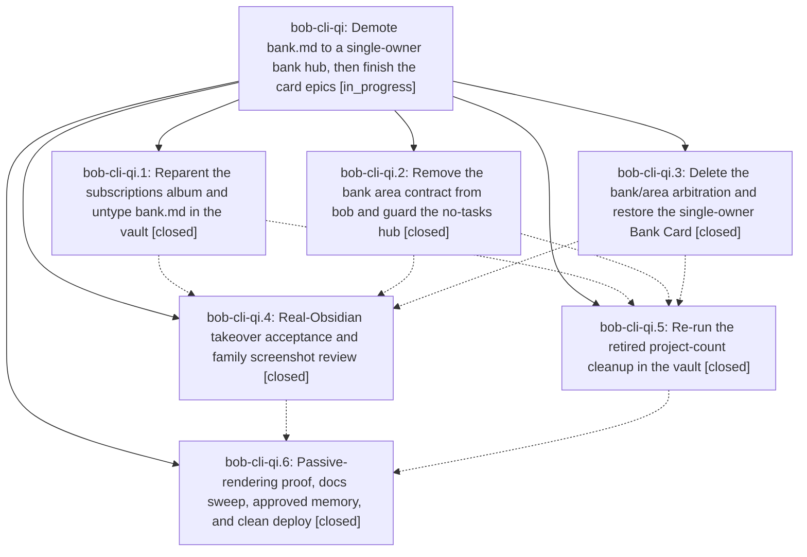

# Bead: bob-cli-qi — Demote bank.md to a single-owner bank hub, then finish the card epics

[Bead Pages](../README.md) / bob-cli-qi

**Status:** ◐ in_progress · **Type:** ▸ plan · **Tier:** epic
**Owner:** `bryanbugyi34@gmail.com` · **Created by:** [bbugyi200.athena.1gn](https://github.com/bobs-org/bob-cli--agents/blob/main/sessions/bbugyi200.athena.1gn.md) · **Assignee:** `bob-cli-qi.land`
**Created:** 2026-11-26 10:06:12 EST
**Plan:** [202611/bank\_hub\_demotion.md](https://github.com/bobs-org/bob-cli--plans/blob/main/202611/bank_hub_demotion.md)

<!-- sase:links:start -->

## Links

| Relation | Artifact | Why |
| --- | --- | --- |
| implemented-by | [plan:202611/bank_hub_demotion.md][1] | derived from the plan's `bead_id:` frontmatter field |
| related | [bead:bob-cli-qr][2] | Triaged during the bob-cli-qi landing; baseline from the canceled bob-cli-pl area/project cards, not caused by qi |
| related | file:explicit:309bb1f413ab69cdac861126 | Records the reproducible props update contract failure found against the bank-hub contract |
| related | file:explicit:4be78da0fdc26952391a664f | attached via sase artifact create --bead |
| related | file:explicit:660cabc9cf32530dcf480887 | attached via sase artifact create --bead |
| related | file:explicit:d254ed707483200bbaaca14f | attached via sase artifact create --bead |

_Plus 16 automatic references — see [Referenced By](#referenced-by)._

[1]: https://github.com/bobs-org/bob-cli--plans/blob/main/202611/bank_hub_demotion.md
[2]: https://github.com/bobs-org/bob-cli--beads/blob/main/pages/bob-cli-qr/README.md

<!-- sase:links:end -->

## Description

~/bob/bank.md is an untyped, path-canonical bank hub under cash. It has exactly one card (the Bank Card, gated on props_v1), no area semantics in any repo, and no tasks. Every piece of logic that supported the bank/area hybrid is gone. On top of that single-owner model, the unfinished work of the canceled bob-cli-pl and bob-cli-q6 epics is completed: acceptance, polish, cleanup, docs, and deployment.

## Notes

[2026-11-26T20:01:35Z · bob-cli-qj.2] DISCOVERED ISSUE: On checked tree 4168e201, the required just check and an isolated retry both fail tests/cli/props_contract.rs::update_json_returns_candidate_contract_after_clear_apply_and_undo at line 382: a dry-run update of the test fixture bank.md returns null note_kind where the assertion expects bank. The fixture is untyped and root-level, while this epic defines the bank hub as an untyped path-canonical cash/bank.md note. Please verify the props update response against the migrated hub contract during the remaining bank-hub work. Evidence: file:explicit:309bb1f413ab69cdac861126.

[2026-11-26T21:18:07Z · bob-cli-qi.land] LAND TRIAGE (bob-cli-qi land agent). Follow-up outcomes:
(1) qi.2#1 transfer_merge_refusals_are_atomic_and_coded: declined, already passes in just check at 4168e201.
(2) qi.3#1 block-id-prompt stale bundle: declined, npm run build:check is clean at bob-plugins b021aff5/cb847f20.
(3) qi.4#2 pomodoro-theme-write + reference-lifecycle npm failures: declined, both suites pass (58/58) on current bob-plugins master.
(4) qi.4#5 record-foot live churn (live-autosave/live-slow-reparse): declined, did not reproduce in 3 full-profile takeover runs at b021aff5/cb847f20 (all GO 63/63) and passed on pre-epic 27447919; evidence file:explicit:660cabc9cf32530dcf480887, file:explicit:d254ed707483200bbaaca14f. Reopen if it recurs.
(5) qi.4#6 home-cards runner 7 failures: created bob-cli-qr (task(ci), large). It reproduces identically at pre-epic 27447919, so it is baseline from canceled pl.
(6) qi.5#1 missing prior count-sweep receipt 7e981553: declined, superseded by retained receipts 3fdb4562/59a92613/5a1b0a30/17c63484 with no remaining action.
(7) qi.6#1 docs/snooze.md home-path privacy hit: declined, fixed by 59037b23 (no /home/bryan in docs/snooze.md).
(8) qi.6#2 snooze CLI test E0433: declined, fixed by 59037b23; just check compiles.
(9) Epic note #1 (qj.2) props_contract update note_kind assertion: epic-caused (qi.2 asserted a field props update never emits); fixed in the landing commit by asserting the card-owned bank row.
(10) Land-discovered meetings wispr_summary PDF failure: +1 on existing bob-cli-q9.
Also fixed: stale 240q comment that still said the bank hub needs props_contract_v1 (epic-caused by 8e6a5a61), rebuilt and synced bob-ledger-tools.
Note: 478d5233 is a CLI/JSON contract break without the required ! marker. History is not rewritten. Next release is already a breaking bump from 6 other ! commits since v0.6.0, but the changelog will list it under Added.

[2026-11-26T21:20:06Z · bob-cli-qi.land] LAND GAP (bob-cli-qi land agent): takeover-proof (qi.4) never produced real-Obsidian takeover evidence for area, sub-area, inbox, or active/terminal project, nor the area/inbox/project screenshots. scripts/obsidian-frontmatter-takeover-e2e.cjs has no such fixtures, and obsidian-home-cards-e2e.cjs expects native Properties visible and aborts before screenshots (bob-cli-qr). docs/develop/validation.md currently overclaims that coverage. Planned as tale plan sase_plan_bank_hub_home_takeover_acceptance.md (medium), which ends with this epic's closeout.

## Phases

| Bead | Title | Status | Size | Created | Agents | Commits |
|---|---|---|---|---|---:|---:|
| [bob-cli-qi.1](bob-cli-qi.1.md) | Reparent the subscriptions album and untype bank.md in the vault | ✓ closed | small | 2026-11-26 | 1 | 0 |
| [bob-cli-qi.2](bob-cli-qi.2.md) | Remove the bank area contract from bob and guard the no-tasks hub | ✓ closed | medium | 2026-11-26 | 1 | 1 |
| [bob-cli-qi.3](bob-cli-qi.3.md) | Delete the bank/area arbitration and restore the single-owner Bank Card | ✓ closed | medium | 2026-11-26 | 1 | 1 |
| [bob-cli-qi.4](bob-cli-qi.4.md) | Real-Obsidian takeover acceptance and family screenshot review | ✓ closed | medium | 2026-11-26 | 1 | 1 |
| [bob-cli-qi.5](bob-cli-qi.5.md) | Re-run the retired project-count cleanup in the vault | ✓ closed | small | 2026-11-26 | 1 | 0 |
| [bob-cli-qi.6](bob-cli-qi.6.md) | Passive-rendering proof, docs sweep, approved memory, and clean deploy | ✓ closed | medium | 2026-11-26 | 1 | 2 |

## Lineage

## Agents

| Agent | Bead | Commits |
|---|---|---:|
| [bbugyi200.athena.bob-cli-qi.1](https://github.com/bobs-org/bob-cli--agents/blob/main/agents/bbugyi200.athena.bob-cli-qi.1/README.md) | [bob-cli-qi.1](bob-cli-qi.1.md) | 0 |
| [bbugyi200.athena.bob-cli-qi.2](https://github.com/bobs-org/bob-cli--agents/blob/main/agents/bbugyi200.athena.bob-cli-qi.2/README.md) | [bob-cli-qi.2](bob-cli-qi.2.md) | 1 |
| [bbugyi200.athena.bob-cli-qi.3](https://github.com/bobs-org/bob-cli--agents/blob/main/sessions/bbugyi200.athena.bob-cli-qi.3.md) | [bob-cli-qi.3](bob-cli-qi.3.md) | 1 |
| [bbugyi200.athena.bob-cli-qi.4](https://github.com/bobs-org/bob-cli--agents/blob/main/sessions/bbugyi200.athena.bob-cli-qi.4.md) | [bob-cli-qi.4](bob-cli-qi.4.md) | 1 |
| [bbugyi200.athena.bob-cli-qi.5](https://github.com/bobs-org/bob-cli--agents/blob/main/agents/bbugyi200.athena.bob-cli-qi.5/README.md) | [bob-cli-qi.5](bob-cli-qi.5.md) | 0 |
| [bbugyi200.athena.bob-cli-qi.6](https://github.com/bobs-org/bob-cli--agents/blob/main/sessions/bbugyi200.athena.bob-cli-qi.6.md) | [bob-cli-qi.6](bob-cli-qi.6.md) | 2 |
| [bbugyi200.athena.bob-cli-qi.land](https://github.com/bobs-org/bob-cli--agents/blob/main/sessions/bbugyi200.athena.bob-cli-qi.land.md) | [bob-cli-qi](README.md) | 3 |

## Commits

| Repo | Commit | Subject | Bead | Committed |
|---|---|---|---|---|
| bob-plugins | [`bob-plugins@8e6a5a6`](https://github.com/bobs-org/bob-plugins/commit/8e6a5a61908bb5eac13584536fa6f564b7464617) | refactor(plugins): restore single-owner Bank Card | [bob-cli-qi.3](bob-cli-qi.3.md) | 2026-11-26 10:40:24 EST |
| bob-cli | [`478d523`](https://github.com/bobs-org/bob-cli/commit/478d5233100d45ba27d1bf29530eb790a36a8837) | feat(bank,props,capture): enforce Area-only props and bank-holds-no-tasks | [bob-cli-qi.2](bob-cli-qi.2.md) | 2026-11-26 10:52:44 EST |
| bob-plugins | [`bob-plugins@19e895f`](https://github.com/bobs-org/bob-plugins/commit/19e895f0993f09816cf5216ff5585fa258a9be3f) | fix(plugins): drop stale bank/area arbitration anchor in live fallback | [bob-cli-qi.4](bob-cli-qi.4.md) | 2026-11-26 12:51:31 EST |
| bob-cli | [`c89ba1d`](https://github.com/bobs-org/bob-cli/commit/c89ba1d4c49775b1840c065f0f31d262e60930ac) | docs(bank): establish path-canonical single-owner hub | [bob-cli-qi.6](bob-cli-qi.6.md) | 2026-11-26 13:57:29 EST |
| bob-plugins | [`bob-plugins@17a0567`](https://github.com/bobs-org/bob-plugins/commit/17a0567013d75cecd1f8c9751993864151cf524e) | docs(props): document home-card ownership and passive rendering | [bob-cli-qi.6](bob-cli-qi.6.md) | 2026-11-26 14:21:42 EST |
| bob-cli | [`33fe342`](https://github.com/bobs-org/bob-cli/commit/33fe3425b51207b39215bb2a8553224b3302bea7) | test(props): assert the bank hub update preview by its card-owned row | [bob-cli-qi](README.md) | 2026-11-26 16:21:07 EST |
| bob-plugins | [`bob-plugins@feaa5b4`](https://github.com/bobs-org/bob-plugins/commit/feaa5b420047803fa03a9e82a523a5fc02a0cb39) | docs(ledger-tools): drop stale bank-hub props\_contract\_v1 claim in 240q | [bob-cli-qi](README.md) | 2026-11-26 16:21:34 EST |
| bob-plugins | [`bob-plugins@319862a`](https://github.com/bobs-org/bob-plugins/commit/319862a7f4a8606c961302e2bb26d0e6b89b8332) | test: expand home-card takeover acceptance | [bob-cli-qi](README.md) | 2026-11-26 17:11:39 EST |

<!-- sase:referenced-by:start -->

## Referenced By

| Relation | Artifact | Why | Uses |
| --- | --- | --- | ---: |
| read-by | [agent:bob-cli-qi.land][1] | Need the epic scope, children, and linked plan file | 1 |
| read-by | [agent:bob-cli-qj.2][2] | Need to decide whether the bank contract gate failure belongs to this active bank-hub epic | 2 |
| read-by | [agent:research.6k.cdx][3] | Determine active epic contracts and overlaps for prose and notebook cards | 1 |
| read-by | [agent:research.6k.cld][4] | Research prose/notebook property cards; must understand in-progress epic to plan parallel work | 1 |
| read-by | [agent:research.6k.final][5] | Lead researcher verifying live epic phase status for the consolidated prose/notebook card sequencing recommendation | 1 |
| read-by | [agent:research.6k.gem][6] | Inspect in-progress epic bob-cli-qi for parallel coordination analysis | 1 |
| read-by | [agent:research.6k.grk][7] | Need qi epic scope and remaining phases to judge parallel implementation with prose/notebook cards | 1 |
| read-by | [agent:research.6k.mus][8] | prose/notebook card research: check parallel epic scope | 1 |
| read-by | [agent:research.6l.cld][9] | Check qi phase states (qi.4 gate) for ref card coordination | 1 |
| read-by | [agent:research.6l.gem][10] | Inspect bob-cli-qi and bob-cli-qm phase details for parallel coordination and card architecture | 1 |
| read-by | [agent:research.6m.cdx][11] | Research independent cabinet implementation and overlap with active epics | 1 |
| read-by | [agent:research.6m.cld][12] | Assess coordination with cabinets research | 1 |
| read-by | [agent:research.6m.final][13] | Refresh epic phase snapshot for consolidated cabinets research | 2 |
| read-by | [agent:research.6m.gem][14] | Understand active epic scope, files, and status for parallel cabinet implementation analysis | 1 |
| read-by | [agent:research.6m.grk][15] | Need qi epic scope for cabinet coordination with bank hub and card family | 2 |
| read-by | [agent:research.6m.mus][16] | Research cabinet design parallel coordination with in-progress epics | 1 |

[1]: https://github.com/bobs-org/bob-cli--agents/blob/main/sessions/bbugyi200.athena.bob-cli-qi.land.md
[2]: https://github.com/bobs-org/bob-cli--agents/blob/main/agents/bbugyi200.athena.bob-cli-qj.2/README.md
[3]: https://github.com/bobs-org/bob-cli--agents/blob/main/agents/bbugyi200.athena.research.6k.cdx/README.md
[4]: https://github.com/bobs-org/bob-cli--agents/blob/main/agents/bbugyi200.athena.research.6k.cld/README.md
[5]: https://github.com/bobs-org/bob-cli--agents/blob/main/agents/bbugyi200.athena.research.6k.final/README.md
[6]: https://github.com/bobs-org/bob-cli--agents/blob/main/agents/bbugyi200.athena.research.6k.gem/README.md
[7]: https://github.com/bobs-org/bob-cli--agents/blob/main/agents/bbugyi200.athena.research.6k.grk/README.md
[8]: https://github.com/bobs-org/bob-cli--agents/blob/main/agents/bbugyi200.athena.research.6k.mus/README.md
[9]: https://github.com/bobs-org/bob-cli--agents/blob/main/agents/bbugyi200.athena.research.6l.cld/README.md
[10]: https://github.com/bobs-org/bob-cli--agents/blob/main/agents/bbugyi200.athena.research.6l.gem/README.md
[11]: https://github.com/bobs-org/bob-cli--agents/blob/main/agents/bbugyi200.athena.research.6m.cdx/README.md
[12]: https://github.com/bobs-org/bob-cli--agents/blob/main/agents/bbugyi200.athena.research.6m.cld/README.md
[13]: https://github.com/bobs-org/bob-cli--agents/blob/main/agents/bbugyi200.athena.research.6m.final/README.md
[14]: https://github.com/bobs-org/bob-cli--agents/blob/main/agents/bbugyi200.athena.research.6m.gem/README.md
[15]: https://github.com/bobs-org/bob-cli--agents/blob/main/agents/bbugyi200.athena.research.6m.grk/README.md
[16]: https://github.com/bobs-org/bob-cli--agents/blob/main/agents/bbugyi200.athena.research.6m.mus/README.md

<!-- sase:referenced-by:end -->
