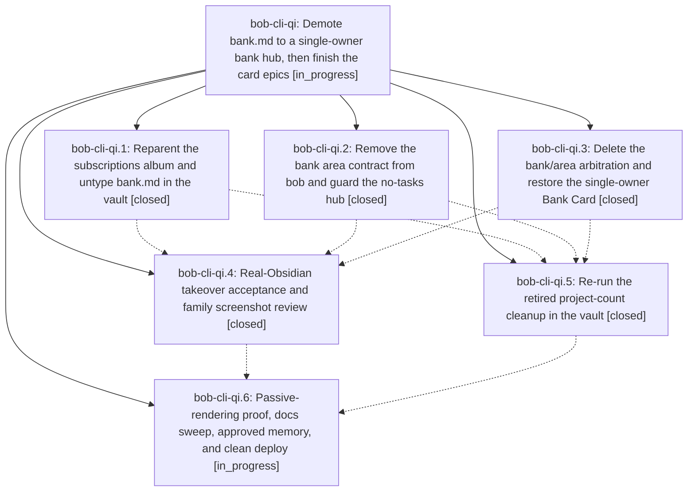

# Bead: bob-cli-qi — Demote bank.md to a single-owner bank hub, then finish the card epics

[Bead Pages](../README.md) / bob-cli-qi

**Status:** ◐ in_progress · **Type:** ▸ plan · **Tier:** epic
**Owner:** `bryanbugyi34@gmail.com` · **Created by:** [bbugyi200.athena.1gn](https://github.com/bobs-org/bob-cli--agents/blob/main/sessions/bbugyi200.athena.1gn.md) · **Assignee:** `bob-cli-qi.land`
**Created:** 2026-11-26 10:06:12 EST
**Plan:** [202611/bank\_hub\_demotion.md](https://github.com/bobs-org/bob-cli--plans/blob/main/202611/bank_hub_demotion.md)

<!-- sase:links:start -->

## Links

| Relation | Artifact | Why |
| --- | --- | --- |
| implemented-by | [plan:202611/bank_hub_demotion.md][1] | derived from the plan's `bead_id:` frontmatter field |

_Plus 8 automatic references — see [Referenced By](#referenced-by)._

[1]: https://github.com/bobs-org/bob-cli--plans/blob/main/202611/bank_hub_demotion.md

<!-- sase:links:end -->

## Description

~/bob/bank.md is an untyped, path-canonical bank hub under cash. It has exactly one card (the Bank Card, gated on props_v1), no area semantics in any repo, and no tasks. Every piece of logic that supported the bank/area hybrid is gone. On top of that single-owner model, the unfinished work of the canceled bob-cli-pl and bob-cli-q6 epics is completed: acceptance, polish, cleanup, docs, and deployment.

## Phases

| Bead | Title | Status | Size | Created | Agents | Commits |
|---|---|---|---|---|---:|---:|
| [bob-cli-qi.1](bob-cli-qi.1.md) | Reparent the subscriptions album and untype bank.md in the vault | ✓ closed | small | 2026-11-26 | 1 | 0 |
| [bob-cli-qi.2](bob-cli-qi.2.md) | Remove the bank area contract from bob and guard the no-tasks hub | ✓ closed | medium | 2026-11-26 | 1 | 1 |
| [bob-cli-qi.3](bob-cli-qi.3.md) | Delete the bank/area arbitration and restore the single-owner Bank Card | ✓ closed | medium | 2026-11-26 | 1 | 1 |
| [bob-cli-qi.4](bob-cli-qi.4.md) | Real-Obsidian takeover acceptance and family screenshot review | ✓ closed | medium | 2026-11-26 | 1 | 1 |
| [bob-cli-qi.5](bob-cli-qi.5.md) | Re-run the retired project-count cleanup in the vault | ✓ closed | small | 2026-11-26 | 1 | 0 |
| [bob-cli-qi.6](bob-cli-qi.6.md) | Passive-rendering proof, docs sweep, approved memory, and clean deploy | ◐ in_progress | medium | 2026-11-26 | 1 | 1 |

## Lineage

## Agents

| Agent | Bead | Commits |
|---|---|---:|
| [bbugyi200.athena.bob-cli-qi.1](https://github.com/bobs-org/bob-cli--agents/blob/main/agents/bbugyi200.athena.bob-cli-qi.1/README.md) | [bob-cli-qi.1](bob-cli-qi.1.md) | 0 |
| [bbugyi200.athena.bob-cli-qi.2](https://github.com/bobs-org/bob-cli--agents/blob/main/agents/bbugyi200.athena.bob-cli-qi.2/README.md) | [bob-cli-qi.2](bob-cli-qi.2.md) | 1 |
| [bbugyi200.athena.bob-cli-qi.3](https://github.com/bobs-org/bob-cli--agents/blob/main/sessions/bbugyi200.athena.bob-cli-qi.3.md) | [bob-cli-qi.3](bob-cli-qi.3.md) | 1 |
| [bbugyi200.athena.bob-cli-qi.4](https://github.com/bobs-org/bob-cli--agents/blob/main/sessions/bbugyi200.athena.bob-cli-qi.4.md) | [bob-cli-qi.4](bob-cli-qi.4.md) | 1 |
| [bbugyi200.athena.bob-cli-qi.5](https://github.com/bobs-org/bob-cli--agents/blob/main/agents/bbugyi200.athena.bob-cli-qi.5/README.md) | [bob-cli-qi.5](bob-cli-qi.5.md) | 0 |
| [bbugyi200.athena.bob-cli-qi.6](https://github.com/bobs-org/bob-cli--agents/blob/main/sessions/bbugyi200.athena.bob-cli-qi.6.md) | [bob-cli-qi.6](bob-cli-qi.6.md) | 1 |
| [bbugyi200.athena.bob-cli-qi.land](https://github.com/bobs-org/bob-cli--agents/blob/main/agents/bbugyi200.athena.bob-cli-qi.land/README.md) | [bob-cli-qi](README.md) | 0 |

## Commits

| Repo | Commit | Subject | Bead | Committed |
|---|---|---|---|---|
| bob-plugins | [`bob-plugins@8e6a5a6`](https://github.com/bobs-org/bob-plugins/commit/8e6a5a61908bb5eac13584536fa6f564b7464617) | refactor(plugins): restore single-owner Bank Card | [bob-cli-qi.3](bob-cli-qi.3.md) | 2026-11-26 10:40:24 EST |
| bob-cli | [`478d523`](https://github.com/bobs-org/bob-cli/commit/478d5233100d45ba27d1bf29530eb790a36a8837) | feat(bank,props,capture): enforce Area-only props and bank-holds-no-tasks | [bob-cli-qi.2](bob-cli-qi.2.md) | 2026-11-26 10:52:44 EST |
| bob-plugins | [`bob-plugins@19e895f`](https://github.com/bobs-org/bob-plugins/commit/19e895f0993f09816cf5216ff5585fa258a9be3f) | fix(plugins): drop stale bank/area arbitration anchor in live fallback | [bob-cli-qi.4](bob-cli-qi.4.md) | 2026-11-26 12:51:31 EST |
| bob-cli | [`c89ba1d`](https://github.com/bobs-org/bob-cli/commit/c89ba1d4c49775b1840c065f0f31d262e60930ac) | docs(bank): establish path-canonical single-owner hub | [bob-cli-qi.6](bob-cli-qi.6.md) | 2026-11-26 13:57:29 EST |

<!-- sase:referenced-by:start -->

## Referenced By

| Relation | Artifact | Why | Uses |
| --- | --- | --- | ---: |
| read-by | [agent:research.6k.cdx][1] | Determine active epic contracts and overlaps for prose and notebook cards | 1 |
| read-by | [agent:research.6k.cld][2] | Research prose/notebook property cards; must understand in-progress epic to plan parallel work | 1 |
| read-by | [agent:research.6k.final][3] | Lead researcher verifying live epic phase status for the consolidated prose/notebook card sequencing recommendation | 1 |
| read-by | [agent:research.6k.gem][4] | Inspect in-progress epic bob-cli-qi for parallel coordination analysis | 1 |
| read-by | [agent:research.6k.grk][5] | Need qi epic scope and remaining phases to judge parallel implementation with prose/notebook cards | 1 |
| read-by | [agent:research.6k.mus][6] | prose/notebook card research: check parallel epic scope | 1 |
| read-by | [agent:research.6l.cld][7] | Check qi phase states (qi.4 gate) for ref card coordination | 1 |
| read-by | [agent:research.6l.gem][8] | Inspect bob-cli-qi and bob-cli-qm phase details for parallel coordination and card architecture | 1 |

[1]: https://github.com/bobs-org/bob-cli--agents/blob/main/agents/bbugyi200.athena.research.6k.cdx/README.md
[2]: https://github.com/bobs-org/bob-cli--agents/blob/main/agents/bbugyi200.athena.research.6k.cld/README.md
[3]: https://github.com/bobs-org/bob-cli--agents/blob/main/agents/bbugyi200.athena.research.6k.final/README.md
[4]: https://github.com/bobs-org/bob-cli--agents/blob/main/agents/bbugyi200.athena.research.6k.gem/README.md
[5]: https://github.com/bobs-org/bob-cli--agents/blob/main/agents/bbugyi200.athena.research.6k.grk/README.md
[6]: https://github.com/bobs-org/bob-cli--agents/blob/main/agents/bbugyi200.athena.research.6k.mus/README.md
[7]: https://github.com/bobs-org/bob-cli--agents/blob/main/agents/bbugyi200.athena.research.6l.cld/README.md
[8]: https://github.com/bobs-org/bob-cli--agents/blob/main/agents/bbugyi200.athena.research.6l.gem/README.md

<!-- sase:referenced-by:end -->
