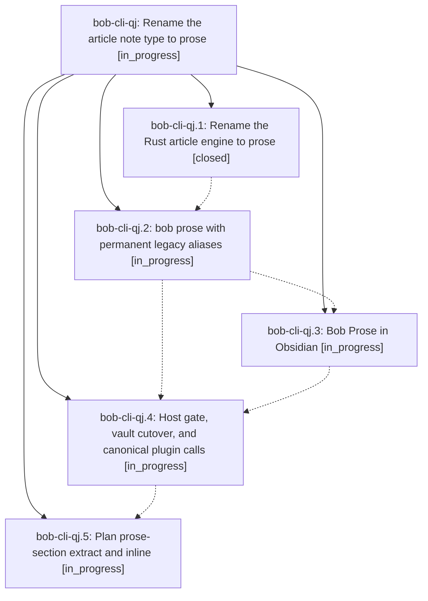

# Bead: bob-cli-qj — Rename the article note type to prose

[Bead Pages](../README.md) / bob-cli-qj

**Status:** ◐ in_progress · **Type:** ▸ plan · **Tier:** epic
**Owner:** `bryanbugyi34@gmail.com` · **Created by:** [bbugyi200.apollo.research.6i.linker.w0](https://github.com/bobs-org/bob-cli--agents/blob/main/sessions/bbugyi200.apollo.research.6i.linker.w0.md) · **Assignee:** `bob-cli-qj.land`
**Created:** 2026-11-26 10:56:26 EST
**Plan:** [202611/prose\_note\_type.md](https://github.com/bobs-org/bob-cli--plans/blob/main/202611/prose_note_type.md)

<!-- sase:links:start -->

## Links

| Relation | Artifact | Why |
| --- | --- | --- |
| implemented-by | [plan:202611/prose_note_type.md][1] | derived from the plan's `bead_id:` frontmatter field |

_Plus 6 automatic references — see [Referenced By](#referenced-by)._

[1]: https://github.com/bobs-org/bob-cli--plans/blob/main/202611/prose_note_type.md

<!-- sase:links:end -->

## Description

The Bob note type for authored writing is named prose everywhere a person reads it: the type link, the bob prose CLI, Bob Prose in Obsidian, the docs, and the vault. Every legacy article note, bob articles call, plugin id, and JSON consumer keeps working unchanged, and prose-section extract/inline is planned on top of the rename.

## Phases

| Bead | Title | Status | Size | Created | Agents | Commits |
|---|---|---|---|---|---:|---:|
| [bob-cli-qj.1](bob-cli-qj.1.md) | Rename the Rust article engine to prose | ✓ closed | small | 2026-11-26 | 1 | 1 |
| [bob-cli-qj.2](bob-cli-qj.2.md) | bob prose with permanent legacy aliases | ◐ in_progress | medium | 2026-11-26 | 1 | 0 |
| [bob-cli-qj.3](bob-cli-qj.3.md) | Bob Prose in Obsidian | ◐ in_progress | medium | 2026-11-26 | 1 | 0 |
| [bob-cli-qj.4](bob-cli-qj.4.md) | Host gate, vault cutover, and canonical plugin calls | ◐ in_progress | small | 2026-11-26 | 1 | 0 |
| [bob-cli-qj.5](bob-cli-qj.5.md) | Plan prose-section extract and inline | ◐ in_progress | xlarge | 2026-11-26 | 1 | 0 |

## Lineage

## Agents

| Agent | Bead | Commits |
|---|---|---:|
| [bbugyi200.apollo.bob-cli-qj.1](https://github.com/bobs-org/bob-cli--agents/blob/main/agents/bbugyi200.apollo.bob-cli-qj.1/README.md) | [bob-cli-qj.1](bob-cli-qj.1.md) | 1 |
| [bbugyi200.apollo.bob-cli-qj.2](https://github.com/bobs-org/bob-cli--agents/blob/main/agents/bbugyi200.apollo.bob-cli-qj.2/README.md) | [bob-cli-qj.2](bob-cli-qj.2.md) | 0 |
| [bbugyi200.apollo.bob-cli-qj.3](https://github.com/bobs-org/bob-cli--agents/blob/main/agents/bbugyi200.apollo.bob-cli-qj.3/README.md) | [bob-cli-qj.3](bob-cli-qj.3.md) | 0 |
| [bbugyi200.apollo.bob-cli-qj.4](https://github.com/bobs-org/bob-cli--agents/blob/main/agents/bbugyi200.apollo.bob-cli-qj.4/README.md) | [bob-cli-qj.4](bob-cli-qj.4.md) | 0 |
| [bbugyi200.apollo.bob-cli-qj.5](https://github.com/bobs-org/bob-cli--agents/blob/main/agents/bbugyi200.apollo.bob-cli-qj.5/README.md) | [bob-cli-qj.5](bob-cli-qj.5.md) | 0 |
| [bbugyi200.apollo.bob-cli-qj.land](https://github.com/bobs-org/bob-cli--agents/blob/main/agents/bbugyi200.apollo.bob-cli-qj.land/README.md) | [bob-cli-qj](README.md) | 0 |

## Commits

| Repo | Commit | Subject | Bead | Committed |
|---|---|---|---|---|
| bob-cli | [`cf414ce`](https://github.com/bobs-org/bob-cli/commit/cf414ce15c5489203abf81d308d9359d30214510) | refactor(prose): rename the article engine module to prose | [bob-cli-qj.1](bob-cli-qj.1.md) | 2026-11-26 12:15:08 EST |

<!-- sase:referenced-by:start -->

## Referenced By

| Relation | Artifact | Why | Uses |
| --- | --- | --- | ---: |
| read-by | [agent:research.6k.cdx][1] | Determine active epic contracts and overlaps for prose and notebook cards | 1 |
| read-by | [agent:research.6k.cld][2] | Research prose/notebook property cards; must understand in-progress epic to plan parallel work | 1 |
| read-by | [agent:research.6k.final][3] | Lead researcher verifying live epic phase status for the consolidated prose/notebook card sequencing recommendation | 1 |
| read-by | [agent:research.6k.gem][4] | Inspect in-progress epic bob-cli-qj for parallel coordination analysis | 1 |
| read-by | [agent:research.6k.grk][5] | Need qj prose-rename epic scope to judge parallel implementation with prose/notebook cards | 1 |
| read-by | [agent:research.6k.mus][6] | prose/notebook card research: check parallel epic scope | 1 |

[1]: https://github.com/bobs-org/bob-cli--agents/blob/main/agents/bbugyi200.apollo.research.6k.cdx/README.md
[2]: https://github.com/bobs-org/bob-cli--agents/blob/main/agents/bbugyi200.apollo.research.6k.cld/README.md
[3]: https://github.com/bobs-org/bob-cli--agents/blob/main/agents/bbugyi200.apollo.research.6k.final/README.md
[4]: https://github.com/bobs-org/bob-cli--agents/blob/main/agents/bbugyi200.apollo.research.6k.gem/README.md
[5]: https://github.com/bobs-org/bob-cli--agents/blob/main/agents/bbugyi200.apollo.research.6k.grk/README.md
[6]: https://github.com/bobs-org/bob-cli--agents/blob/main/agents/bbugyi200.apollo.research.6k.mus/README.md

<!-- sase:referenced-by:end -->
