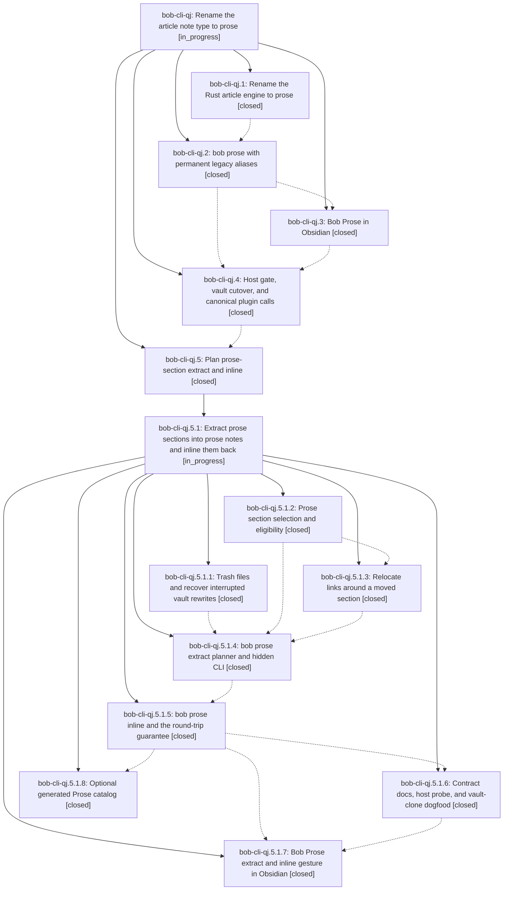

# Bead: bob-cli-qj — Rename the article note type to prose

[Bead Pages](../README.md) / bob-cli-qj

**Status:** ◐ in_progress · **Type:** ▸ plan · **Tier:** epic
**Owner:** `bryanbugyi34@gmail.com` · **Created by:** [bbugyi200.apollo.research.6i.linker.w0](https://github.com/bobs-org/bob-cli--agents/blob/main/sessions/bbugyi200.apollo.research.6i.linker.w0.md) · **Assignee:** `bob-cli-qj.land`
**Created:** 2026-11-26 10:56:26 EST
**Plan:** [202611/prose\_note\_type.md](https://github.com/bobs-org/bob-cli--plans/blob/main/202611/prose_note_type.md)

<!-- sase:links:start -->

## Links

| Relation | Artifact | Why |
| --- | --- | --- |
| implemented-by | [plan:202611/prose_note_type.md][1] | derived from the plan's `bead_id:` frontmatter field |

_Plus 15 automatic references — see [Referenced By](#referenced-by)._

[1]: https://github.com/bobs-org/bob-cli--plans/blob/main/202611/prose_note_type.md

<!-- sase:links:end -->

## Description

The Bob note type for authored writing is named prose everywhere a person reads it: the type link, the bob prose CLI, Bob Prose in Obsidian, the docs, and the vault. Every legacy article note, bob articles call, plugin id, and JSON consumer keeps working unchanged, and prose-section extract/inline is planned on top of the rename.

## Notes

[2026-11-27T13:09:18Z · bob-cli-qj.land] LANDING VERIFIED, CLOSE BLOCKED (bob-cli-qj.land): sase bead close bob-cli-qj was refused because nested child epic bob-cli-qj.5.1 (prose-section extract/inline, proposed by phase qj.5 as planned) still has 9 open descendants. --force would cancel that active epic, so I did not use it. A monitor waits for qj.5.1 to close, then its follow-up closes this epic. Verification so far: Verified: all 5 phases closed and every phase note was addressed. Commits: bob-cli cf414ce1 (engine-rename: src/native/articles moved to src/native/prose, Rust identifiers renamed, wire field summary.articles kept), 4168e201 (prose-cli: one is_prose_type_name predicate accepts prose and legacy article; TYPE_LINE writes [[prose]]; prose added to the reserved record ids and the props built-in type list; bob prose canonical with a hidden articles alias; catalog row ids and the article-note slot kept; --section-numbers on|off; prose-type-read host probe; docs/prose.md plus redirects for articles.md and reference/cli/articles.md; vault-format Prose notes section), 16a2497d (decision evidence cites 4168e201). bob-plugins c41e07e9 (re-landed the lost qj.3 work: [[prose]] and [[article]] detection in bob-articles, command-mode, navigation-hotkeys, and ledger-tools; Bob Prose copy under unchanged ids; toggle-section-numbers; spawn argv prose; bob-prose-type-v1 marker in all 4 bundles). Vault ~/bob 335f401a6 and decc7fdfa: prose.md, prose.base, _templates/new_prose.md; sase_blog_contents is [[prose]] and still formatted; rg [[article]] outside .bob lists only AGENTS.md and prose.md. The host gate passed on athena, apollo, and the Mac (artifact file:explicit:c7e796fd6902bbaed0bde124). Decisions honored: type_name=prose, numbering_default=keep_on (no ! break), and only glossary:prose-note and decisions:prose-notes-are-owned-prose changed memory; the other memory diffs in 4168e201 are generated descriptors and indexes. ArticlePlan v1 changed only its display string (notice). The prose-sections child epic bob-cli-qj.5.1 is proposed and in progress, which meets the plan's Done-when.

Checks on master eef6cc07: cargo test --lib 8245 passed, 0 failed; cargo test --test cli 4279 passed, 0 failed (focused prose/alias/sections/props/nightly 176 passed); just docs-check passed (448).

INTEGRATION: I reviewed the 17 non-epic bob-cli commits since cf414ce1 (qm.7, qp, q5, qi, ph, capture). They already use prose or only use article in the web-article sense; no change needed. bob-plugins: the concurrent Prose Card (31024085, eca733c2), cabinets, and ref-card work already accept [[prose]] and [[article]]. Two stale display-name spots fixed in this landing: docs/nav.yml nav title "Bob Articles" -> "Bob Prose" (missed by the qj.3 rename) and docs/develop/plugin-apis.md "Bob Articles" -> "Bob Prose" (added concurrently by 31024085). bob-plugins npm run docs:gen and docs:check passed. bob plugins sync left all bundles unchanged; its refusals for bob-ledger-tools and bob-navigation-hotkeys concern another running agent's uncommitted deploy from bob-cli_12. My change touches no bundle, so nothing was forced.

FOLLOW-UPS: (1) qj.1 #1 and qj.2 #1 (baseline drawer/capture test failures, tracked as bob-cli-qo): declined as new work because they no longer reproduce on eef6cc07 (lib and cli suites fully green); I left a non-repro note on bob-cli-qo recommending it close. (2) qj.4 #2 (two bob-plugins unit failures from the q5.6.1 snooze work): declined because they were already fixed by the q5.6.1 landing 56baeb9f (bob-cli-qu closed superseded); both test files pass 81/0 on bob-plugins master 56baeb9f. (3) qj.4 #3 (guard closes against unpushed linked-repo commits): no duplicate and no causal active epic, so I created feature task bob-cli-qy (large, ready). epic-symbols: none. just symvision: no such recipe in this justfile.

## Phases

| Bead | Title | Status | Size | Created | Agents | Commits |
|---|---|---|---|---|---:|---:|
| [bob-cli-qj.1](bob-cli-qj.1.md) | Rename the Rust article engine to prose | ✓ closed | small | 2026-11-26 | 1 | 1 |
| [bob-cli-qj.2](bob-cli-qj.2.md) | bob prose with permanent legacy aliases | ✓ closed | medium | 2026-11-26 | 1 | 1 |
| [bob-cli-qj.3](bob-cli-qj.3.md) | Bob Prose in Obsidian | ✓ closed | medium | 2026-11-26 | 1 | 0 |
| [bob-cli-qj.4](bob-cli-qj.4.md) | Host gate, vault cutover, and canonical plugin calls | ✓ closed | small | 2026-11-26 | 1 | 2 |
| [bob-cli-qj.5](bob-cli-qj.5.md) | Plan prose-section extract and inline | ✓ closed | xlarge | 2026-11-26 | 1 | 0 |

## Lineage

## Agents

| Agent | Bead | Commits |
|---|---|---:|
| [bbugyi200.apollo.bob-cli-qj.1](https://github.com/bobs-org/bob-cli--agents/blob/main/agents/bbugyi200.apollo.bob-cli-qj.1/README.md) | [bob-cli-qj.1](bob-cli-qj.1.md) | 1 |
| [bbugyi200.apollo.bob-cli-qj.2](https://github.com/bobs-org/bob-cli--agents/blob/main/agents/bbugyi200.apollo.bob-cli-qj.2/README.md) | [bob-cli-qj.2](bob-cli-qj.2.md) | 1 |
| [bbugyi200.apollo.bob-cli-qj.3](https://github.com/bobs-org/bob-cli--agents/blob/main/agents/bbugyi200.apollo.bob-cli-qj.3/README.md) | [bob-cli-qj.3](bob-cli-qj.3.md) | 0 |
| [bbugyi200.apollo.bob-cli-qj.4](https://github.com/bobs-org/bob-cli--agents/blob/main/sessions/bbugyi200.apollo.bob-cli-qj.4.md) | [bob-cli-qj.4](bob-cli-qj.4.md) | 2 |
| [bbugyi200.apollo.bob-cli-qj.5](https://github.com/bobs-org/bob-cli--agents/blob/main/sessions/bbugyi200.apollo.bob-cli-qj.5.md) | [bob-cli-qj.5](bob-cli-qj.5.md) | 0 |
| [bbugyi200.apollo.bob-cli-qj.5.1.1](https://github.com/bobs-org/bob-cli--agents/blob/main/agents/bbugyi200.apollo.bob-cli-qj.5.1.1/README.md) | [bob-cli-qj.5.1.1](bob-cli-qj.5.1.1.md) | 1 |
| [bbugyi200.apollo.bob-cli-qj.5.1.2](https://github.com/bobs-org/bob-cli--agents/blob/main/sessions/bbugyi200.apollo.bob-cli-qj.5.1.2.md) | [bob-cli-qj.5.1.2](bob-cli-qj.5.1.2.md) | 1 |
| [bbugyi200.apollo.bob-cli-qj.5.1.3](https://github.com/bobs-org/bob-cli--agents/blob/main/agents/bbugyi200.apollo.bob-cli-qj.5.1.3/README.md) | [bob-cli-qj.5.1.3](bob-cli-qj.5.1.3.md) | 1 |
| [bbugyi200.apollo.bob-cli-qj.5.1.4](https://github.com/bobs-org/bob-cli--agents/blob/main/agents/bbugyi200.apollo.bob-cli-qj.5.1.4/README.md) | [bob-cli-qj.5.1.4](bob-cli-qj.5.1.4.md) | 1 |
| [bbugyi200.apollo.bob-cli-qj.5.1.5](https://github.com/bobs-org/bob-cli--agents/blob/main/sessions/bbugyi200.apollo.bob-cli-qj.5.1.5.md) | [bob-cli-qj.5.1.5](bob-cli-qj.5.1.5.md) | 1 |
| [bbugyi200.apollo.bob-cli-qj.5.1.6](https://github.com/bobs-org/bob-cli--agents/blob/main/agents/bbugyi200.apollo.bob-cli-qj.5.1.6/README.md) | [bob-cli-qj.5.1.6](bob-cli-qj.5.1.6.md) | 1 |
| [bbugyi200.apollo.bob-cli-qj.5.1.7](https://github.com/bobs-org/bob-cli--agents/blob/main/sessions/bbugyi200.apollo.bob-cli-qj.5.1.7.md) | [bob-cli-qj.5.1.7](bob-cli-qj.5.1.7.md) | 2 |
| [bbugyi200.apollo.bob-cli-qj.5.1.8](https://github.com/bobs-org/bob-cli--agents/blob/main/agents/bbugyi200.apollo.bob-cli-qj.5.1.8/README.md) | [bob-cli-qj.5.1.8](bob-cli-qj.5.1.8.md) | 0 |
| [bbugyi200.apollo.bob-cli-qj.5.1.land](https://github.com/bobs-org/bob-cli--agents/blob/main/agents/bbugyi200.apollo.bob-cli-qj.5.1.land/README.md) | [bob-cli-qj.5.1](bob-cli-qj.5.1.md) | 1 |
| [bbugyi200.apollo.bob-cli-qj.land](https://github.com/bobs-org/bob-cli--agents/blob/main/sessions/bbugyi200.apollo.bob-cli-qj.land.md) | [bob-cli-qj](README.md) | 1 |

## Commits

| Repo | Commit | Subject | Bead | Committed |
|---|---|---|---|---|
| bob-cli | [`cf414ce`](https://github.com/bobs-org/bob-cli/commit/cf414ce15c5489203abf81d308d9359d30214510) | refactor(prose): rename the article engine module to prose | [bob-cli-qj.1](bob-cli-qj.1.md) | 2026-11-26 12:15:08 EST |
| bob-cli | [`4168e20`](https://github.com/bobs-org/bob-cli/commit/4168e2013a35cf08e11858c2d66a61d60f5f8a8b) | feat(prose): make prose the canonical note type and CLI | [bob-cli-qj.2](bob-cli-qj.2.md) | 2026-11-26 14:48:41 EST |
| bob-cli | [`16a2497`](https://github.com/bobs-org/bob-cli/commit/16a2497d0a73f8497220a656116eaf311c08d246) | docs(decisions): cite the prose-cli commit in prose-notes-are-owned-prose | [bob-cli-qj.4](bob-cli-qj.4.md) | 2026-11-27 06:34:53 EST |
| bob-plugins | [`bob-plugins@c41e07e`](https://github.com/bobs-org/bob-plugins/commit/c41e07e9d6d66e06410af472df4117b0be6efc49) | feat(prose): Bob Prose in Obsidian with canonical bob prose calls | [bob-cli-qj.4](bob-cli-qj.4.md) | 2026-11-27 06:35:35 EST |
| bob-cli | [`85d2fb3`](https://github.com/bobs-org/bob-cli/commit/85d2fb32b0f99a7555289c07b40f82c92807e28a) | feat(prose): add section selection and eligibility model | [bob-cli-qj.5.1.2](bob-cli-qj.5.1.2.md) | 2026-11-27 08:00:59 EST |
| bob-plugins | [`bob-plugins@e48f86b`](https://github.com/bobs-org/bob-plugins/commit/e48f86b6896d8802e0ba4fa6a4be72dbe5438223) | docs(prose): name Bob Prose in the plugin nav and the prose API section | [bob-cli-qj](README.md) | 2026-11-27 08:11:03 EST |
| bob-cli | [`4f55514`](https://github.com/bobs-org/bob-cli/commit/4f55514f9eefe091d57a17ac6a86b13a58883c45) | feat(vault-rewrite): crash-safe rewrite with trash, journal, and recovery | [bob-cli-qj.5.1.1](bob-cli-qj.5.1.1.md) | 2026-11-27 09:13:08 EST |
| bob-cli | [`9f461d5`](https://github.com/bobs-org/bob-cli/commit/9f461d52c51251f26e778c7eba6550cebc81a8df) | feat(prose): relocate links around extracted sections | [bob-cli-qj.5.1.3](bob-cli-qj.5.1.3.md) | 2026-11-27 09:31:41 EST |
| bob-cli | [`a558ce1`](https://github.com/bobs-org/bob-cli/commit/a558ce11176fcb9d03e8a11be917f8d671810b32) | feat(prose): plan and write prose-section extraction | [bob-cli-qj.5.1.4](bob-cli-qj.5.1.4.md) | 2026-11-27 11:18:45 EST |
| bob-cli | [`eff5d98`](https://github.com/bobs-org/bob-cli/commit/eff5d986678801e3466622aafa64e70c950f07a2) | feat(prose): inline prose notes and guarantee round trips | [bob-cli-qj.5.1.5](bob-cli-qj.5.1.5.md) | 2026-11-27 12:57:43 EST |
| bob-cli | [`d856be4`](https://github.com/bobs-org/bob-cli/commit/d856be45f37d9ca3b62cad77c426fd6247406e8b) | docs(prose): document extract and inline sections with JSON contract | [bob-cli-qj.5.1.6](bob-cli-qj.5.1.6.md) | 2026-11-27 13:44:02 EST |
| bob-plugins | [`bob-plugins@c2f7315`](https://github.com/bobs-org/bob-plugins/commit/c2f73154be826107b397ed7eeaa4348468dc8a02) | feat(prose): add section extraction and inline gestures | [bob-cli-qj.5.1.7](bob-cli-qj.5.1.7.md) | 2026-11-27 14:12:12 EST |
| bob-plugins | [`bob-plugins@07c4eeb`](https://github.com/bobs-org/bob-plugins/commit/07c4eeb4dc249e506efef49d3c88fa6c04c91720) | feat(bob-articles): ship prose section conversion gestures | [bob-cli-qj.5.1.7](bob-cli-qj.5.1.7.md) | 2026-11-27 14:32:28 EST |
| bob-cli | [`46885db`](https://github.com/bobs-org/bob-cli/commit/46885dbf65778dd67a4b4de84c1c7c8647e84374) | fix(prose): green the canonical gate for extract and inline | [bob-cli-qj.5.1](bob-cli-qj.5.1.md) | 2026-11-27 15:48:12 EST |

<!-- sase:referenced-by:start -->

## Referenced By

| Relation | Artifact | Why | Uses |
| --- | --- | --- | ---: |
| read-by | [agent:bob-cli-qj.1][1] | need epic scope | 1 |
| read-by | [agent:bob-cli-qj.4][2] | Check epic notes for earlier prose-vault work or host gate results | 1 |
| read-by | [agent:research.6k.cdx][3] | Determine active epic contracts and overlaps for prose and notebook cards | 1 |
| read-by | [agent:research.6k.cld][4] | Research prose/notebook property cards; must understand in-progress epic to plan parallel work | 1 |
| read-by | [agent:research.6k.final][5] | Lead researcher verifying live epic phase status for the consolidated prose/notebook card sequencing recommendation | 1 |
| read-by | [agent:research.6k.gem][6] | Inspect in-progress epic bob-cli-qj for parallel coordination analysis | 1 |
| read-by | [agent:research.6k.grk][7] | Need qj prose-rename epic scope to judge parallel implementation with prose/notebook cards | 1 |
| read-by | [agent:research.6k.mus][8] | prose/notebook card research: check parallel epic scope | 1 |
| read-by | [agent:research.6l.cld][9] | Check qj phase states for ref card coordination | 1 |
| read-by | [agent:research.6m.cdx][10] | Research independent cabinet implementation and overlap with active epics | 1 |
| read-by | [agent:research.6m.cld][11] | Assess coordination with cabinets research | 1 |
| read-by | [agent:research.6m.final][12] | Refresh epic phase snapshot for consolidated cabinets research | 4 |
| read-by | [agent:research.6m.gem][13] | Understand active epic scope, files, and status for parallel cabinet implementation analysis | 1 |
| read-by | [agent:research.6m.grk][14] | Cite sibling epic scope and out-of-scope catalog work before recommending a cabinets epic | 2 |
| read-by | [agent:research.6m.mus][15] | Research cabinet design parallel coordination with in-progress epics | 1 |

[1]: https://github.com/bobs-org/bob-cli--agents/blob/main/agents/bbugyi200.apollo.bob-cli-qj.1/README.md
[2]: https://github.com/bobs-org/bob-cli--agents/blob/main/sessions/bbugyi200.apollo.bob-cli-qj.4.md
[3]: https://github.com/bobs-org/bob-cli--agents/blob/main/agents/bbugyi200.apollo.research.6k.cdx/README.md
[4]: https://github.com/bobs-org/bob-cli--agents/blob/main/agents/bbugyi200.apollo.research.6k.cld/README.md
[5]: https://github.com/bobs-org/bob-cli--agents/blob/main/agents/bbugyi200.apollo.research.6k.final/README.md
[6]: https://github.com/bobs-org/bob-cli--agents/blob/main/agents/bbugyi200.apollo.research.6k.gem/README.md
[7]: https://github.com/bobs-org/bob-cli--agents/blob/main/agents/bbugyi200.apollo.research.6k.grk/README.md
[8]: https://github.com/bobs-org/bob-cli--agents/blob/main/agents/bbugyi200.apollo.research.6k.mus/README.md
[9]: https://github.com/bobs-org/bob-cli--agents/blob/main/agents/bbugyi200.apollo.research.6l.cld/README.md
[10]: https://github.com/bobs-org/bob-cli--agents/blob/main/agents/bbugyi200.apollo.research.6m.cdx/README.md
[11]: https://github.com/bobs-org/bob-cli--agents/blob/main/agents/bbugyi200.apollo.research.6m.cld/README.md
[12]: https://github.com/bobs-org/bob-cli--agents/blob/main/agents/bbugyi200.apollo.research.6m.final/README.md
[13]: https://github.com/bobs-org/bob-cli--agents/blob/main/agents/bbugyi200.apollo.research.6m.gem/README.md
[14]: https://github.com/bobs-org/bob-cli--agents/blob/main/agents/bbugyi200.apollo.research.6m.grk/README.md
[15]: https://github.com/bobs-org/bob-cli--agents/blob/main/agents/bbugyi200.apollo.research.6m.mus/README.md

<!-- sase:referenced-by:end -->
