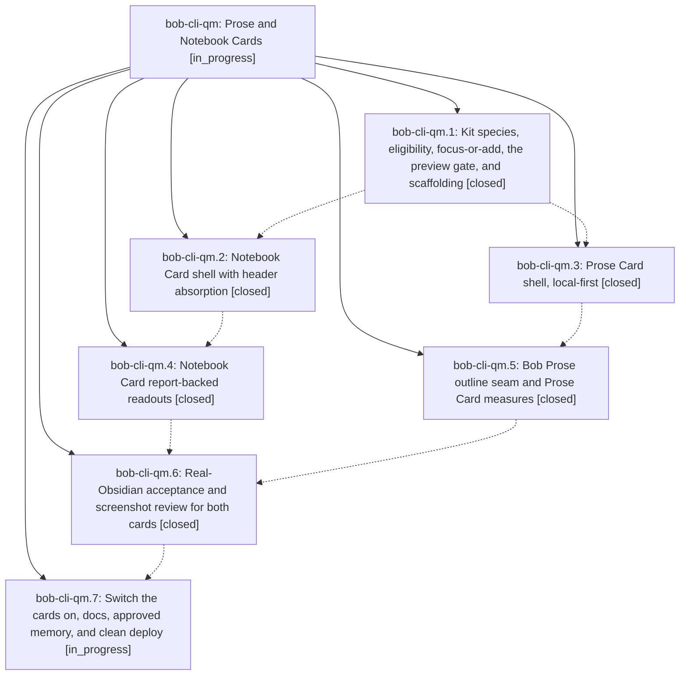

# Bead: bob-cli-qm — Prose and Notebook Cards

[Bead Pages](../README.md) / bob-cli-qm

**Status:** ◐ in_progress · **Type:** ▸ plan · **Tier:** epic
**Owner:** `bryanbugyi34@gmail.com` · **Created by:** [bbugyi200.athena.1gr](https://github.com/bobs-org/bob-cli--agents/blob/main/sessions/bbugyi200.athena.1gr.md) · **Assignee:** `bob-cli-qm.land`
**Created:** 2026-11-26 12:37:59 EST
**Plan:** [202611/prose\_and\_notebook\_cards.md](https://github.com/bobs-org/bob-cli--plans/blob/main/202611/prose_and_notebook_cards.md)

<!-- sase:links:start -->

## Links

| Relation | Artifact | Why |
| --- | --- | --- |
| implemented-by | [plan:202611/prose_and_notebook_cards.md][1] | derived from the plan's `bead_id:` frontmatter field |

_Plus 13 automatic references — see [Referenced By](#referenced-by)._

[1]: https://github.com/bobs-org/bob-cli--plans/blob/main/202611/prose_and_notebook_cards.md

<!-- sase:links:end -->

## Description

Prose notes and notebooks open on beautiful, reliable title cards in the Property Card family. Native Properties hide under the family gate, and the cards paint rich derived data without spawning bob or writing the vault. The work is built beside bob-cli-qi and bob-cli-qj and touches them only at four explicit gates.

## Phases

| Bead | Title | Status | Size | Created | Agents | Commits |
|---|---|---|---|---|---:|---:|
| [bob-cli-qm.1](bob-cli-qm.1.md) | Kit species, eligibility, focus-or-add, the preview gate, and scaffolding | ✓ closed | medium | 2026-11-26 | 1 | 1 |
| [bob-cli-qm.2](bob-cli-qm.2.md) | Notebook Card shell with header absorption | ✓ closed | medium | 2026-11-26 | 1 | 3 |
| [bob-cli-qm.3](bob-cli-qm.3.md) | Prose Card shell, local-first | ✓ closed | medium | 2026-11-26 | 1 | 1 |
| [bob-cli-qm.4](bob-cli-qm.4.md) | Notebook Card report-backed readouts | ✓ closed | medium | 2026-11-26 | 1 | 1 |
| [bob-cli-qm.5](bob-cli-qm.5.md) | Bob Prose outline seam and Prose Card measures | ✓ closed | medium | 2026-11-26 | 1 | 1 |
| [bob-cli-qm.6](bob-cli-qm.6.md) | Real-Obsidian acceptance and screenshot review for both cards | ✓ closed | medium | 2026-11-26 | 1 | 1 |
| [bob-cli-qm.7](bob-cli-qm.7.md) | Switch the cards on, docs, approved memory, and clean deploy | ◐ in_progress | medium | 2026-11-26 | 1 | 2 |

## Lineage

## Agents

| Agent | Bead | Commits |
|---|---|---:|
| [bbugyi200.athena.bob-cli-qm.1](https://github.com/bobs-org/bob-cli--agents/blob/main/agents/bbugyi200.athena.bob-cli-qm.1/README.md) | [bob-cli-qm.1](bob-cli-qm.1.md) | 1 |
| [bbugyi200.athena.bob-cli-qm.2](https://github.com/bobs-org/bob-cli--agents/blob/main/sessions/bbugyi200.athena.bob-cli-qm.2.md) | [bob-cli-qm.2](bob-cli-qm.2.md) | 3 |
| [bbugyi200.athena.bob-cli-qm.3](https://github.com/bobs-org/bob-cli--agents/blob/main/sessions/bbugyi200.athena.bob-cli-qm.3.md) | [bob-cli-qm.3](bob-cli-qm.3.md) | 1 |
| [bbugyi200.athena.bob-cli-qm.4](https://github.com/bobs-org/bob-cli--agents/blob/main/agents/bbugyi200.athena.bob-cli-qm.4/README.md) | [bob-cli-qm.4](bob-cli-qm.4.md) | 1 |
| [bbugyi200.athena.bob-cli-qm.5](https://github.com/bobs-org/bob-cli--agents/blob/main/sessions/bbugyi200.athena.bob-cli-qm.5.md) | [bob-cli-qm.5](bob-cli-qm.5.md) | 1 |
| [bbugyi200.athena.bob-cli-qm.6](https://github.com/bobs-org/bob-cli--agents/blob/main/agents/bbugyi200.athena.bob-cli-qm.6/README.md) | [bob-cli-qm.6](bob-cli-qm.6.md) | 1 |
| [bbugyi200.athena.bob-cli-qm.7](https://github.com/bobs-org/bob-cli--agents/blob/main/sessions/bbugyi200.athena.bob-cli-qm.7.md) | [bob-cli-qm.7](bob-cli-qm.7.md) | 2 |
| [bbugyi200.athena.bob-cli-qm.land](https://github.com/bobs-org/bob-cli--agents/blob/main/agents/bbugyi200.athena.bob-cli-qm.land/README.md) | [bob-cli-qm](README.md) | 0 |

## Commits

| Repo | Commit | Subject | Bead | Committed |
|---|---|---|---|---|
| bob-plugins | [`bob-plugins@deee0f2`](https://github.com/bobs-org/bob-plugins/commit/deee0f214d8997d8b1d24f5007a64001f4c3cbb2) | feat(note-cards): add notebook and prose species kit with focus-or-add | [bob-cli-qm.1](bob-cli-qm.1.md) | 2026-11-26 13:08:45 EST |
| bob-plugins | [`bob-plugins@5152f49`](https://github.com/bobs-org/bob-plugins/commit/5152f4936445123b0ab012746a63bbf01b9e9199) | feat(ledger-tools): implement notebook title card | [bob-cli-qm.2](bob-cli-qm.2.md) | 2026-11-26 13:44:08 EST |
| bob-plugins | [`bob-plugins@d190ba2`](https://github.com/bobs-org/bob-plugins/commit/d190ba210989fe288b4b679d0ffce9f9a5ff89e4) | fix(ledger-tools): remove duplicate Notebook header path declaration | [bob-cli-qm.2](bob-cli-qm.2.md) | 2026-11-26 13:49:58 EST |
| bob-plugins | [`bob-plugins@175515f`](https://github.com/bobs-org/bob-plugins/commit/175515f243e6ad0670c6d87e5fe8a7aa90314da7) | feat(ledger-tools): finish Notebook Card shell | [bob-cli-qm.2](bob-cli-qm.2.md) | 2026-11-26 14:14:20 EST |
| bob-plugins | [`bob-plugins@3863bc4`](https://github.com/bobs-org/bob-plugins/commit/3863bc46007c6287ac8eebfda37d68c42be951d0) | feat(ledger-tools): restore Prose Card over landed notebook bundle | [bob-cli-qm.3](bob-cli-qm.3.md) | 2026-11-26 14:24:01 EST |
| bob-plugins | [`bob-plugins@f6458cb`](https://github.com/bobs-org/bob-plugins/commit/f6458cb04930d45ce340e91828ce2dd52a23ba45) | feat(ledger-tools): add Notebook Card report-backed readouts | [bob-cli-qm.4](bob-cli-qm.4.md) | 2026-11-26 14:38:22 EST |
| bob-plugins | [`bob-plugins@3102408`](https://github.com/bobs-org/bob-plugins/commit/3102408596f263baa8f955c01093c5ab53135dbb) | feat(prose): expose read-only Bob prose card measures | [bob-cli-qm.5](bob-cli-qm.5.md) | 2026-11-26 16:37:52 EST |
| bob-plugins | [`bob-plugins@fb72a96`](https://github.com/bobs-org/bob-plugins/commit/fb72a96c6590061ac614e1a6d31f8391bfce9a42) | test(props): real-Obsidian acceptance for Notebook and Prose Cards | [bob-cli-qm.6](bob-cli-qm.6.md) | 2026-11-26 17:51:16 EST |
| bob-cli | [`ebc45fe`](https://github.com/bobs-org/bob-cli/commit/ebc45fece48aa486cdb59bfdbace11a3576a3ec3) | docs(cards): document Notebook and Prose cards | [bob-cli-qm.7](bob-cli-qm.7.md) | 2026-11-26 18:27:05 EST |
| bob-plugins | [`bob-plugins@eca733c`](https://github.com/bobs-org/bob-plugins/commit/eca733c23a43ffad6bc2ab4bd2f7ec76eb2023ee) | feat(cards): add Notebook and Prose property cards | [bob-cli-qm.7](bob-cli-qm.7.md) | 2026-11-26 19:28:12 EST |

<!-- sase:referenced-by:start -->

## Referenced By

| Relation | Artifact | Why | Uses |
| --- | --- | --- | ---: |
| read-by | [agent:bob-cli-qm.1][1] | Need parent epic scope and plan reference | 1 |
| read-by | [agent:bob-cli-qm.6][2] | check epic status and remaining phases for qm.6 acceptance | 1 |
| read-by | [agent:research.6l.cdx][3] | Evaluate parallel delivery boundaries for ref cards alongside notebook and prose cards | 1 |
| read-by | [agent:research.6l.cld][4] | Understand the in-progress notebook/prose card epic to design ref cards in parallel | 1 |
| read-by | [agent:research.6l.gem][5] | Inspect bob-cli-qm epic for notebook cards and prose cards context | 1 |
| read-by | [agent:research.6l.grk][6] | Need the in-progress notebook/prose card epic for parallel-delivery design | 1 |
| read-by | [agent:research.6l.mus][7] | Research ref cards design: need notebook/prose card epic context | 2 |
| read-by | [agent:research.6m.cdx][8] | Research independent cabinet implementation and overlap with active epics | 1 |
| read-by | [agent:research.6m.cld][9] | Assess coordination with cabinets research | 1 |
| read-by | [agent:research.6m.final][10] | Refresh epic phase snapshot for consolidated cabinets research | 4 |
| read-by | [agent:research.6m.gem][11] | Understand active epic scope, files, and status for parallel cabinet implementation analysis | 1 |
| read-by | [agent:research.6m.grk][12] | Cite sibling epic scope and out-of-scope catalog work before recommending a cabinets epic | 2 |
| read-by | [agent:research.6m.mus][13] | Research cabinet design parallel coordination with in-progress epics | 1 |

[1]: https://github.com/bobs-org/bob-cli--agents/blob/main/agents/bbugyi200.athena.bob-cli-qm.1/README.md
[2]: https://github.com/bobs-org/bob-cli--agents/blob/main/agents/bbugyi200.athena.bob-cli-qm.6/README.md
[3]: https://github.com/bobs-org/bob-cli--agents/blob/main/agents/bbugyi200.athena.research.6l.cdx/README.md
[4]: https://github.com/bobs-org/bob-cli--agents/blob/main/agents/bbugyi200.athena.research.6l.cld/README.md
[5]: https://github.com/bobs-org/bob-cli--agents/blob/main/agents/bbugyi200.athena.research.6l.gem/README.md
[6]: https://github.com/bobs-org/bob-cli--agents/blob/main/agents/bbugyi200.athena.research.6l.grk/README.md
[7]: https://github.com/bobs-org/bob-cli--agents/blob/main/agents/bbugyi200.athena.research.6l.mus/README.md
[8]: https://github.com/bobs-org/bob-cli--agents/blob/main/agents/bbugyi200.athena.research.6m.cdx/README.md
[9]: https://github.com/bobs-org/bob-cli--agents/blob/main/agents/bbugyi200.athena.research.6m.cld/README.md
[10]: https://github.com/bobs-org/bob-cli--agents/blob/main/agents/bbugyi200.athena.research.6m.final/README.md
[11]: https://github.com/bobs-org/bob-cli--agents/blob/main/agents/bbugyi200.athena.research.6m.gem/README.md
[12]: https://github.com/bobs-org/bob-cli--agents/blob/main/agents/bbugyi200.athena.research.6m.grk/README.md
[13]: https://github.com/bobs-org/bob-cli--agents/blob/main/agents/bbugyi200.athena.research.6m.mus/README.md

<!-- sase:referenced-by:end -->
