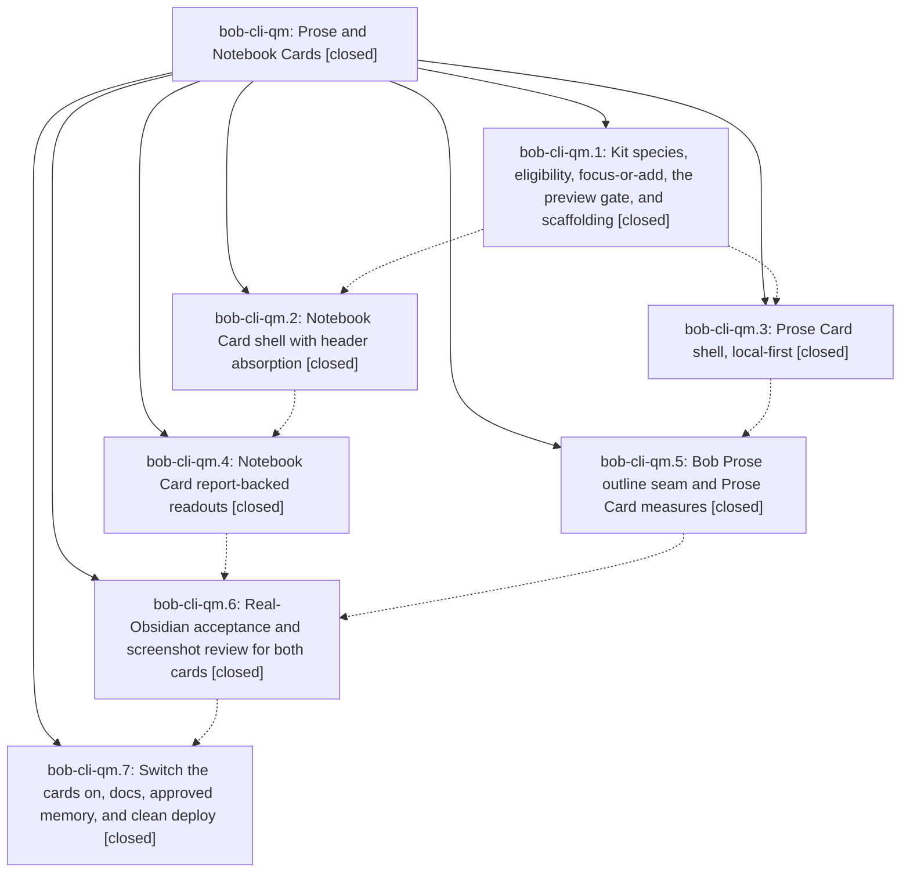

# Bead: bob-cli-qm — Prose and Notebook Cards

[Bead Pages](../README.md) / bob-cli-qm

**Status:** ✓ closed · **Resolution:** done · **Type:** ▸ plan · **Tier:** epic
**Owner:** `bryanbugyi34@gmail.com` · **Created by:** [bbugyi200.athena.1gr](https://github.com/bobs-org/bob-cli--agents/blob/main/sessions/bbugyi200.athena.1gr.md) · **Assignee:** `bob-cli-qm.land`
**Created:** 2026-11-26 12:37:59 EST · **Closed:** 2026-11-27 08:12:31 EST
**Plan:** [202611/prose\_and\_notebook\_cards.md](https://github.com/bobs-org/bob-cli--plans/blob/main/202611/prose_and_notebook_cards.md)

<!-- sase:links:start -->

## Links

| Relation | Artifact | Why |
| --- | --- | --- |
| implemented-by | [plan:202611/prose_and_notebook_cards.md][1] | derived from the plan's `bead_id:` frontmatter field |
| related | [bead:bob-cli-qw][2] | The Prose Card this crumb extends; the follow-up was proposed in bob-cli-qm.7 note #3 |
| related | file:explicit:796d9fe246948dac342685b1 | attached via sase artifact create --bead |
| related | file:explicit:ae549d06b84ecde17db11c8b | attached via sase artifact create --bead |
| related | file:explicit:b1a9d69c775e25c93e86c9e9 | attached via sase artifact create --bead |

_Plus 14 automatic references — see [Referenced By](#referenced-by)._

[1]: https://github.com/bobs-org/bob-cli--plans/blob/main/202611/prose_and_notebook_cards.md
[2]: https://github.com/bobs-org/bob-cli--beads/blob/main/pages/bob-cli-qw/README.md

<!-- sase:links:end -->

## Description

Prose notes and notebooks open on beautiful, reliable title cards in the Property Card family. Native Properties hide under the family gate, and the cards paint rich derived data without spawning bob or writing the vault. The work is built beside bob-cli-qi and bob-cli-qj and touches them only at four explicit gates.

## Notes

[2026-11-27T01:00:14Z · bob-cli-q5.8.1.land] DISCOVERED ISSUE: ebc45fec (bob-cli-qm.7, docs(cards): document Notebook and Prose cards) pushed docs/reference/vault-format.md over the reference word budget. On bob-cli athena 2026-11-26, bob-docs lint passes with the file at ebc45fec~1 and fails at ebc45fec: 'docs/reference/vault-format.md:1: budget: over budget at 6030 words (cap 6000 for reference/)', so just docs-check is red for every bob-cli change. Reported as PROPOSED FOLLOW-UP by bob-cli-q5.8.1.5; tracked task bob-cli-oc reopened with a verified-after-close +1. Trim the page under 6000 words before landing bob-cli-qm.

[2026-11-27T12:31:59Z · bob-cli-qm.land] LAND TRIAGE (bob-cli-qm.land, 2026-11-27). Every PROPOSED FOLLOW-UP and DISCOVERED ISSUE got an outcome:
(1) Epic note #1 vault-format.md over budget (ebc45fec): fixed on master by dc96ef4c (5969/6000 words, Prose keys kept). just docs-check passes on eef6cc07. Closed bob-cli-oc with that evidence.
(2) qm.2 #1 / qm.4 #1 docs/develop/decisions.md drift: declined. It no longer reproduces; bob-plugins npm run docs:check passes on 56baeb9f.
(3) qm.5--1 / qm.6 #3 qj.3 commit 9426ee8f never reached master: declined. It was resolved by c41e07e9 (bob-cli-qj.4 re-landed both-spellings detection and bob-articles:toggle-section-numbers). The acceptance runner still encodes the old assumption, so the prose ready-snapshot and toggle rows never ran in real Obsidian. That refresh is remaining epic work (landing tale).
(4) qm.6 #3 takeover screenshot inventory 44 vs 76: declined. It no longer reproduces; test-obsidian-frontmatter-takeover-e2e passes 18/18.
(5) qm.6 #3 forced-colors emulation did not engage: no separate task, because the epic caused it. scripts/obsidian-note-cards-e2e.cjs:993 sends Emulation.setEmulatedMedia({forcedColors:"active"}), which is not a CDP parameter, and still records forced-colors-emulation as passing. Fixing it is remaining epic work (landing tale).
(6) qm.7 #3 Prose provenance crumb: filed feature task bob-cli-qw (medium). It depends on bob-cli-qj.5.1, which defines extracted_from/extracted_heading.
(7) qm.7 #4 snooze unit failures: declined; 56baeb9f resolved them (qm.7 #7).
(8) qm.7 #5 /tmp tmpfs full: duplicate. Corroborated bob-cli-qt with +1.
(9) qm.7 #6 cabinets e2e still seeds cardPreviewKinds: recorded as a DISCOVERED ISSUE on the active cabinets epic bob-cli-qq for qq.9's gate removal.
(10) qm.7 #8 bob-emoji tracked in vault git: duplicate. Corroborated bob-cli-cd with +1.
Other remaining epic work: delete the vestigial propertyCardKindLive shim that go-live left behind; it now only checks PROPERTY_CARD_KINDS membership.

[2026-11-27T13:12:31Z · bob-cli-qm.land] LAND TALE COMPLETE (bob-cli-qm.land tale 202611/land_prose_and_notebook_cards.md).

Prior land verification holds: all 7 phases closed done; prior commits bob-plugins deee0f21,5152f493,d190ba21,175515f2,3863bc46,f6458cc0,31024085,fb72a96c,eca733c2 and bob-cli ebc45fec,eef6cc07; docs-check green in both repos; deploy was drift 0 (ledger-tools 1.172.4, articles 0.4.0); live sase_blog_contents.md is [[prose]]; follow-up triage recorded (qw filed, qt/cd +1, DISCOVERED ISSUE on qq).

This tale:
- Gate shim deleted: removed propertyCardKindLive from 240t-plugin-property-card-note-species.js and 374-exports-property-card.js; dropped always-true clauses in 249i (notebook eligible) and 249n (prose match, modelFor, isCurrent, reading guard, livePath). grep propertyCardKindLive now empty in src; main.js clean after rebuild.
- Runner refreshed (scripts/obsidian-note-cards-e2e.cjs): ready-snapshot rows prose-ready-with-title (approx 30 words, <1 min read, 2 sections), prose-ready-legacy-spelling (approx 130 words, 1 min read, 12 sections, 9 to-write), prose-refused-message (holds-tasks refusal text, never zeros); outline expands/stub-leaf (leaf rule, umbrella not counted), outline-jump and finding-jump (body finding line 10); live numbering-toggle (BUTTON, flip numbered/unumbered, one editor undo restores bytes, passive hash clean); inert SPAN branch kept in prose-identity-without-articles disabled row; forced-colors via media screen features active + matchMedia gate; TMPDIR via BOB_OBSIDIAN_TMPDIR; self-test covers new ids, features form, and env selection. Added fixture prose-with-body-finding.md (broken-heading-link line 10). Fixed shared shim stdin forwarding for --stdin/-s in obsidian-record-card-e2e.cjs (Bob Prose pipes buffer via --stdin; shim previously dropped it, returning not-article).
- Docs: merged duplicate section-sign descriptions in docs/prose-card.md (toggle runs Toggle section numbers in one undoable edit; inert only when Bob Prose absent/disabled/older); npm run docs:check passes; inventory regenerated for 1.172.5.
- Real-Obsidian GO: 40 checks, 0 failed, 18 shots. Artifacts: report file:explicit:b1a9d69c775e25c93e86c9e9, log file:explicit:ae549d06b84ecde17db11c8b, shots tar file:explicit:796d9fe246948dac342685b1.
- Forced-colors verdict: pass. Emulation matched (matchMedia true) for notebook and prose shots. Inspected expanded/folded prose and notebook plus both forced-colors shots: text legible, card/tile edges visible, spine/folio distinct. No styles.css repair needed.
- Deploy: bob plugins sync ok (no -F). Smoke PASS (layout-ready 345ms, heap 48.1MiB, 0 exceptions). Versions: bob-ledger-tools 1.172.5 (pre-commit uncommitted build, drift 1 until host commit), bob-articles 0.4.0. Source HEAD 546ecfa5 plus tale changes (host finalizer commits). No symvision recipe in either repo.
- Pre-existing failures (not fixed, recorded): full npm test has 3 ENOSPC on /tmp from tmpfs 100pct (obsidian-block-marks-e2e, obsidian-command-chips-keymap-e2e, task-link-marks-motion), same root cause as tracked bob-cli-qt; reproduces on clean master; focused suites and build:check green (79/79).

## Phases

| Bead | Title | Status | Size | Created | Agents | Commits |
|---|---|---|---|---|---:|---:|
| [bob-cli-qm.1](bob-cli-qm.1.md) | Kit species, eligibility, focus-or-add, the preview gate, and scaffolding | ✓ closed | medium | 2026-11-26 | 1 | 1 |
| [bob-cli-qm.2](bob-cli-qm.2.md) | Notebook Card shell with header absorption | ✓ closed | medium | 2026-11-26 | 1 | 3 |
| [bob-cli-qm.3](bob-cli-qm.3.md) | Prose Card shell, local-first | ✓ closed | medium | 2026-11-26 | 1 | 1 |
| [bob-cli-qm.4](bob-cli-qm.4.md) | Notebook Card report-backed readouts | ✓ closed | medium | 2026-11-26 | 1 | 1 |
| [bob-cli-qm.5](bob-cli-qm.5.md) | Bob Prose outline seam and Prose Card measures | ✓ closed | medium | 2026-11-26 | 1 | 1 |
| [bob-cli-qm.6](bob-cli-qm.6.md) | Real-Obsidian acceptance and screenshot review for both cards | ✓ closed | medium | 2026-11-26 | 1 | 1 |
| [bob-cli-qm.7](bob-cli-qm.7.md) | Switch the cards on, docs, approved memory, and clean deploy | ✓ closed | medium | 2026-11-26 | 1 | 3 |

## Lineage

## Agents

| Agent | Bead | Commits |
|---|---|---:|
| [bbugyi200.athena.bob-cli-qm.1](https://github.com/bobs-org/bob-cli--agents/blob/main/agents/bbugyi200.athena.bob-cli-qm.1/README.md) | [bob-cli-qm.1](bob-cli-qm.1.md) | 1 |
| [bbugyi200.athena.bob-cli-qm.2](https://github.com/bobs-org/bob-cli--agents/blob/main/sessions/bbugyi200.athena.bob-cli-qm.2.md) | [bob-cli-qm.2](bob-cli-qm.2.md) | 3 |
| [bbugyi200.athena.bob-cli-qm.3](https://github.com/bobs-org/bob-cli--agents/blob/main/sessions/bbugyi200.athena.bob-cli-qm.3.md) | [bob-cli-qm.3](bob-cli-qm.3.md) | 1 |
| [bbugyi200.athena.bob-cli-qm.4](https://github.com/bobs-org/bob-cli--agents/blob/main/agents/bbugyi200.athena.bob-cli-qm.4/README.md) | [bob-cli-qm.4](bob-cli-qm.4.md) | 1 |
| [bbugyi200.athena.bob-cli-qm.5](https://github.com/bobs-org/bob-cli--agents/blob/main/sessions/bbugyi200.athena.bob-cli-qm.5.md) | [bob-cli-qm.5](bob-cli-qm.5.md) | 1 |
| [bbugyi200.athena.bob-cli-qm.6](https://github.com/bobs-org/bob-cli--agents/blob/main/agents/bbugyi200.athena.bob-cli-qm.6/README.md) | [bob-cli-qm.6](bob-cli-qm.6.md) | 1 |
| [bbugyi200.athena.bob-cli-qm.7](https://github.com/bobs-org/bob-cli--agents/blob/main/sessions/bbugyi200.athena.bob-cli-qm.7.md) | [bob-cli-qm.7](bob-cli-qm.7.md) | 3 |
| [bbugyi200.athena.bob-cli-qm.land](https://github.com/bobs-org/bob-cli--agents/blob/main/sessions/bbugyi200.athena.bob-cli-qm.land.md) | [bob-cli-qm](README.md) | 2 |

## Commits

| Repo | Commit | Subject | Bead | Committed |
|---|---|---|---|---|
| bob-plugins | [`bob-plugins@deee0f2`](https://github.com/bobs-org/bob-plugins/commit/deee0f214d8997d8b1d24f5007a64001f4c3cbb2) | feat(note-cards): add notebook and prose species kit with focus-or-add | [bob-cli-qm.1](bob-cli-qm.1.md) | 2026-11-26 13:08:45 EST |
| bob-plugins | [`bob-plugins@5152f49`](https://github.com/bobs-org/bob-plugins/commit/5152f4936445123b0ab012746a63bbf01b9e9199) | feat(ledger-tools): implement notebook title card | [bob-cli-qm.2](bob-cli-qm.2.md) | 2026-11-26 13:44:08 EST |
| bob-plugins | [`bob-plugins@d190ba2`](https://github.com/bobs-org/bob-plugins/commit/d190ba210989fe288b4b679d0ffce9f9a5ff89e4) | fix(ledger-tools): remove duplicate Notebook header path declaration | [bob-cli-qm.2](bob-cli-qm.2.md) | 2026-11-26 13:49:58 EST |
| bob-plugins | [`bob-plugins@175515f`](https://github.com/bobs-org/bob-plugins/commit/175515f243e6ad0670c6d87e5fe8a7aa90314da7) | feat(ledger-tools): finish Notebook Card shell | [bob-cli-qm.2](bob-cli-qm.2.md) | 2026-11-26 14:14:20 EST |
| bob-plugins | [`bob-plugins@3863bc4`](https://github.com/bobs-org/bob-plugins/commit/3863bc46007c6287ac8eebfda37d68c42be951d0) | feat(ledger-tools): restore Prose Card over landed notebook bundle | [bob-cli-qm.3](bob-cli-qm.3.md) | 2026-11-26 14:24:01 EST |
| bob-plugins | [`bob-plugins@f6458cb`](https://github.com/bobs-org/bob-plugins/commit/f6458cb04930d45ce340e91828ce2dd52a23ba45) | feat(ledger-tools): add Notebook Card report-backed readouts | [bob-cli-qm.4](bob-cli-qm.4.md) | 2026-11-26 14:38:22 EST |
| bob-plugins | [`bob-plugins@3102408`](https://github.com/bobs-org/bob-plugins/commit/3102408596f263baa8f955c01093c5ab53135dbb) | feat(prose): expose read-only Bob prose card measures | [bob-cli-qm.5](bob-cli-qm.5.md) | 2026-11-26 16:37:52 EST |
| bob-plugins | [`bob-plugins@fb72a96`](https://github.com/bobs-org/bob-plugins/commit/fb72a96c6590061ac614e1a6d31f8391bfce9a42) | test(props): real-Obsidian acceptance for Notebook and Prose Cards | [bob-cli-qm.6](bob-cli-qm.6.md) | 2026-11-26 17:51:16 EST |
| bob-cli | [`ebc45fe`](https://github.com/bobs-org/bob-cli/commit/ebc45fece48aa486cdb59bfdbace11a3576a3ec3) | docs(cards): document Notebook and Prose cards | [bob-cli-qm.7](bob-cli-qm.7.md) | 2026-11-26 18:27:05 EST |
| bob-plugins | [`bob-plugins@eca733c`](https://github.com/bobs-org/bob-plugins/commit/eca733c23a43ffad6bc2ab4bd2f7ec76eb2023ee) | feat(cards): add Notebook and Prose property cards | [bob-cli-qm.7](bob-cli-qm.7.md) | 2026-11-26 19:28:12 EST |
| bob-cli | [`eef6cc0`](https://github.com/bobs-org/bob-cli/commit/eef6cc07fe4225de1a27d052f3eee55e996b2a1a) | docs(memory): add Prose and Notebook Card glossary strands | [bob-cli-qm.7](bob-cli-qm.7.md) | 2026-11-27 07:05:01 EST |
| bob-plugins | [`bob-plugins@d971e4e`](https://github.com/bobs-org/bob-plugins/commit/d971e4e05e18c5cacf42fab2abc03e0050b4e7cd) | feat(ledger-tools): land prose and notebook cards acceptance | [bob-cli-qm](README.md) | 2026-11-27 08:13:41 EST |
| bob-cli--plans | [`bob-cli--plans@b460063`](https://github.com/bobs-org/bob-cli--plans/commit/b460063f6930424a648a261fbed68f7f37dc724f) | docs(plans): mark prose\_and\_notebook\_cards done | [bob-cli-qm](README.md) | 2026-11-27 08:14:14 EST |

<!-- sase:referenced-by:start -->

## Referenced By

| Relation | Artifact | Why | Uses |
| --- | --- | --- | ---: |
| read-by | [agent:bob-cli-q5.5.1.land][1] | Check whether the vault-format budget overflow from qm.7 ebc45fec is already recorded on this active epic | 1 |
| read-by | [agent:bob-cli-qm.1][2] | Need parent epic scope and plan reference | 1 |
| read-by | [agent:bob-cli-qm.6][3] | check epic status and remaining phases for qm.6 acceptance | 1 |
| read-by | [agent:research.6l.cdx][4] | Evaluate parallel delivery boundaries for ref cards alongside notebook and prose cards | 1 |
| read-by | [agent:research.6l.cld][5] | Understand the in-progress notebook/prose card epic to design ref cards in parallel | 1 |
| read-by | [agent:research.6l.gem][6] | Inspect bob-cli-qm epic for notebook cards and prose cards context | 1 |
| read-by | [agent:research.6l.grk][7] | Need the in-progress notebook/prose card epic for parallel-delivery design | 1 |
| read-by | [agent:research.6l.mus][8] | Research ref cards design: need notebook/prose card epic context | 2 |
| read-by | [agent:research.6m.cdx][9] | Research independent cabinet implementation and overlap with active epics | 1 |
| read-by | [agent:research.6m.cld][10] | Assess coordination with cabinets research | 1 |
| read-by | [agent:research.6m.final][11] | Refresh epic phase snapshot for consolidated cabinets research | 4 |
| read-by | [agent:research.6m.gem][12] | Understand active epic scope, files, and status for parallel cabinet implementation analysis | 1 |
| read-by | [agent:research.6m.grk][13] | Cite sibling epic scope and out-of-scope catalog work before recommending a cabinets epic | 2 |
| read-by | [agent:research.6m.mus][14] | Research cabinet design parallel coordination with in-progress epics | 1 |

[1]: https://github.com/bobs-org/bob-cli--agents/blob/main/sessions/bbugyi200.athena.bob-cli-q5.5.1.land.md
[2]: https://github.com/bobs-org/bob-cli--agents/blob/main/agents/bbugyi200.athena.bob-cli-qm.1/README.md
[3]: https://github.com/bobs-org/bob-cli--agents/blob/main/agents/bbugyi200.athena.bob-cli-qm.6/README.md
[4]: https://github.com/bobs-org/bob-cli--agents/blob/main/agents/bbugyi200.athena.research.6l.cdx/README.md
[5]: https://github.com/bobs-org/bob-cli--agents/blob/main/agents/bbugyi200.athena.research.6l.cld/README.md
[6]: https://github.com/bobs-org/bob-cli--agents/blob/main/agents/bbugyi200.athena.research.6l.gem/README.md
[7]: https://github.com/bobs-org/bob-cli--agents/blob/main/agents/bbugyi200.athena.research.6l.grk/README.md
[8]: https://github.com/bobs-org/bob-cli--agents/blob/main/agents/bbugyi200.athena.research.6l.mus/README.md
[9]: https://github.com/bobs-org/bob-cli--agents/blob/main/agents/bbugyi200.athena.research.6m.cdx/README.md
[10]: https://github.com/bobs-org/bob-cli--agents/blob/main/agents/bbugyi200.athena.research.6m.cld/README.md
[11]: https://github.com/bobs-org/bob-cli--agents/blob/main/agents/bbugyi200.athena.research.6m.final/README.md
[12]: https://github.com/bobs-org/bob-cli--agents/blob/main/agents/bbugyi200.athena.research.6m.gem/README.md
[13]: https://github.com/bobs-org/bob-cli--agents/blob/main/agents/bbugyi200.athena.research.6m.grk/README.md
[14]: https://github.com/bobs-org/bob-cli--agents/blob/main/agents/bbugyi200.athena.research.6m.mus/README.md

<!-- sase:referenced-by:end -->
