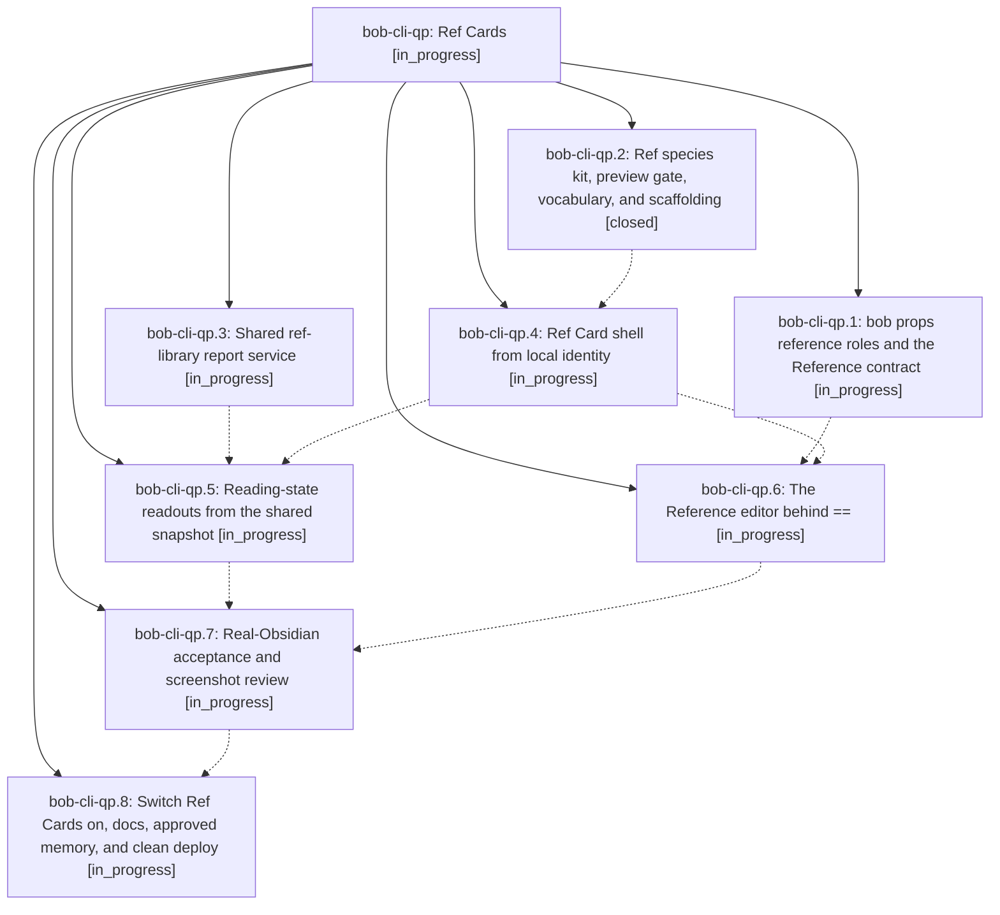

# Bead: bob-cli-qp — Ref Cards

[Bead Pages](../README.md) / bob-cli-qp

**Status:** ◐ in_progress · **Type:** ▸ plan · **Tier:** epic
**Owner:** `bryanbugyi34@gmail.com` · **Created by:** [bbugyi200.apollo.research.6l.linker.w0](https://github.com/bobs-org/bob-cli--agents/blob/main/sessions/bbugyi200.apollo.research.6l.linker.w0.md) · **Assignee:** `bob-cli-qp.land`
**Created:** 2026-11-26 14:22:07 EST
**Plan:** [202611/ref\_cards.md](https://github.com/bobs-org/bob-cli--plans/blob/main/202611/ref_cards.md)

<!-- sase:links:start -->

## Links

| Relation | Artifact | Why |
| --- | --- | --- |
| implemented-by | [plan:202611/ref_cards.md][1] | derived from the plan's `bead_id:` frontmatter field |

[1]: https://github.com/bobs-org/bob-cli--plans/blob/main/202611/ref_cards.md

<!-- sase:links:end -->

## Description

Every library reference note opens on a calm, information-dense Ref Card in the Property Card family. The card answers what the reference is, where it came from, where Bryan is with it, and what useful material it holds, and it omits whatever a note lacks. `==` opens a bob-owned Reference editor. bob protects reference sync and identity keys from generic edits. The work ships beside bob-cli-qm and touches it only at named seams.

## Phases

| Bead | Title | Status | Size | Created | Agents | Commits |
|---|---|---|---|---|---:|---:|
| [bob-cli-qp.1](bob-cli-qp.1.md) | bob props reference roles and the Reference contract | ◐ in_progress | medium | 2026-11-26 | 1 | 0 |
| [bob-cli-qp.2](bob-cli-qp.2.md) | Ref species kit, preview gate, vocabulary, and scaffolding | ✓ closed | medium | 2026-11-26 | 1 | 1 |
| [bob-cli-qp.3](bob-cli-qp.3.md) | Shared ref-library report service | ◐ in_progress | medium | 2026-11-26 | 1 | 0 |
| [bob-cli-qp.4](bob-cli-qp.4.md) | Ref Card shell from local identity | ◐ in_progress | medium | 2026-11-26 | 1 | 0 |
| [bob-cli-qp.5](bob-cli-qp.5.md) | Reading-state readouts from the shared snapshot | ◐ in_progress | medium | 2026-11-26 | 1 | 0 |
| [bob-cli-qp.6](bob-cli-qp.6.md) | The Reference editor behind == | ◐ in_progress | medium | 2026-11-26 | 1 | 0 |
| [bob-cli-qp.7](bob-cli-qp.7.md) | Real-Obsidian acceptance and screenshot review | ◐ in_progress | medium | 2026-11-26 | 1 | 0 |
| [bob-cli-qp.8](bob-cli-qp.8.md) | Switch Ref Cards on, docs, approved memory, and clean deploy | ◐ in_progress | medium | 2026-11-26 | 1 | 0 |

## Lineage

## Agents

| Agent | Bead | Commits |
|---|---|---:|
| [bbugyi200.apollo.bob-cli-qp.1](https://github.com/bobs-org/bob-cli--agents/blob/main/agents/bbugyi200.apollo.bob-cli-qp.1/README.md) | [bob-cli-qp.1](bob-cli-qp.1.md) | 0 |
| [bbugyi200.apollo.bob-cli-qp.2](https://github.com/bobs-org/bob-cli--agents/blob/main/agents/bbugyi200.apollo.bob-cli-qp.2/README.md) | [bob-cli-qp.2](bob-cli-qp.2.md) | 1 |
| [bbugyi200.apollo.bob-cli-qp.3](https://github.com/bobs-org/bob-cli--agents/blob/main/agents/bbugyi200.apollo.bob-cli-qp.3/README.md) | [bob-cli-qp.3](bob-cli-qp.3.md) | 0 |
| [bbugyi200.apollo.bob-cli-qp.4](https://github.com/bobs-org/bob-cli--agents/blob/main/agents/bbugyi200.apollo.bob-cli-qp.4/README.md) | [bob-cli-qp.4](bob-cli-qp.4.md) | 0 |
| [bbugyi200.apollo.bob-cli-qp.5](https://github.com/bobs-org/bob-cli--agents/blob/main/agents/bbugyi200.apollo.bob-cli-qp.5/README.md) | [bob-cli-qp.5](bob-cli-qp.5.md) | 0 |
| [bbugyi200.apollo.bob-cli-qp.6](https://github.com/bobs-org/bob-cli--agents/blob/main/agents/bbugyi200.apollo.bob-cli-qp.6/README.md) | [bob-cli-qp.6](bob-cli-qp.6.md) | 0 |
| [bbugyi200.apollo.bob-cli-qp.7](https://github.com/bobs-org/bob-cli--agents/blob/main/agents/bbugyi200.apollo.bob-cli-qp.7/README.md) | [bob-cli-qp.7](bob-cli-qp.7.md) | 0 |
| [bbugyi200.apollo.bob-cli-qp.8](https://github.com/bobs-org/bob-cli--agents/blob/main/agents/bbugyi200.apollo.bob-cli-qp.8/README.md) | [bob-cli-qp.8](bob-cli-qp.8.md) | 0 |
| [bbugyi200.apollo.bob-cli-qp.land](https://github.com/bobs-org/bob-cli--agents/blob/main/agents/bbugyi200.apollo.bob-cli-qp.land/README.md) | [bob-cli-qp](README.md) | 0 |

## Commits

| Repo | Commit | Subject | Bead | Committed |
|---|---|---|---|---|
| bob-plugins | [`bob-plugins@b021aff`](https://github.com/bobs-org/bob-plugins/commit/b021aff56b293e8da928dca440f99ae4b99ad1d6) | feat(ledger-tools): add Ref Card kit, preview gate, vocabulary, and scaffolding | [bob-cli-qp.2](bob-cli-qp.2.md) | 2026-11-26 14:53:45 EST |
