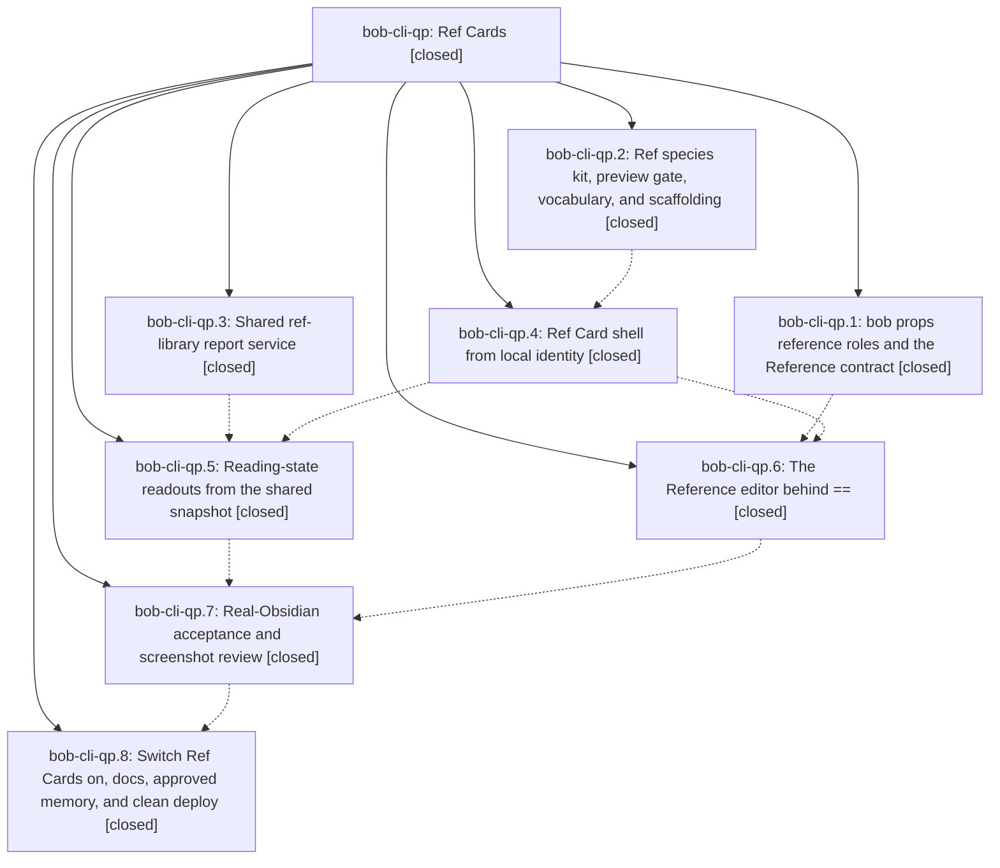

# Bead: bob-cli-qp — Ref Cards

[Bead Pages](../README.md) / bob-cli-qp

**Status:** ✓ closed · **Resolution:** done · **Type:** ▸ plan · **Tier:** epic
**Owner:** `bryanbugyi34@gmail.com` · **Created by:** [bbugyi200.apollo.research.6l.linker.w0](https://github.com/bobs-org/bob-cli--agents/blob/main/sessions/bbugyi200.apollo.research.6l.linker.w0.md) · **Assignee:** `bob-cli-qp.land`
**Created:** 2026-11-26 14:22:07 EST · **Closed:** 2026-11-27 08:45:44 EST
**Plan:** [202611/ref\_cards.md](https://github.com/bobs-org/bob-cli--plans/blob/main/202611/ref_cards.md)

<!-- sase:links:start -->

## Links

| Relation | Artifact | Why |
| --- | --- | --- |
| implemented-by | [plan:202611/ref_cards.md][1] | derived from the plan's `bead_id:` frontmatter field |

_Plus 8 automatic references — see [Referenced By](#referenced-by)._

[1]: https://github.com/bobs-org/bob-cli--plans/blob/main/202611/ref_cards.md

<!-- sase:links:end -->

## Description

Every library reference note opens on a calm, information-dense Ref Card in the Property Card family. The card answers what the reference is, where it came from, where Bryan is with it, and what useful material it holds, and it omits whatever a note lacks. `==` opens a bob-owned Reference editor. bob protects reference sync and identity keys from generic edits. The work ships beside bob-cli-qm and touches it only at named seams.

## Notes

[2026-11-27T13:45:44Z · bob-cli-qp.land] LANDED. All 8 phases are closed, and I re-read every child note. The work matches the plan, its governing decisions, and the two memory decisions.
VERIFIED IN SOURCE. bob-cli 0846b038: props roles scoped by ref_library coverage, plus the REFERENCE contract and props_ref_contract_v1. 0e32b956 and 7666118c: docs plus the glossary:ref-card and glossary:property-card edits only. bob-plugins b021aff5..546ecfa5: species kit, 240v vocabulary shared with the Reading Board, 241a/241ak shared snapshot, 249q-w card, readouts, Reference editor, 249w Vim guard. The gate is gone: there are no refCardPreview reads in src or main.js, and every fragment is at or under 1000 lines.
TESTS. Current bob-plugins master 28e75739: build:check passes, and 113/113 focused Ref Card, passive, Reading Board, and acceptance-meta tests pass. bob-cli master 85d2fb32: cargo test --workspace reported 13344 passed, 0 failed. just docs-check passes, and bob-plugins npm run docs:check passes. just check fails only at clippy::question_mark in src/native/prose/section_model.rs:922, which came from 85d2fb32 (bob-cli-qj.5.1.2), not this epic. I recorded it as a DISCOVERED ISSUE on bob-cli-qj.5.1. Vault: bob plugins list shows 12 synced and 0 drift; ledger-tools 1.172.5 carries the live Ref Card. qp.7 acceptance GO 54/54 with 59 screenshots: file:explicit:71e7c7a55117ffd98b5fec4b, file:explicit:65cd84a81d3610f4285ddd5c, file:explicit:4f6ec6de1f7e3ef296d67c86.
EPIC GAPS FIXED. (1) bob-cli-qn was still READY although the plan required closing it. I closed it with the verification above. (2) 0846b038 landed as feat(props) without the ! the plan and decisions:bob-cli-releases-ride-a-daily-train required. This lander adds a docs/props.md migration note committed as docs(props)!, so the Breaking changelog group lists the protected-keys refusal. The 0.7.0 bump is unchanged because other ! commits already exist since v0.6.0.
INTEGRATION. Concurrent commits checked: 0ffb4511 cancels pending Vim input in 249db, but it does not apply to 249w, which never swallows keys. c6fbeb36 changes only catalog embed and hover behavior. 28e75739 is cabinets-only; Ref tests still pass on top of it. 33fe3425 already fixed qp.1's note_kind test. The cabinets runner still seeds the dead refCardPreview key and gates only exceptions, not console.error; I left both as a DISCOVERED ISSUE on bob-cli-qq, because qq.8 and qq.9 own those files.
FOLLOW-UPS.
- Corroborated: qp.5 frees-marks flake as +1 on bob-cli-io; qp.7 #5 /tmp tmpfs as +1 on bob-cli-qt; qp.4 record-writer e2e recurrence as a note on active epic bob-cli-ms.8; qp.7 #3 on bob-cli-qq.
- New tasks: bob-cli-qz (qp.7 #4: Notebook/Prose lack a Vim guard, unify 249db/249w); bob-cli-r0 (qp.6: api.commandMode prefill); bob-cli-r1 (F2: Reading Board shared snapshot); bob-cli-r2 (F1: 13 [[ref]] hub notes, Bryan decides); bob-cli-r3 (F4+F5: additive ref list measures); bob-cli-r4 (F6: bob ref retitle); bob-cli-r5 (F7: descriptor-driven kit lists, after qq); bob-cli-r6 (qp.7 #6: narrow actions row).
- Declined: qp.1 #1, already fixed by 33fe3425. qp.2 #2, docs-check passes now. qp.7 #7 and qp.8 #5, vault-format is at 5969/6000 and bob-cli-oc is closed. F3, because its conditions are unmet: the approved screenshots keep the embed below the card, and no cross-note lane writer exists. qp.7 #8 was an observation that did not recur.
No --epic-symbol entries, no parent bead, no symvision recipe.
REMINDER FOR BRYAN: update bob from master and run bob plugins sync on the Mac and apollo, then glance at a finished blog, an open paper, and a legacy ref.

## Phases

| Bead | Title | Status | Size | Created | Agents | Commits |
|---|---|---|---|---|---:|---:|
| [bob-cli-qp.1](bob-cli-qp.1.md) | bob props reference roles and the Reference contract | ✓ closed | medium | 2026-11-26 | 1 | 1 |
| [bob-cli-qp.2](bob-cli-qp.2.md) | Ref species kit, preview gate, vocabulary, and scaffolding | ✓ closed | medium | 2026-11-26 | 1 | 1 |
| [bob-cli-qp.3](bob-cli-qp.3.md) | Shared ref-library report service | ✓ closed | medium | 2026-11-26 | 1 | 1 |
| [bob-cli-qp.4](bob-cli-qp.4.md) | Ref Card shell from local identity | ✓ closed | medium | 2026-11-26 | 1 | 1 |
| [bob-cli-qp.5](bob-cli-qp.5.md) | Reading-state readouts from the shared snapshot | ✓ closed | medium | 2026-11-26 | 1 | 1 |
| [bob-cli-qp.6](bob-cli-qp.6.md) | The Reference editor behind == | ✓ closed | medium | 2026-11-26 | 1 | 1 |
| [bob-cli-qp.7](bob-cli-qp.7.md) | Real-Obsidian acceptance and screenshot review | ✓ closed | medium | 2026-11-26 | 1 | 3 |
| [bob-cli-qp.8](bob-cli-qp.8.md) | Switch Ref Cards on, docs, approved memory, and clean deploy | ✓ closed | medium | 2026-11-26 | 1 | 4 |

## Lineage

## Agents

| Agent | Bead | Commits |
|---|---|---:|
| [bbugyi200.apollo.bob-cli-qp.1](https://github.com/bobs-org/bob-cli--agents/blob/main/sessions/bbugyi200.apollo.bob-cli-qp.1.md) | [bob-cli-qp.1](bob-cli-qp.1.md) | 1 |
| [bbugyi200.apollo.bob-cli-qp.2](https://github.com/bobs-org/bob-cli--agents/blob/main/agents/bbugyi200.apollo.bob-cli-qp.2/README.md) | [bob-cli-qp.2](bob-cli-qp.2.md) | 1 |
| [bbugyi200.apollo.bob-cli-qp.3](https://github.com/bobs-org/bob-cli--agents/blob/main/agents/bbugyi200.apollo.bob-cli-qp.3/README.md) | [bob-cli-qp.3](bob-cli-qp.3.md) | 1 |
| [bbugyi200.apollo.bob-cli-qp.4](https://github.com/bobs-org/bob-cli--agents/blob/main/agents/bbugyi200.apollo.bob-cli-qp.4/README.md) | [bob-cli-qp.4](bob-cli-qp.4.md) | 1 |
| [bbugyi200.apollo.bob-cli-qp.5](https://github.com/bobs-org/bob-cli--agents/blob/main/agents/bbugyi200.apollo.bob-cli-qp.5/README.md) | [bob-cli-qp.5](bob-cli-qp.5.md) | 1 |
| [bbugyi200.apollo.bob-cli-qp.6](https://github.com/bobs-org/bob-cli--agents/blob/main/agents/bbugyi200.apollo.bob-cli-qp.6/README.md) | [bob-cli-qp.6](bob-cli-qp.6.md) | 1 |
| [bbugyi200.apollo.bob-cli-qp.7](https://github.com/bobs-org/bob-cli--agents/blob/main/agents/bbugyi200.apollo.bob-cli-qp.7/README.md) | [bob-cli-qp.7](bob-cli-qp.7.md) | 3 |
| [bbugyi200.apollo.bob-cli-qp.8](https://github.com/bobs-org/bob-cli--agents/blob/main/sessions/bbugyi200.apollo.bob-cli-qp.8.md) | [bob-cli-qp.8](bob-cli-qp.8.md) | 4 |
| [bbugyi200.apollo.bob-cli-qp.land](https://github.com/bobs-org/bob-cli--agents/blob/main/agents/bbugyi200.apollo.bob-cli-qp.land/README.md) | [bob-cli-qp](README.md) | 2 |

## Commits

| Repo | Commit | Subject | Bead | Committed |
|---|---|---|---|---|
| bob-plugins | [`bob-plugins@b021aff`](https://github.com/bobs-org/bob-plugins/commit/b021aff56b293e8da928dca440f99ae4b99ad1d6) | feat(ledger-tools): add Ref Card kit, preview gate, vocabulary, and scaffolding | [bob-cli-qp.2](bob-cli-qp.2.md) | 2026-11-26 14:53:45 EST |
| bob-plugins | [`bob-plugins@6045168`](https://github.com/bobs-org/bob-plugins/commit/6045168fd586c71cb7cd98d94809cbabdb505838) | feat(ref-card): add shared report service | [bob-cli-qp.3](bob-cli-qp.3.md) | 2026-11-26 15:26:58 EST |
| bob-plugins | [`bob-plugins@cb847f2`](https://github.com/bobs-org/bob-plugins/commit/cb847f20ad011cd6357d8aa1924dac3d53e8fafd) | feat(ref-card): implement local identity shell | [bob-cli-qp.4](bob-cli-qp.4.md) | 2026-11-26 15:46:38 EST |
| bob-cli | [`0846b03`](https://github.com/bobs-org/bob-cli/commit/0846b0381e05d8abbb5a42669cbe5ca73be12056) | feat(props): add Reference contract and roles | [bob-cli-qp.1](bob-cli-qp.1.md) | 2026-11-26 16:10:25 EST |
| bob-plugins | [`bob-plugins@0d8ccd6`](https://github.com/bobs-org/bob-plugins/commit/0d8ccd662ba098449af1ec39907da7bd35e037ee) | feat(ref-card): add reading-state readouts to ref note cards | [bob-cli-qp.5](bob-cli-qp.5.md) | 2026-11-26 16:16:35 EST |
| bob-plugins | [`bob-plugins@f62a43e`](https://github.com/bobs-org/bob-plugins/commit/f62a43ec653018cd2536579b22b6e85a33d5e4d1) | feat(ref-card): open the Reference editor behind == | [bob-cli-qp.6](bob-cli-qp.6.md) | 2026-11-26 16:57:25 EST |
| bob-plugins | [`bob-plugins@d32d7a9`](https://github.com/bobs-org/bob-plugins/commit/d32d7a9823b0fcdca753c8dce8f714c479a7c238) | test(ref-card): add native acceptance review harness | [bob-cli-qp.7](bob-cli-qp.7.md) | 2026-11-26 18:22:23 EST |
| bob-plugins | [`bob-plugins@880ee82`](https://github.com/bobs-org/bob-plugins/commit/880ee823efd98f3f2507b2624de84a508ea24d10) | test(ref-card): capture native launch diagnostics | [bob-cli-qp.7](bob-cli-qp.7.md) | 2026-11-26 19:38:43 EST |
| bob-plugins | [`bob-plugins@2bd92b1`](https://github.com/bobs-org/bob-plugins/commit/2bd92b19a42054ba6b11aba0c4a997d412b6ed48) | fix(ref-card): pass real-Obsidian acceptance and repair review defects | [bob-cli-qp.7](bob-cli-qp.7.md) | 2026-11-27 00:12:30 EST |
| bob-cli | [`0e32b95`](https://github.com/bobs-org/bob-cli/commit/0e32b956c2ed665a1043e965db1791a6f387fbef) | docs(ref): remove preview-gate docs and add ref-card glossary strand | [bob-cli-qp.8](bob-cli-qp.8.md) | 2026-11-27 00:35:37 EST |
| bob-plugins | [`bob-plugins@4410a5b`](https://github.com/bobs-org/bob-plugins/commit/4410a5bf20505e468f3672a73b7eaece0c22a7c8) | feat(ref): remove ref-card preview gate and extend passive coverage | [bob-cli-qp.8](bob-cli-qp.8.md) | 2026-11-27 00:36:13 EST |
| bob-cli | [`7666118`](https://github.com/bobs-org/bob-cli/commit/7666118c640875cdcbc380f0a9accb249e63abd8) | docs(ref): finish Ref Card go-live docs and property-card glossary | [bob-cli-qp.8](bob-cli-qp.8.md) | 2026-11-27 08:00:47 EST |
| bob-plugins | [`bob-plugins@546ecfa`](https://github.com/bobs-org/bob-plugins/commit/546ecfa5c382bddeaaed1658cef24c61d9a0bd54) | docs(ref-card): document the live Ref Card across plugin docs | [bob-cli-qp.8](bob-cli-qp.8.md) | 2026-11-27 08:01:37 EST |
| bob-cli | [`51a5091`](https://github.com/bobs-org/bob-cli/commit/51a509130b1ee3c2f28675c0065a9bc9004ac1e9) | docs(props)!: note the reference protected-keys contract break | [bob-cli-qp](README.md) | 2026-11-27 08:47:20 EST |
| bob-cli--plans | [`bob-cli--plans@518da56`](https://github.com/bobs-org/bob-cli--plans/commit/518da56830521512ef6f80a70d96c1095e64ddd1) | chore(plans): mark Ref Cards plan done after bob-cli-qp landed | [bob-cli-qp](README.md) | 2026-11-27 08:48:09 EST |

<!-- sase:referenced-by:start -->

## Referenced By

| Relation | Artifact | Why | Uses |
| --- | --- | --- | ---: |
| read-by | [agent:bob-cli-qp.2][1] | Need epic scope for phase qp.2 | 1 |
| read-by | [agent:bob-cli-qp.5][2] | Need epic scope | 1 |
| read-by | [agent:research.6m.cdx][3] | Research independent cabinet implementation and overlap with active epics | 1 |
| read-by | [agent:research.6m.cld][4] | Assess coordination with cabinets research | 1 |
| read-by | [agent:research.6m.final][5] | Refresh epic phase snapshot for consolidated cabinets research | 4 |
| read-by | [agent:research.6m.gem][6] | Understand active epic scope, files, and status for parallel cabinet implementation analysis | 1 |
| read-by | [agent:research.6m.grk][7] | Cite sibling epic scope and out-of-scope catalog work before recommending a cabinets epic | 2 |
| read-by | [agent:research.6m.mus][8] | Research cabinet design parallel coordination with in-progress epics | 1 |

[1]: https://github.com/bobs-org/bob-cli--agents/blob/main/agents/bbugyi200.apollo.bob-cli-qp.2/README.md
[2]: https://github.com/bobs-org/bob-cli--agents/blob/main/agents/bbugyi200.apollo.bob-cli-qp.5/README.md
[3]: https://github.com/bobs-org/bob-cli--agents/blob/main/agents/bbugyi200.apollo.research.6m.cdx/README.md
[4]: https://github.com/bobs-org/bob-cli--agents/blob/main/agents/bbugyi200.apollo.research.6m.cld/README.md
[5]: https://github.com/bobs-org/bob-cli--agents/blob/main/agents/bbugyi200.apollo.research.6m.final/README.md
[6]: https://github.com/bobs-org/bob-cli--agents/blob/main/agents/bbugyi200.apollo.research.6m.gem/README.md
[7]: https://github.com/bobs-org/bob-cli--agents/blob/main/agents/bbugyi200.apollo.research.6m.grk/README.md
[8]: https://github.com/bobs-org/bob-cli--agents/blob/main/agents/bbugyi200.apollo.research.6m.mus/README.md

<!-- sase:referenced-by:end -->
