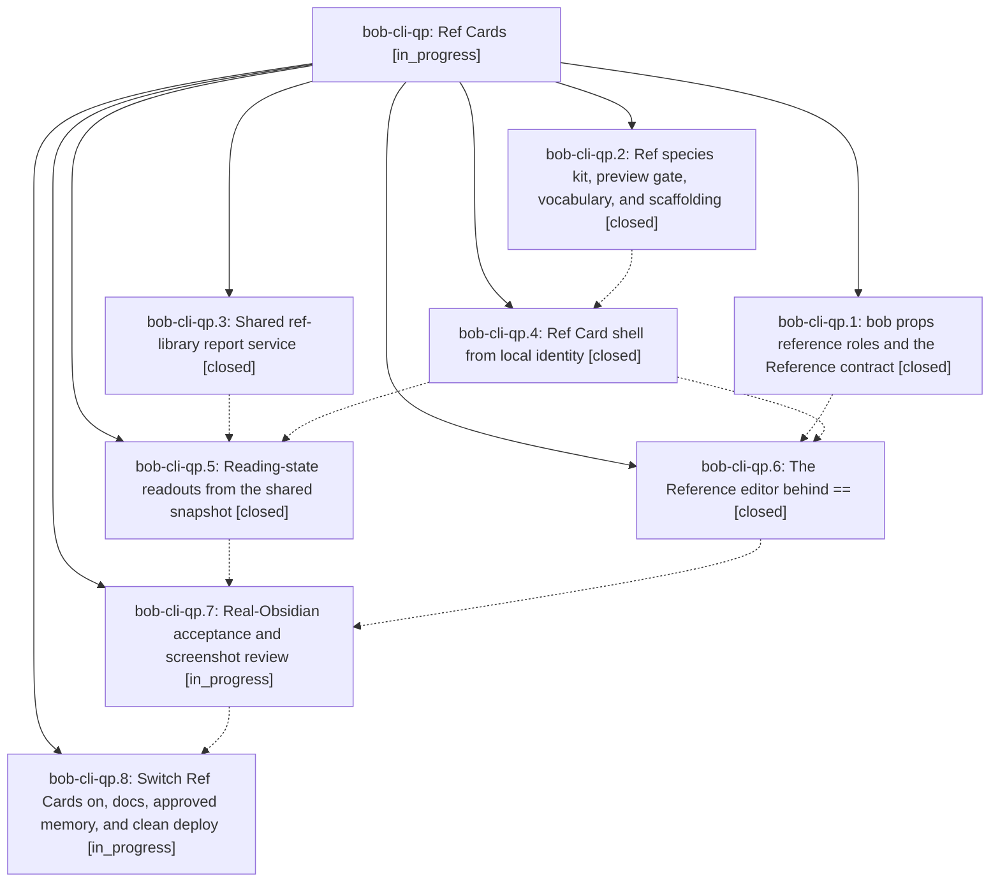

# Bead: bob-cli-qp — Ref Cards

[Bead Pages](../README.md) / bob-cli-qp

**Status:** ◐ in_progress · **Type:** ▸ plan · **Tier:** epic
**Owner:** `bryanbugyi34@gmail.com` · **Created by:** [bbugyi200.apollo.research.6l.linker.w0](https://github.com/bobs-org/bob-cli--agents/blob/main/sessions/bbugyi200.apollo.research.6l.linker.w0.md) · **Assignee:** `bob-cli-qp.land`
**Created:** 2026-11-26 14:22:07 EST
**Plan:** [202611/ref\_cards.md](https://github.com/bobs-org/bob-cli--plans/blob/main/202611/ref_cards.md)

<!-- sase:links:start -->

## Links

| Relation | Artifact | Why |
| --- | --- | --- |
| implemented-by | [plan:202611/ref_cards.md][1] | derived from the plan's `bead_id:` frontmatter field |

_Plus 8 automatic references — see [Referenced By](#referenced-by)._

[1]: https://github.com/bobs-org/bob-cli--plans/blob/main/202611/ref_cards.md

<!-- sase:links:end -->

## Description

Every library reference note opens on a calm, information-dense Ref Card in the Property Card family. The card answers what the reference is, where it came from, where Bryan is with it, and what useful material it holds, and it omits whatever a note lacks. `==` opens a bob-owned Reference editor. bob protects reference sync and identity keys from generic edits. The work ships beside bob-cli-qm and touches it only at named seams.

## Phases

| Bead | Title | Status | Size | Created | Agents | Commits |
|---|---|---|---|---|---:|---:|
| [bob-cli-qp.1](bob-cli-qp.1.md) | bob props reference roles and the Reference contract | ✓ closed | medium | 2026-11-26 | 1 | 1 |
| [bob-cli-qp.2](bob-cli-qp.2.md) | Ref species kit, preview gate, vocabulary, and scaffolding | ✓ closed | medium | 2026-11-26 | 1 | 1 |
| [bob-cli-qp.3](bob-cli-qp.3.md) | Shared ref-library report service | ✓ closed | medium | 2026-11-26 | 1 | 1 |
| [bob-cli-qp.4](bob-cli-qp.4.md) | Ref Card shell from local identity | ✓ closed | medium | 2026-11-26 | 1 | 1 |
| [bob-cli-qp.5](bob-cli-qp.5.md) | Reading-state readouts from the shared snapshot | ✓ closed | medium | 2026-11-26 | 1 | 1 |
| [bob-cli-qp.6](bob-cli-qp.6.md) | The Reference editor behind == | ✓ closed | medium | 2026-11-26 | 1 | 1 |
| [bob-cli-qp.7](bob-cli-qp.7.md) | Real-Obsidian acceptance and screenshot review | ◐ in_progress | medium | 2026-11-26 | 1 | 2 |
| [bob-cli-qp.8](bob-cli-qp.8.md) | Switch Ref Cards on, docs, approved memory, and clean deploy | ◐ in_progress | medium | 2026-11-26 | 1 | 0 |

## Lineage

## Agents

| Agent | Bead | Commits |
|---|---|---:|
| [bbugyi200.apollo.bob-cli-qp.1](https://github.com/bobs-org/bob-cli--agents/blob/main/sessions/bbugyi200.apollo.bob-cli-qp.1.md) | [bob-cli-qp.1](bob-cli-qp.1.md) | 1 |
| [bbugyi200.apollo.bob-cli-qp.2](https://github.com/bobs-org/bob-cli--agents/blob/main/agents/bbugyi200.apollo.bob-cli-qp.2/README.md) | [bob-cli-qp.2](bob-cli-qp.2.md) | 1 |
| [bbugyi200.apollo.bob-cli-qp.3](https://github.com/bobs-org/bob-cli--agents/blob/main/agents/bbugyi200.apollo.bob-cli-qp.3/README.md) | [bob-cli-qp.3](bob-cli-qp.3.md) | 1 |
| [bbugyi200.apollo.bob-cli-qp.4](https://github.com/bobs-org/bob-cli--agents/blob/main/agents/bbugyi200.apollo.bob-cli-qp.4/README.md) | [bob-cli-qp.4](bob-cli-qp.4.md) | 1 |
| [bbugyi200.apollo.bob-cli-qp.5](https://github.com/bobs-org/bob-cli--agents/blob/main/agents/bbugyi200.apollo.bob-cli-qp.5/README.md) | [bob-cli-qp.5](bob-cli-qp.5.md) | 1 |
| [bbugyi200.apollo.bob-cli-qp.6](https://github.com/bobs-org/bob-cli--agents/blob/main/agents/bbugyi200.apollo.bob-cli-qp.6/README.md) | [bob-cli-qp.6](bob-cli-qp.6.md) | 1 |
| [bbugyi200.apollo.bob-cli-qp.7](https://github.com/bobs-org/bob-cli--agents/blob/main/sessions/bbugyi200.apollo.bob-cli-qp.7.md) | [bob-cli-qp.7](bob-cli-qp.7.md) | 2 |
| [bbugyi200.apollo.bob-cli-qp.8](https://github.com/bobs-org/bob-cli--agents/blob/main/agents/bbugyi200.apollo.bob-cli-qp.8/README.md) | [bob-cli-qp.8](bob-cli-qp.8.md) | 0 |
| [bbugyi200.apollo.bob-cli-qp.land](https://github.com/bobs-org/bob-cli--agents/blob/main/agents/bbugyi200.apollo.bob-cli-qp.land/README.md) | [bob-cli-qp](README.md) | 0 |

## Commits

| Repo | Commit | Subject | Bead | Committed |
|---|---|---|---|---|
| bob-plugins | [`bob-plugins@b021aff`](https://github.com/bobs-org/bob-plugins/commit/b021aff56b293e8da928dca440f99ae4b99ad1d6) | feat(ledger-tools): add Ref Card kit, preview gate, vocabulary, and scaffolding | [bob-cli-qp.2](bob-cli-qp.2.md) | 2026-11-26 14:53:45 EST |
| bob-plugins | [`bob-plugins@6045168`](https://github.com/bobs-org/bob-plugins/commit/6045168fd586c71cb7cd98d94809cbabdb505838) | feat(ref-card): add shared report service | [bob-cli-qp.3](bob-cli-qp.3.md) | 2026-11-26 15:26:58 EST |
| bob-plugins | [`bob-plugins@cb847f2`](https://github.com/bobs-org/bob-plugins/commit/cb847f20ad011cd6357d8aa1924dac3d53e8fafd) | feat(ref-card): implement local identity shell | [bob-cli-qp.4](bob-cli-qp.4.md) | 2026-11-26 15:46:38 EST |
| bob-cli | [`0846b03`](https://github.com/bobs-org/bob-cli/commit/0846b0381e05d8abbb5a42669cbe5ca73be12056) | feat(props): add Reference contract and roles | [bob-cli-qp.1](bob-cli-qp.1.md) | 2026-11-26 16:10:25 EST |
| bob-plugins | [`bob-plugins@0d8ccd6`](https://github.com/bobs-org/bob-plugins/commit/0d8ccd662ba098449af1ec39907da7bd35e037ee) | feat(ref-card): add reading-state readouts to ref note cards | [bob-cli-qp.5](bob-cli-qp.5.md) | 2026-11-26 16:16:35 EST |
| bob-plugins | [`bob-plugins@f62a43e`](https://github.com/bobs-org/bob-plugins/commit/f62a43ec653018cd2536579b22b6e85a33d5e4d1) | feat(ref-card): open the Reference editor behind == | [bob-cli-qp.6](bob-cli-qp.6.md) | 2026-11-26 16:57:25 EST |
| bob-plugins | [`bob-plugins@d32d7a9`](https://github.com/bobs-org/bob-plugins/commit/d32d7a9823b0fcdca753c8dce8f714c479a7c238) | test(ref-card): add native acceptance review harness | [bob-cli-qp.7](bob-cli-qp.7.md) | 2026-11-26 18:22:23 EST |
| bob-plugins | [`bob-plugins@880ee82`](https://github.com/bobs-org/bob-plugins/commit/880ee823efd98f3f2507b2624de84a508ea24d10) | test(ref-card): capture native launch diagnostics | [bob-cli-qp.7](bob-cli-qp.7.md) | 2026-11-26 19:38:43 EST |

<!-- sase:referenced-by:start -->

## Referenced By

| Relation | Artifact | Why | Uses |
| --- | --- | --- | ---: |
| read-by | [agent:bob-cli-qp.2][1] | Need epic scope for phase qp.2 | 1 |
| read-by | [agent:bob-cli-qp.5][2] | Need epic scope | 1 |
| read-by | [agent:research.6m.cdx][3] | Research independent cabinet implementation and overlap with active epics | 1 |
| read-by | [agent:research.6m.cld][4] | Assess coordination with cabinets research | 1 |
| read-by | [agent:research.6m.final][5] | Refresh epic phase snapshot for consolidated cabinets research | 4 |
| read-by | [agent:research.6m.gem][6] | Understand active epic scope, files, and status for parallel cabinet implementation analysis | 1 |
| read-by | [agent:research.6m.grk][7] | Cite sibling epic scope and out-of-scope catalog work before recommending a cabinets epic | 2 |
| read-by | [agent:research.6m.mus][8] | Research cabinet design parallel coordination with in-progress epics | 1 |

[1]: https://github.com/bobs-org/bob-cli--agents/blob/main/agents/bbugyi200.apollo.bob-cli-qp.2/README.md
[2]: https://github.com/bobs-org/bob-cli--agents/blob/main/agents/bbugyi200.apollo.bob-cli-qp.5/README.md
[3]: https://github.com/bobs-org/bob-cli--agents/blob/main/agents/bbugyi200.apollo.research.6m.cdx/README.md
[4]: https://github.com/bobs-org/bob-cli--agents/blob/main/agents/bbugyi200.apollo.research.6m.cld/README.md
[5]: https://github.com/bobs-org/bob-cli--agents/blob/main/agents/bbugyi200.apollo.research.6m.final/README.md
[6]: https://github.com/bobs-org/bob-cli--agents/blob/main/agents/bbugyi200.apollo.research.6m.gem/README.md
[7]: https://github.com/bobs-org/bob-cli--agents/blob/main/agents/bbugyi200.apollo.research.6m.grk/README.md
[8]: https://github.com/bobs-org/bob-cli--agents/blob/main/agents/bbugyi200.apollo.research.6m.mus/README.md

<!-- sase:referenced-by:end -->
