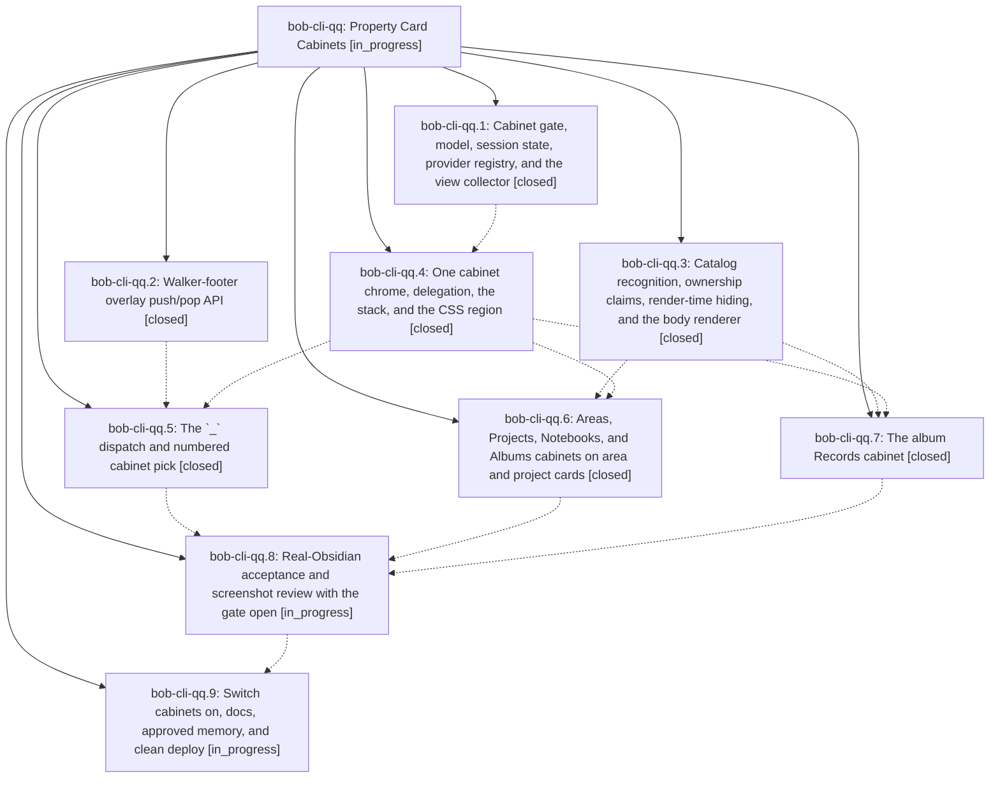

# Bead: bob-cli-qq — Property Card Cabinets

[Bead Pages](../README.md) / bob-cli-qq

**Status:** ◐ in_progress · **Type:** ▸ plan · **Tier:** epic
**Owner:** `bryanbugyi34@gmail.com` · **Created by:** [bbugyi200.apollo.research.6m.linker.w0](https://github.com/bobs-org/bob-cli--agents/blob/main/sessions/bbugyi200.apollo.research.6m.linker.w0.md) · **Assignee:** `bob-cli-qq.land`
**Created:** 2026-11-26 16:09:02 EST
**Plan:** [202611/property\_card\_cabinets.md](https://github.com/bobs-org/bob-cli--plans/blob/main/202611/property_card_cabinets.md)

<!-- sase:links:start -->

## Links

| Relation | Artifact | Why |
| --- | --- | --- |
| implemented-by | [plan:202611/property_card_cabinets.md][1] | derived from the plan's `bead_id:` frontmatter field |

_Plus 3 automatic references — see [Referenced By](#referenced-by)._

[1]: https://github.com/bobs-org/bob-cli--plans/blob/main/202611/property_card_cabinets.md

<!-- sase:links:end -->

## Description

Child areas, sub-projects, notebooks, albums, and album records open as collapsible cabinets at the bottom of their note's Property Card. Each cabinet shows exactly the data its H2 section showed. Album Schema and bank Setup move into the same chrome as a restyled Properties cabinet, and `_` becomes a numbered, cancel-safe cabinet pick. The stored catalogs stay bob-owned Markdown, and nothing in bob-cli, the release train, or Bob Mac Capture changes. The work lands dark beside bob-cli-qj, bob-cli-qm, and bob-cli-qp and switches on only after the sibling go-lives it would race.

## Phases

| Bead | Title | Status | Size | Created | Agents | Commits |
|---|---|---|---|---|---:|---:|
| [bob-cli-qq.1](bob-cli-qq.1.md) | Cabinet gate, model, session state, provider registry, and the view collector | ✓ closed | medium | 2026-11-26 | 1 | 1 |
| [bob-cli-qq.2](bob-cli-qq.2.md) | Walker-footer overlay push/pop API | ✓ closed | small | 2026-11-26 | 1 | 1 |
| [bob-cli-qq.3](bob-cli-qq.3.md) | Catalog recognition, ownership claims, render-time hiding, and the body renderer | ✓ closed | medium | 2026-11-26 | 1 | 1 |
| [bob-cli-qq.4](bob-cli-qq.4.md) | One cabinet chrome, delegation, the stack, and the CSS region | ✓ closed | medium | 2026-11-26 | 1 | 1 |
| [bob-cli-qq.5](bob-cli-qq.5.md) | The \`\_\` dispatch and numbered cabinet pick | ✓ closed | medium | 2026-11-26 | 1 | 1 |
| [bob-cli-qq.6](bob-cli-qq.6.md) | Areas, Projects, Notebooks, and Albums cabinets on area and project cards | ✓ closed | medium | 2026-11-26 | 1 | 1 |
| [bob-cli-qq.7](bob-cli-qq.7.md) | The album Records cabinet | ✓ closed | medium | 2026-11-26 | 1 | 1 |
| [bob-cli-qq.8](bob-cli-qq.8.md) | Real-Obsidian acceptance and screenshot review with the gate open | ◐ in_progress | medium | 2026-11-26 | 1 | 7 |
| [bob-cli-qq.9](bob-cli-qq.9.md) | Switch cabinets on, docs, approved memory, and clean deploy | ◐ in_progress | medium | 2026-11-26 | 1 | 0 |

## Lineage

## Agents

| Agent | Bead | Commits |
|---|---|---:|
| [bbugyi200.apollo.bob-cli-qq.1](https://github.com/bobs-org/bob-cli--agents/blob/main/sessions/bbugyi200.apollo.bob-cli-qq.1.md) | [bob-cli-qq.1](bob-cli-qq.1.md) | 1 |
| [bbugyi200.apollo.bob-cli-qq.2](https://github.com/bobs-org/bob-cli--agents/blob/main/sessions/bbugyi200.apollo.bob-cli-qq.2.md) | [bob-cli-qq.2](bob-cli-qq.2.md) | 1 |
| [bbugyi200.apollo.bob-cli-qq.3](https://github.com/bobs-org/bob-cli--agents/blob/main/agents/bbugyi200.apollo.bob-cli-qq.3/README.md) | [bob-cli-qq.3](bob-cli-qq.3.md) | 1 |
| [bbugyi200.apollo.bob-cli-qq.4](https://github.com/bobs-org/bob-cli--agents/blob/main/sessions/bbugyi200.apollo.bob-cli-qq.4.md) | [bob-cli-qq.4](bob-cli-qq.4.md) | 1 |
| [bbugyi200.apollo.bob-cli-qq.5](https://github.com/bobs-org/bob-cli--agents/blob/main/agents/bbugyi200.apollo.bob-cli-qq.5/README.md) | [bob-cli-qq.5](bob-cli-qq.5.md) | 1 |
| [bbugyi200.apollo.bob-cli-qq.6](https://github.com/bobs-org/bob-cli--agents/blob/main/agents/bbugyi200.apollo.bob-cli-qq.6/README.md) | [bob-cli-qq.6](bob-cli-qq.6.md) | 1 |
| [bbugyi200.apollo.bob-cli-qq.7](https://github.com/bobs-org/bob-cli--agents/blob/main/agents/bbugyi200.apollo.bob-cli-qq.7/README.md) | [bob-cli-qq.7](bob-cli-qq.7.md) | 1 |
| [bbugyi200.apollo.bob-cli-qq.8](https://github.com/bobs-org/bob-cli--agents/blob/main/sessions/bbugyi200.apollo.bob-cli-qq.8.md) | [bob-cli-qq.8](bob-cli-qq.8.md) | 7 |
| [bbugyi200.apollo.bob-cli-qq.9](https://github.com/bobs-org/bob-cli--agents/blob/main/agents/bbugyi200.apollo.bob-cli-qq.9/README.md) | [bob-cli-qq.9](bob-cli-qq.9.md) | 0 |
| [bbugyi200.apollo.bob-cli-qq.land](https://github.com/bobs-org/bob-cli--agents/blob/main/agents/bbugyi200.apollo.bob-cli-qq.land/README.md) | [bob-cli-qq](README.md) | 0 |

## Commits

| Repo | Commit | Subject | Bead | Committed |
|---|---|---|---|---|
| bob-plugins | [`bob-plugins@c0a5c4d`](https://github.com/bobs-org/bob-plugins/commit/c0a5c4dd4dfa21eebf778834c464ae8e58b9a47f) | feat(ledger): add walker-footer overlay API | [bob-cli-qq.2](bob-cli-qq.2.md) | 2026-11-26 16:21:24 EST |
| bob-plugins | [`bob-plugins@1e29d7c`](https://github.com/bobs-org/bob-plugins/commit/1e29d7ce681c5e83db4cccdd028d292153957815) | feat(cabinets): add catalog absorption kit (bob-cli-qq.3) | [bob-cli-qq.3](bob-cli-qq.3.md) | 2026-11-26 16:40:14 EST |
| bob-plugins | [`bob-plugins@9c1123b`](https://github.com/bobs-org/bob-plugins/commit/9c1123bdf6c224d1e5cefa54ad5e5135070a907e) | feat(cabinets): add gated cabinet kit and view state | [bob-cli-qq.1](bob-cli-qq.1.md) | 2026-11-26 17:08:09 EST |
| bob-plugins | [`bob-plugins@9527ee1`](https://github.com/bobs-org/bob-plugins/commit/9527ee14e2fa4193bdd3fbc9d85017094f39ef90) | feat(ledger-tools): add cabinet plugin features and refresh docs inventory | [bob-cli-qq.4](bob-cli-qq.4.md) | 2026-11-26 20:42:29 EST |
| bob-plugins | [`bob-plugins@5e2c0bd`](https://github.com/bobs-org/bob-plugins/commit/5e2c0bd54aaeb8c6fe4012f36277f0ace0fb0bde) | feat(cabinets): add numbered cabinet pick and \_ dispatch | [bob-cli-qq.5](bob-cli-qq.5.md) | 2026-11-26 20:54:14 EST |
| bob-plugins | [`bob-plugins@6cb79d7`](https://github.com/bobs-org/bob-plugins/commit/6cb79d73bc0602ea6d5f8902783c16b7e1683912) | feat(cabinets): add the album Records cabinet | [bob-cli-qq.7](bob-cli-qq.7.md) | 2026-11-26 21:05:14 EST |
| bob-plugins | [`bob-plugins@a4bd99f`](https://github.com/bobs-org/bob-plugins/commit/a4bd99f27b1980539e7ebedf87e39c4897670f26) | feat(cabinets): add host catalog providers | [bob-cli-qq.6](bob-cli-qq.6.md) | 2026-11-26 21:46:47 EST |
| bob-plugins | [`bob-plugins@7e0ba56`](https://github.com/bobs-org/bob-plugins/commit/7e0ba5695e86ea88c4f103e682c38e342f43a701) | test(cabinets): add real Obsidian acceptance runner | [bob-cli-qq.8](bob-cli-qq.8.md) | 2026-11-26 22:14:41 EST |
| bob-plugins | [`bob-plugins@18e6cb9`](https://github.com/bobs-org/bob-plugins/commit/18e6cb9980eb028d04f8841fea9f0cd2ac85d207) | test(cabinets): retain failed real-Obsidian acceptance evidence | [bob-cli-qq.8](bob-cli-qq.8.md) | 2026-11-26 22:48:25 EST |
| bob-plugins | [`bob-plugins@bd1af86`](https://github.com/bobs-org/bob-plugins/commit/bd1af8607014226cc86b75845c5739032295643a) | fix(cabinets): add report fixtures and record properties stack | [bob-cli-qq.8](bob-cli-qq.8.md) | 2026-11-26 23:24:11 EST |
| bob-plugins | [`bob-plugins@66667b1`](https://github.com/bobs-org/bob-plugins/commit/66667b1c224fd2403f0ac7ceb9d46850d091441e) | test(cabinets): preserve attempt 4 report and attempt 5 launcher | [bob-cli-qq.8](bob-cli-qq.8.md) | 2026-11-26 23:38:01 EST |
| bob-plugins | [`bob-plugins@f279186`](https://github.com/bobs-org/bob-plugins/commit/f279186d37b5cad0054cec52bfb1e9b85d0e5f4e) | fix(cabinets): preserve Obsidian startup diagnostics | [bob-cli-qq.8](bob-cli-qq.8.md) | 2026-11-26 23:50:30 EST |
| bob-plugins | [`bob-plugins@e9f0c07`](https://github.com/bobs-org/bob-plugins/commit/e9f0c0703a8b10576663374883e2bb4b0ad277c2) | fix(cabinets-e2e): isolate Xvfb temporary storage | [bob-cli-qq.8](bob-cli-qq.8.md) | 2026-11-27 00:16:24 EST |
| bob-plugins | [`bob-plugins@c476086`](https://github.com/bobs-org/bob-plugins/commit/c476086a9a7135ad944993ed9ea0d715ec3fcddd) | fix(cabinets): repair acceptance fixtures and narrow bank layout | [bob-cli-qq.8](bob-cli-qq.8.md) | 2026-11-27 00:57:29 EST |

<!-- sase:referenced-by:start -->

## Referenced By

| Relation | Artifact | Why | Uses |
| --- | --- | --- | ---: |
| read-by | [agent:bob-cli-qq.5][1] | Need epic scope for phase qq.5 | 1 |
| read-by | [agent:bob-cli-qq.7][2] | need epic scope and sibling repo info | 2 |
| read-by | [agent:bob-cli-qq.8--3][3] | Confirm the parent bead scope and preserve its status as requested | 1 |

[1]: https://github.com/bobs-org/bob-cli--agents/blob/main/agents/bbugyi200.apollo.bob-cli-qq.5/README.md
[2]: https://github.com/bobs-org/bob-cli--agents/blob/main/agents/bbugyi200.apollo.bob-cli-qq.7/README.md
[3]: https://github.com/bobs-org/bob-cli--agents/blob/main/sessions/bbugyi200.apollo.bob-cli-qq.8.md

<!-- sase:referenced-by:end -->
