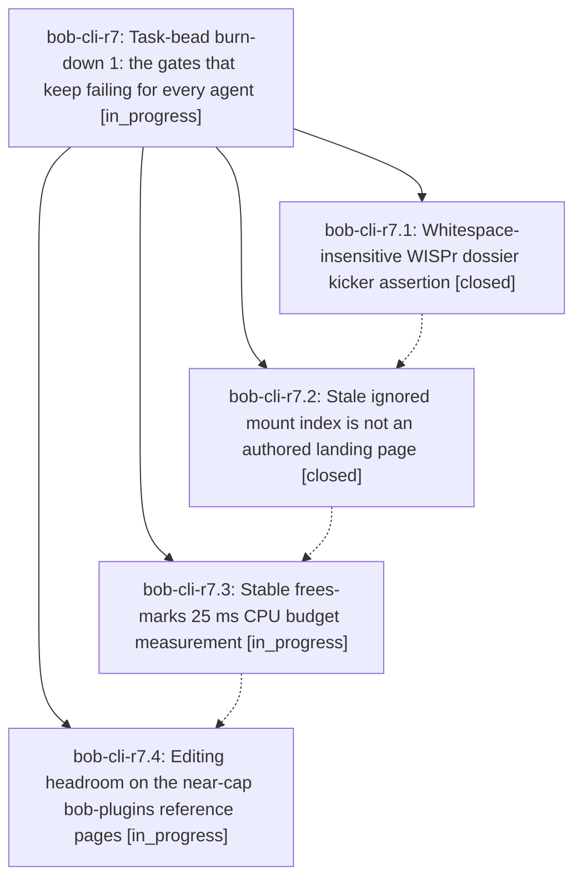

# Bead: bob-cli-r7 — Task-bead burn-down 1: the gates that keep failing for every agent

[Bead Pages](../README.md) / bob-cli-r7

**Status:** ◐ in_progress · **Type:** ▸ plan · **Tier:** epic
**Owner:** `bryanbugyi34@gmail.com` · **Created by:** [bbugyi200.athena.1h4](https://github.com/bobs-org/bob-cli--agents/blob/main/sessions/bbugyi200.athena.1h4.md) · **Assignee:** `bob-cli-r7.land`
**Created:** 2026-11-27 10:16:12 EST
**Plan:** [202611/task\_bead\_burndown\_1.md](https://github.com/bobs-org/bob-cli--plans/blob/main/202611/task_bead_burndown_1.md)

<!-- sase:links:start -->

## Links

| Relation | Artifact | Why |
| --- | --- | --- |
| implemented-by | [plan:202611/task_bead_burndown_1.md][1] | derived from the plan's `bead_id:` frontmatter field |

_Plus 1 automatic references — see [Referenced By](#referenced-by)._

[1]: https://github.com/bobs-org/bob-cli--plans/blob/main/202611/task_bead_burndown_1.md

<!-- sase:links:end -->

## Description

The five open task beads that most often turn agents' check runs red for reasons unrelated to their work are fixed and closed. The lander triages what is left and proposes the next five-bead epic under the same rules, and the chain continues until no open task beads remain.

## Phases

| Bead | Title | Status | Size | Created | Agents | Commits |
|---|---|---|---|---|---:|---:|
| [bob-cli-r7.1](bob-cli-r7.1.md) | Whitespace-insensitive WISPr dossier kicker assertion | ✓ closed | small | 2026-11-27 | 1 | 1 |
| [bob-cli-r7.2](bob-cli-r7.2.md) | Stale ignored mount index is not an authored landing page | ✓ closed | small | 2026-11-27 | 1 | 1 |
| [bob-cli-r7.3](bob-cli-r7.3.md) | Stable frees-marks 25 ms CPU budget measurement | ◐ in_progress | medium | 2026-11-27 | 1 | 0 |
| [bob-cli-r7.4](bob-cli-r7.4.md) | Editing headroom on the near-cap bob-plugins reference pages | ◐ in_progress | medium | 2026-11-27 | 1 | 0 |

## Lineage

## Agents

| Agent | Bead | Commits |
|---|---|---:|
| [bbugyi200.athena.bob-cli-r7.1](https://github.com/bobs-org/bob-cli--agents/blob/main/agents/bbugyi200.athena.bob-cli-r7.1/README.md) | [bob-cli-r7.1](bob-cli-r7.1.md) | 1 |
| [bbugyi200.athena.bob-cli-r7.2](https://github.com/bobs-org/bob-cli--agents/blob/main/sessions/bbugyi200.athena.bob-cli-r7.2.md) | [bob-cli-r7.2](bob-cli-r7.2.md) | 1 |
| [bbugyi200.athena.bob-cli-r7.3](https://github.com/bobs-org/bob-cli--agents/blob/main/agents/bbugyi200.athena.bob-cli-r7.3/README.md) | [bob-cli-r7.3](bob-cli-r7.3.md) | 0 |
| [bbugyi200.athena.bob-cli-r7.4](https://github.com/bobs-org/bob-cli--agents/blob/main/agents/bbugyi200.athena.bob-cli-r7.4/README.md) | [bob-cli-r7.4](bob-cli-r7.4.md) | 0 |
| [bbugyi200.athena.bob-cli-r7.land](https://github.com/bobs-org/bob-cli--agents/blob/main/agents/bbugyi200.athena.bob-cli-r7.land/README.md) | [bob-cli-r7](README.md) | 0 |

## Commits

| Repo | Commit | Subject | Bead | Committed |
|---|---|---|---|---|
| bob-cli | [`2671238`](https://github.com/bobs-org/bob-cli/commit/26712382e5f1e6a38e9b819c0e4e1dc1470aa111) | fix(meetings): whitespace-insensitive WISPr dossier kicker assertion | [bob-cli-r7.1](bob-cli-r7.1.md) | 2026-11-27 10:34:57 EST |
| bob-cli | [`1878531`](https://github.com/bobs-org/bob-cli/commit/187853158344f2978486c3d0164b4fe6f7040fd1) | fix(docs): replace stale gitignored mount copies instead of treating them as authored | [bob-cli-r7.2](bob-cli-r7.2.md) | 2026-11-27 11:24:24 EST |

<!-- sase:referenced-by:start -->

## Referenced By

| Relation | Artifact | Why | Uses |
| --- | --- | --- | ---: |
| read-by | [agent:bob-cli-r7.1][1] | epic context | 1 |

[1]: https://github.com/bobs-org/bob-cli--agents/blob/main/agents/bbugyi200.athena.bob-cli-r7.1/README.md

<!-- sase:referenced-by:end -->
