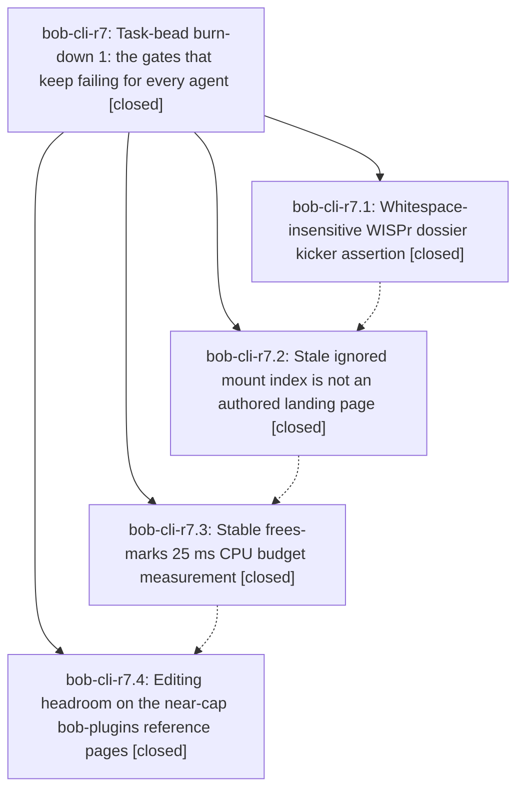

# Bead: bob-cli-r7 — Task-bead burn-down 1: the gates that keep failing for every agent

[Bead Pages](../README.md) / bob-cli-r7

**Status:** ✓ closed · **Resolution:** done · **Type:** ▸ plan · **Tier:** epic
**Owner:** `bryanbugyi34@gmail.com` · **Created by:** [bbugyi200.athena.1h4](https://github.com/bobs-org/bob-cli--agents/blob/main/sessions/bbugyi200.athena.1h4.md) · **Assignee:** `bob-cli-r7.land`
**Created:** 2026-11-27 10:16:12 EST · **Closed:** 2026-11-27 12:54:51 EST
**Plan:** [202611/task\_bead\_burndown\_1.md](https://github.com/bobs-org/bob-cli--plans/blob/main/202611/task_bead_burndown_1.md)

<!-- sase:links:start -->

## Links

| Relation | Artifact | Why |
| --- | --- | --- |
| implemented-by | [plan:202611/task_bead_burndown_1.md][1] | derived from the plan's `bead_id:` frontmatter field |

_Plus 1 automatic references — see [Referenced By](#referenced-by)._

[1]: https://github.com/bobs-org/bob-cli--plans/blob/main/202611/task_bead_burndown_1.md

<!-- sase:links:end -->

## Description

The five open task beads that most often turn agents' check runs red for reasons unrelated to their work are fixed and closed. The lander triages what is left and proposes the next five-bead epic under the same rules, and the chain continues until no open task beads remain.

## Notes

[2026-11-27T17:54:51Z · bob-cli-r7.land] Landed and verified on bob-cli 7213dd89 and bob-plugins 4dd95d52 (both = origin/master).

STEP 1 VERIFY. All four phases closed; every child note was addressed.
- r7.1 wispr-kicker 26712382: profile.rs compares the whitespace-stripped text against MEETINGNOTES and still prints the raw text on failure; no other assertion or the LetterSpace print profile changed. Rerun: cargo test --lib -- wispr_summary passes (1 passed). bob-cli-q9 closed.
- r7.2 docs-mount-index 18785315: mounts.py _is_authored_page lets an untracked, gitignored, unmanifested source-hub index (and per-file copy) be replaced; tracked or non-ignored pages still refuse. New tests: test_stale_ignored_untracked_source_hub_index_is_replaced and test_tracked_unmanifested_source_hub_index_is_rejected. Rerun: tools/docs pytest 449 passed, 1 skipped; BOB_DOCS_BOB_PLUGINS_DIR=<linked bob-plugins> just docs-check passed. bob-cli-it closed.
- r7.3 frees-marks-budget, bob-plugins 738ad529 (the note's 360dc776 was rebased): uses the shared cpu-work-perf-support sampleCpuWork (3 warmups, best of 7); 25 ms kept, deterministic asserts kept, and a comment explains why the minimum of N measures algorithm cost. Rerun: node --test scripts/test-ledger-tools-frees-marks.cjs 17/17. bob-cli-io closed with best-of-N values.
- r7.4 plugin-docs-headroom, bob-plugins 7de181e4 (docs_headroom=yes honored): no headings removed (anchors preserved). Recounted with bob_docs count_words on the assembled mounts: bob-ledger-tools 5688/6000 (312 under), bob-navigation-hotkeys 5638/6000 (362 under). Both are at least 300 under the cap, and the cap was not raised. Rerun: npm run docs:check passed. The r7.4 deploy concern is gone: bob plugins list shows 12 synced, 0 drift (bob-ledger-tools 1.172.8 synced). bob-cli-ob and bob-cli-il closed.
- No Cargo.toml version or CHANGELOG edits; no contract changes (decisions:bob-cli-releases-ride-a-daily-train).

STEP 2 INTEGRATE. Concurrent commits reviewed: bob-cli a558ce11, 11b0243e, 7213dd89; bob-plugins 1c4266ed, 17a64fab, 951572df, 4dd95d52.
- 951572df and 4dd95d52 edited both headroom pages; the counts above include them.
- The new test-ledger-tools-cabinets-perf.cjs (17a64fab) has no timing budget, so the warm best-of-N helper does not apply.
- No new pdf_text letter-spaced assertions and no mounts.py duplication.
- Nothing to integrate.

FOLLOW-UP TRIAGE
- r7.1 #1 and r7.2 #2 (clippy question_mark at section_model.rs:924, items_after_test_module at relocate.rs:813): DECLINED as already fixed by 18785315. The just check clippy step passes on 7213dd89, and qj.5.1 note #2 already records it.
- r7.3 #1 (bob-plugins test-snooze-model-vectors snooze-add-resnooze-replaces-history): still fails on 4dd95d52. It is caused by active epic bob-cli-q5 (js runner enabled by ee21fdff and planner 143c9ca3, both bob-cli-q5.6.1.1); recorded as a DISCOVERED ISSUE note on bob-cli-q5, no task created.
- Lander discovery: just check on 7213dd89 compiles, but 2 lib tests fail: catalog every_path_resolves_to_a_public_leaf (prose extract) and completion every_value_arg_has_a_decision (prose extract --expect/--line). Both come from a558ce11 (bob-cli-qj.5.1.4) of active epic bob-cli-qj.5.1; recorded as a DISCOVERED ISSUE note on bob-cli-qj.5.1. Not caused by r7.

epic-symbols: none. The justfile has no symvision recipe.

[2026-11-27T17:59:10Z · bob-cli-r7.land] BURN-DOWN CHAIN (per plan 'Landing and the next epic'): 1) bob-cli-q9, -it, -io, -ob, -il all closed with verification notes. 2) Triage on 2026-11-27: 297 open task beads (283 ready, 13 snoozed, 1 open draft). No task bead was filed after the burn-down 1 triage. Only bob-cli-bo (duplicate merge of ca) changed since then. None of the concurrent commits (bob-cli 11b0243e, 7213dd89, a558ce11; bob-plugins 1c4266ed, 17a64fab, 951572df, 4dd95d52) fixes an open bead, so nothing was closed. bob-cli-ny and bob-cli-nc still show snoozed past their wake times. 3) Re-verified next-in-line beads on current master: bob-cli-id (chezmoi bashunit still 2 passed, 2 failed), bob-cli-or and bob-cli-pb (evaluate_guard still skips find_inclusion_proof in the clean arm and gates it on incoming_clean in the dirty arm), bob-cli-qt (the runners still delete scratch only on success), bob-cli-f8 (cold 6,500-note chunk gate; +22, last +1 2026-11-27). bob-cli-6g left out: it is a feature that needs an opt-in decision, and flakes and bugs outrank it. Proposing epic plan 'Task-bead burn-down 2' with phases chezmoi-isolation -> deploy-inclusion-proof -> e2e-scratch -> wikilink-cold-chunk, owning bob-cli-id, -or, -pb, -qt, -f8.

## Phases

| Bead | Title | Status | Size | Created | Agents | Commits |
|---|---|---|---|---|---:|---:|
| [bob-cli-r7.1](bob-cli-r7.1.md) | Whitespace-insensitive WISPr dossier kicker assertion | ✓ closed | small | 2026-11-27 | 1 | 1 |
| [bob-cli-r7.2](bob-cli-r7.2.md) | Stale ignored mount index is not an authored landing page | ✓ closed | small | 2026-11-27 | 1 | 1 |
| [bob-cli-r7.3](bob-cli-r7.3.md) | Stable frees-marks 25 ms CPU budget measurement | ✓ closed | medium | 2026-11-27 | 1 | 1 |
| [bob-cli-r7.4](bob-cli-r7.4.md) | Editing headroom on the near-cap bob-plugins reference pages | ✓ closed | medium | 2026-11-27 | 1 | 1 |

## Lineage

## Agents

| Agent | Bead | Commits |
|---|---|---:|
| [bbugyi200.athena.bob-cli-r7.1](https://github.com/bobs-org/bob-cli--agents/blob/main/agents/bbugyi200.athena.bob-cli-r7.1/README.md) | [bob-cli-r7.1](bob-cli-r7.1.md) | 1 |
| [bbugyi200.athena.bob-cli-r7.2](https://github.com/bobs-org/bob-cli--agents/blob/main/sessions/bbugyi200.athena.bob-cli-r7.2.md) | [bob-cli-r7.2](bob-cli-r7.2.md) | 1 |
| [bbugyi200.athena.bob-cli-r7.3](https://github.com/bobs-org/bob-cli--agents/blob/main/agents/bbugyi200.athena.bob-cli-r7.3/README.md) | [bob-cli-r7.3](bob-cli-r7.3.md) | 1 |
| [bbugyi200.athena.bob-cli-r7.4](https://github.com/bobs-org/bob-cli--agents/blob/main/sessions/bbugyi200.athena.bob-cli-r7.4.md) | [bob-cli-r7.4](bob-cli-r7.4.md) | 1 |
| [bbugyi200.athena.bob-cli-r7.land](https://github.com/bobs-org/bob-cli--agents/blob/main/agents/bbugyi200.athena.bob-cli-r7.land/README.md) | [bob-cli-r7](README.md) | 1 |

## Commits

| Repo | Commit | Subject | Bead | Committed |
|---|---|---|---|---|
| bob-cli | [`2671238`](https://github.com/bobs-org/bob-cli/commit/26712382e5f1e6a38e9b819c0e4e1dc1470aa111) | fix(meetings): whitespace-insensitive WISPr dossier kicker assertion | [bob-cli-r7.1](bob-cli-r7.1.md) | 2026-11-27 10:34:57 EST |
| bob-cli | [`1878531`](https://github.com/bobs-org/bob-cli/commit/187853158344f2978486c3d0164b4fe6f7040fd1) | fix(docs): replace stale gitignored mount copies instead of treating them as authored | [bob-cli-r7.2](bob-cli-r7.2.md) | 2026-11-27 11:24:24 EST |
| bob-plugins | [`bob-plugins@738ad52`](https://github.com/bobs-org/bob-plugins/commit/738ad5293c04856c69ff23ab919213197c11857a) | test(ledger-tools): stabilize frees-marks 25ms budget with warm best-of-7 CPU sampling | [bob-cli-r7.3](bob-cli-r7.3.md) | 2026-11-27 11:35:25 EST |
| bob-plugins | [`bob-plugins@7de181e`](https://github.com/bobs-org/bob-plugins/commit/7de181e4211c2255a3de9efcbe6bc8c5b76f259e) | docs: restore headroom in plugin references | [bob-cli-r7.4](bob-cli-r7.4.md) | 2026-11-27 12:00:12 EST |
| bob-cli--plans | [`bob-cli--plans@a83075d`](https://github.com/bobs-org/bob-cli--plans/commit/a83075df6d59603d7ece778627bed8d32491bc15) | chore(plans): mark task\_bead\_burndown\_1 done after landing bob-cli-r7 | [bob-cli-r7](README.md) | 2026-11-27 13:00:18 EST |

<!-- sase:referenced-by:start -->

## Referenced By

| Relation | Artifact | Why | Uses |
| --- | --- | --- | ---: |
| read-by | [agent:bob-cli-r7.1][1] | epic context | 1 |

[1]: https://github.com/bobs-org/bob-cli--agents/blob/main/agents/bbugyi200.athena.bob-cli-r7.1/README.md

<!-- sase:referenced-by:end -->
