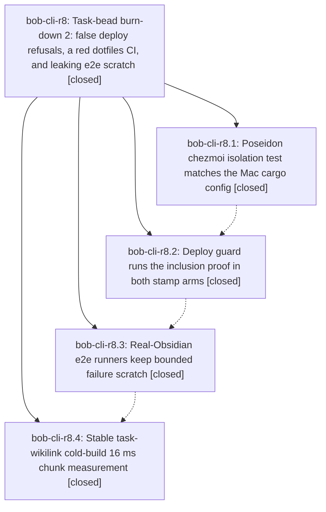

# Bead: bob-cli-r8 — Task-bead burn-down 2: false deploy refusals, a red dotfiles CI, and leaking e2e scratch

[Bead Pages](../README.md) / bob-cli-r8

**Status:** ✓ closed · **Resolution:** done · **Type:** ▸ plan · **Tier:** epic
**Owner:** `bryanbugyi34@gmail.com` · **Created by:** [bbugyi200.athena.bob-cli-r7.land](https://github.com/bobs-org/bob-cli--agents/blob/main/sessions/bbugyi200.athena.bob-cli-r7.land.md) · **Assignee:** `bob-cli-r8.land`
**Created:** 2026-11-27 13:01:15 EST · **Closed:** 2026-11-27 15:28:49 EST
**Plan:** [202611/task\_bead\_burndown\_2.md](https://github.com/bobs-org/bob-cli--plans/blob/main/202611/task_bead_burndown_2.md)

<!-- sase:links:start -->

## Links

| Relation | Artifact | Why |
| --- | --- | --- |
| implemented-by | [plan:202611/task_bead_burndown_2.md][1] | derived from the plan's `bead_id:` frontmatter field |

_Plus 2 automatic references — see [Referenced By](#referenced-by)._

[1]: https://github.com/bobs-org/bob-cli--plans/blob/main/202611/task_bead_burndown_2.md

<!-- sase:links:end -->

## Description

The five open task beads that now cost agents the most time are fixed and closed: the chezmoi isolation test that fails every dotfiles push, the two deploy-guard arms that falsely refuse plugin syncs, the real-Obsidian e2e runners that fill athena's /tmp, and the most-reported bob-plugins perf flake. The lander triages what is left and proposes the next five-bead epic under the same rules, and the chain continues until no open task beads remain.

## Notes

[2026-11-27T20:22:24Z · bob-cli-r8.land] LAND FOLLOW-UP TRIAGE: All notes on r8.1-r8.4 read; no PROPOSED FOLLOW-UP entries. The already-recorded prose check failures remain owned by qj.5.1 and the snooze vector by q5; no duplicate tasks. Exact chezmoi phase SHA 662569a34eb9209baa03e4cc50d32356ee2c7a08 CI 46047534127 passed lint and repaired poseidon cases but failed ssh_clip_doctor SIGINT (130 expected, 0 actual). Prior CI 45910998866 reproduces on d4cb694c before r8. Local focused test passes normally and deterministically fails with inherited SIGINT=SIG_IGN. After all-status duplicate search, past-week sweep, and active-epic causal review, filed small CI task bob-cli-rd, linked to bob-cli-id, ready. This unrelated CI failure is not remaining r8 implementation work; do not claim the overall chezmoi CI run is green. The next burn-down must prioritize it.

[2026-11-27T20:23:39Z · bob-cli-r8.land] INTEGRATION AUDIT: source and diffs reviewed for chezmoi 662569a3, bob-cli dbdc7d24, bob-plugins ce4cb692/6827a275/4eb201ec. Since epic start, bob-cli prose inline/docs (eff5d986,d856be45), dependency docs (6f12dd0d), and blocked marks docs (cbbddc71) do not alter deploy guard behavior. Plugin tie-chord dd9ecff1, cabinet paint cb314726, prose gestures c2f73154/07c4eeb4, and priority bars 937455ff coexist with the helper and tests; package.json includes all added tests, serial test:perf still owns wikilink timing, and the block-marks runner changes do not introduce success-only scratch cleanup. No integration source edit needed. Release decision honored: no r8 Cargo.toml version, CHANGELOG, or JSON shape/exit-code change. Fresh focused checks: poseidon 4/4 (17 assertions), scratch 4/4, wikilink 5/5 (cold chunk 10.76ms, cold build 98.3ms). Live bob plugins sync --no-pull --dry-run from linked checkout reports ok=true, 12 plugins, no refusal. just check stopped on the known qj.5.1 prose Clippy errors; owner corroborated. qt was never closed by r8.3; now closed with commit and reviewed two-run acceptance evidence. No epic-symbol entries; no symvision recipe in bob-cli justfile.

[2026-11-27T20:27:01Z · bob-cli-r8.land] BACKLOG TRIAGE: Current open-task inventory is 294 (280 ready, 13 snoozed, 1 draft) after closing qt and filing rd. Reviewed the only new pre-existing task since epic start, r9: source still probes a body-less project-note draft without the refusal, so KEEP; type-leads rb was planned after that discovery and is not its cause. Reviewed updated-task inventory and post-start commits; no additional obsolete/duplicate close is supported. nc and ny retain snoozed status despite elapsed wake dates. Validated the next independent five-task epic (rd, 5l, oh, qa, qx), with strictly sequential small/medium phases. Prioritized the demonstrated CI signal failure, recurring executable-stub races, two capture identity panics, and merchant normalization. Kept mv for a separate safe provenance design and cd for coordinated multi-host vault untracking; do not weaken the deploy guard or perform one-host untracking. No child plan or parent handoff is needed for r8.

[2026-11-27T20:28:49Z · bob-cli-r8.land] Verified the epic plan, every r8.1-r8.4 note, source, and commits: chezmoi 662569a3, bob-cli dbdc7d24, bob-plugins ce4cb692/6827a275/4eb201ec. All four phases and all five target tasks are closed; this landing supplied the omitted qt close using phase acceptance evidence plus fresh helper tests. Release decision and unchanged CLI/JSON contracts confirmed. Reviewed all non-epic changes since start in all three repos: prose conversion/docs, tie chords, cabinet Reading paint, and Blocked priority bars need no source integration; package test registrations coexist and no new success-only scratch path was introduced. Fresh verification: poseidon bashunit 4/4 (17 assertions); scratch helper 4/4; wikilink perf 5/5 (10.76ms chunk, 98.3ms build); cargo test --lib -- native::plugins 65/65; cargo test --test cli plugins:: 36/36; live sync dry-run ok, 12 plugins, no refusal; diff checks clean. just check ToolRun 5787740ee74cb5105608f1e11247e2e2 passed fmt and stopped on known prose inline Clippy errors, corroborated on owning qj.5.1. Exact chezmoi CI 46047534127 is not green: repaired tests and lint pass, unrelated SIGINT case fails as it did before r8; filed ready small CI task rd with reproducible signal-disposition evidence and related id link. No PROPOSED FOLLOW-UP entries; known prose and snooze failures remain with qj.5.1 and q5, no duplicates. Backlog triage kept 294 tasks (280 ready, 13 snoozed, 1 draft); next independent five-task epic rd/5l/oh/qa/qx validated for proposal. No epic-symbol entries, no symvision recipe, no parent bead. No force used.

## Phases

| Bead | Title | Status | Size | Created | Agents | Commits |
|---|---|---|---|---|---:|---:|
| [bob-cli-r8.1](bob-cli-r8.1.md) | Poseidon chezmoi isolation test matches the Mac cargo config | ✓ closed | small | 2026-11-27 | 1 | 1 |
| [bob-cli-r8.2](bob-cli-r8.2.md) | Deploy guard runs the inclusion proof in both stamp arms | ✓ closed | medium | 2026-11-27 | 1 | 2 |
| [bob-cli-r8.3](bob-cli-r8.3.md) | Real-Obsidian e2e runners keep bounded failure scratch | ✓ closed | medium | 2026-11-27 | 1 | 1 |
| [bob-cli-r8.4](bob-cli-r8.4.md) | Stable task-wikilink cold-build 16 ms chunk measurement | ✓ closed | medium | 2026-11-27 | 1 | 1 |

## Lineage

## Agents

| Agent | Bead | Commits |
|---|---|---:|
| [bbugyi200.athena.bob-cli-r8.1](https://github.com/bobs-org/bob-cli--agents/blob/main/agents/bbugyi200.athena.bob-cli-r8.1/README.md) | [bob-cli-r8.1](bob-cli-r8.1.md) | 1 |
| [bbugyi200.athena.bob-cli-r8.2](https://github.com/bobs-org/bob-cli--agents/blob/main/agents/bbugyi200.athena.bob-cli-r8.2/README.md) | [bob-cli-r8.2](bob-cli-r8.2.md) | 2 |
| [bbugyi200.athena.bob-cli-r8.3](https://github.com/bobs-org/bob-cli--agents/blob/main/sessions/bbugyi200.athena.bob-cli-r8.3.md) | [bob-cli-r8.3](bob-cli-r8.3.md) | 1 |
| [bbugyi200.athena.bob-cli-r8.4](https://github.com/bobs-org/bob-cli--agents/blob/main/agents/bbugyi200.athena.bob-cli-r8.4/README.md) | [bob-cli-r8.4](bob-cli-r8.4.md) | 1 |
| [bbugyi200.athena.bob-cli-r8.land](https://github.com/bobs-org/bob-cli--agents/blob/main/agents/bbugyi200.athena.bob-cli-r8.land/README.md) | [bob-cli-r8](README.md) | 1 |

## Commits

| Repo | Commit | Subject | Bead | Committed |
|---|---|---|---|---|
| chezmoi | [`chezmoi@662569a`](https://github.com/bbugyi200/dotfiles/commit/662569a34eb9209baa03e4cc50d32356ee2c7a08) | test(chezmoi): align poseidon isolation assertions | [bob-cli-r8.1](bob-cli-r8.1.md) | 2026-11-27 13:11:07 EST |
| bob-cli | [`dbdc7d2`](https://github.com/bobs-org/bob-cli/commit/dbdc7d24b28b2e72b2a3119155800738d4ad16ec) | feat(plugins): run deploy inclusion proof in both stamp arms | [bob-cli-r8.2](bob-cli-r8.2.md) | 2026-11-27 13:42:45 EST |
| bob-plugins | [`bob-plugins@ce4cb69`](https://github.com/bobs-org/bob-plugins/commit/ce4cb692999ad7db70015af5baaa11e85a079da6) | docs(deployment): sync guard rule covers clean stamps and dirty incoming | [bob-cli-r8.2](bob-cli-r8.2.md) | 2026-11-27 13:43:11 EST |
| bob-plugins | [`bob-plugins@6827a27`](https://github.com/bobs-org/bob-plugins/commit/6827a275650185b1341c781fe6c2cfc5fa153873) | fix(test): bound retained Obsidian e2e scratch | [bob-cli-r8.3](bob-cli-r8.3.md) | 2026-11-27 14:39:48 EST |
| bob-plugins | [`bob-plugins@4eb201e`](https://github.com/bobs-org/bob-plugins/commit/4eb201ecf730dac950b9737d65ae61eb1eb22315) | test(block-id-prompt): stabilize wikilink cold-chunk 16ms gate | [bob-cli-r8.4](bob-cli-r8.4.md) | 2026-11-27 15:13:26 EST |
| bob-cli--plans | [`bob-cli--plans@39a0490`](https://github.com/bobs-org/bob-cli--plans/commit/39a04909d691e89f4bc503195758c621af12e23d) | docs(plans): mark bob-cli-r8 verified and done | [bob-cli-r8](README.md) | 2026-11-27 15:30:00 EST |

<!-- sase:referenced-by:start -->

## Referenced By

| Relation | Artifact | Why | Uses |
| --- | --- | --- | ---: |
| read-by | [agent:bob-cli-r8.2][1] | epic decisions and scope | 1 |
| read-by | [agent:bob-cli-r8.4][2] | Need parent epic DECISIONS and phase list | 1 |

[1]: https://github.com/bobs-org/bob-cli--agents/blob/main/agents/bbugyi200.athena.bob-cli-r8.2/README.md
[2]: https://github.com/bobs-org/bob-cli--agents/blob/main/agents/bbugyi200.athena.bob-cli-r8.4/README.md

<!-- sase:referenced-by:end -->
