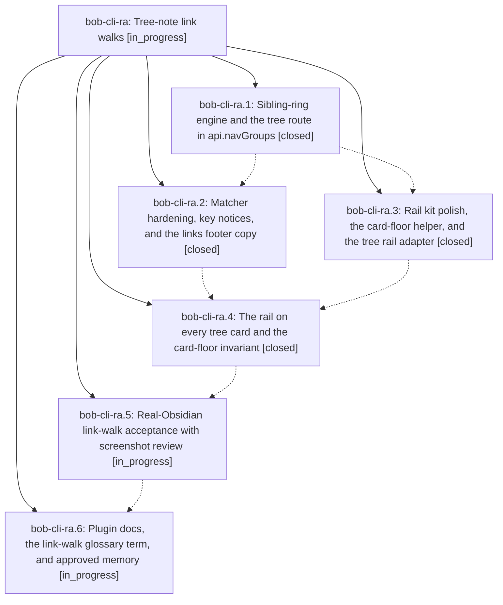

# Bead: bob-cli-ra — Tree-note link walks

[Bead Pages](../README.md) / bob-cli-ra

**Status:** ◐ in_progress · **Type:** ▸ plan · **Tier:** epic
**Owner:** `bryanbugyi34@gmail.com` · **Created by:** [bbugyi200.apollo.research.6o.linker.w0](https://github.com/bobs-org/bob-cli--agents/blob/main/sessions/bbugyi200.apollo.research.6o.linker.w0.md) · **Assignee:** `bob-cli-ra.land`
**Created:** 2026-11-27 15:01:37 EST
**Plan:** [202611/tree\_note\_link\_walks.md](https://github.com/bobs-org/bob-cli--plans/blob/main/202611/tree_note_link_walks.md)

<!-- sase:links:start -->

## Links

| Relation | Artifact | Why |
| --- | --- | --- |
| implemented-by | [plan:202611/ctrl_jk_section_map.md][1] | derived from the plan's `bead_id:` frontmatter field |
| implemented-by | [plan:202611/tree_note_link_walks.md][2] | derived from the plan's `bead_id:` frontmatter field |

_Plus 1 automatic references — see [Referenced By](#referenced-by)._

[1]: https://github.com/bobs-org/bob-cli--plans/blob/main/202611/ctrl_jk_section_map.md
[2]: https://github.com/bobs-org/bob-cli--plans/blob/main/202611/tree_note_link_walks.md

<!-- sase:links:end -->

## Description

On area, project, notebook, and prose notes, `[n` / `]n` step through the note's same-type siblings under its parent (wrapping), and `[N` / `]N` tour that type's parents in outline order. Every Property Card ends with the link-walk rail, below all cabinets. Keys, repeats, the links footer, and the rail always agree. Nothing is written to the vault, and none of it races the bob-cli-qq cabinets go-live.

## Phases

| Bead | Title | Status | Size | Created | Agents | Commits |
|---|---|---|---|---|---:|---:|
| [bob-cli-ra.1](bob-cli-ra.1.md) | Sibling-ring engine and the tree route in api.navGroups | ✓ closed | medium | 2026-11-27 | 1 | 1 |
| [bob-cli-ra.2](bob-cli-ra.2.md) | Matcher hardening, key notices, and the links footer copy | ✓ closed | medium | 2026-11-27 | 1 | 1 |
| [bob-cli-ra.3](bob-cli-ra.3.md) | Rail kit polish, the card-floor helper, and the tree rail adapter | ✓ closed | medium | 2026-11-27 | 1 | 1 |
| [bob-cli-ra.4](bob-cli-ra.4.md) | The rail on every tree card and the card-floor invariant | ✓ closed | medium | 2026-11-27 | 1 | 1 |
| [bob-cli-ra.5](bob-cli-ra.5.md) | Real-Obsidian link-walk acceptance with screenshot review | ◐ in_progress | medium | 2026-11-27 | 1 | 0 |
| [bob-cli-ra.6](bob-cli-ra.6.md) | Plugin docs, the link-walk glossary term, and approved memory | ◐ in_progress | medium | 2026-11-27 | 1 | 0 |

## Lineage

## Agents

| Agent | Bead | Commits |
|---|---|---:|
| [bbugyi200.apollo.bob-cli-ra.1](https://github.com/bobs-org/bob-cli--agents/blob/main/agents/bbugyi200.apollo.bob-cli-ra.1/README.md) | [bob-cli-ra.1](bob-cli-ra.1.md) | 1 |
| [bbugyi200.apollo.bob-cli-ra.2](https://github.com/bobs-org/bob-cli--agents/blob/main/sessions/bbugyi200.apollo.bob-cli-ra.2.md) | [bob-cli-ra.2](bob-cli-ra.2.md) | 1 |
| [bbugyi200.apollo.bob-cli-ra.3](https://github.com/bobs-org/bob-cli--agents/blob/main/agents/bbugyi200.apollo.bob-cli-ra.3/README.md) | [bob-cli-ra.3](bob-cli-ra.3.md) | 1 |
| [bbugyi200.apollo.bob-cli-ra.4](https://github.com/bobs-org/bob-cli--agents/blob/main/agents/bbugyi200.apollo.bob-cli-ra.4/README.md) | [bob-cli-ra.4](bob-cli-ra.4.md) | 1 |
| [bbugyi200.apollo.bob-cli-ra.5](https://github.com/bobs-org/bob-cli--agents/blob/main/agents/bbugyi200.apollo.bob-cli-ra.5/README.md) | [bob-cli-ra.5](bob-cli-ra.5.md) | 0 |
| [bbugyi200.apollo.bob-cli-ra.6](https://github.com/bobs-org/bob-cli--agents/blob/main/agents/bbugyi200.apollo.bob-cli-ra.6/README.md) | [bob-cli-ra.6](bob-cli-ra.6.md) | 0 |
| [bbugyi200.apollo.bob-cli-ra.land](https://github.com/bobs-org/bob-cli--agents/blob/main/agents/bbugyi200.apollo.bob-cli-ra.land/README.md) | [bob-cli-ra](README.md) | 0 |

## Commits

| Repo | Commit | Subject | Bead | Committed |
|---|---|---|---|---|
| bob-plugins | [`bob-plugins@9317ce3`](https://github.com/bobs-org/bob-plugins/commit/9317ce32d3a9724c126062547504c6ea4ce91d0b) | feat(ledger-tools): add nav-groups sibling-ring tree route with lazy index | [bob-cli-ra.1](bob-cli-ra.1.md) | 2026-11-27 16:12:00 EST |
| bob-plugins | [`bob-plugins@061c41b`](https://github.com/bobs-org/bob-plugins/commit/061c41b89e162a2aa4542471c6f789c2adee83f1) | feat(ledger-tools): add tree walk rail floor helper, model, and adapter | [bob-cli-ra.3](bob-cli-ra.3.md) | 2026-11-27 16:40:24 EST |
| bob-plugins | [`bob-plugins@5b34a69`](https://github.com/bobs-org/bob-plugins/commit/5b34a69caf800c6c8d8ab3f6ae202c570c0f1407) | feat(navigation): harden tree walk matching and footer copy | [bob-cli-ra.2](bob-cli-ra.2.md) | 2026-11-27 16:41:06 EST |
| bob-plugins | [`bob-plugins@28b13c4`](https://github.com/bobs-org/bob-plugins/commit/28b13c4e17c4cc5668dd65ce82919ef979c86b82) | feat(ledger-tools): dock the link-walk rail as every property card's floor | [bob-cli-ra.4](bob-cli-ra.4.md) | 2026-11-27 18:10:58 EST |

<!-- sase:referenced-by:start -->

## Referenced By

| Relation | Artifact | Why | Uses |
| --- | --- | --- | ---: |
| read-by | [agent:bob-cli-ra.1][1] | Need epic scope | 1 |

[1]: https://github.com/bobs-org/bob-cli--agents/blob/main/agents/bbugyi200.apollo.bob-cli-ra.1/README.md

<!-- sase:referenced-by:end -->
