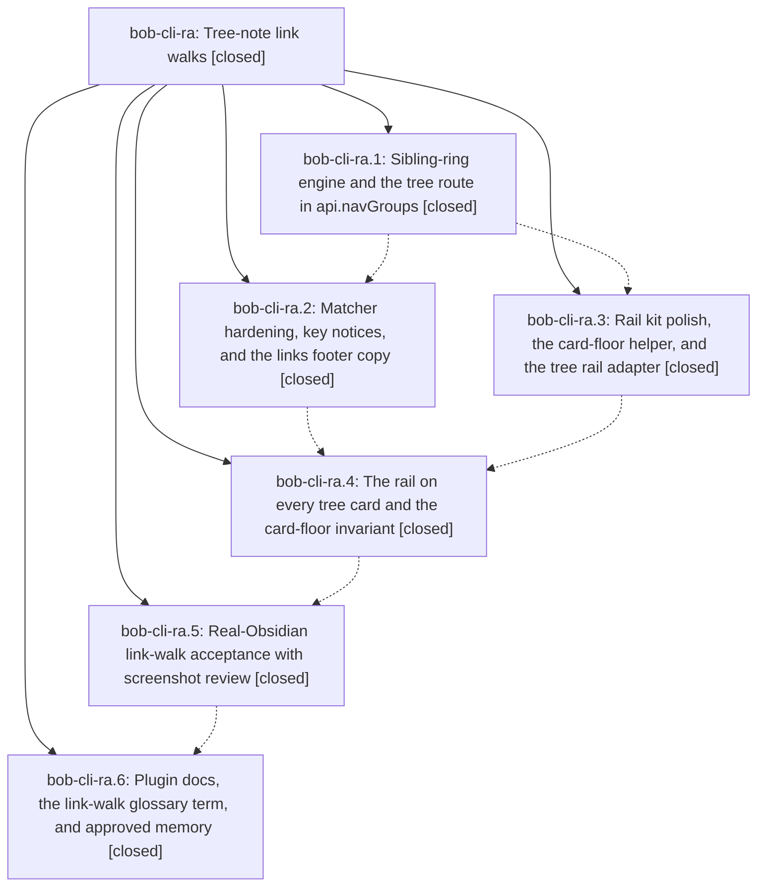

# Bead: bob-cli-ra — Tree-note link walks

[Bead Pages](../README.md) / bob-cli-ra

**Status:** ✓ closed · **Resolution:** done · **Type:** ▸ plan · **Tier:** epic
**Owner:** `bryanbugyi34@gmail.com` · **Created by:** [bbugyi200.apollo.research.6o.linker.w0](https://github.com/bobs-org/bob-cli--agents/blob/main/sessions/bbugyi200.apollo.research.6o.linker.w0.md) · **Assignee:** `bob-cli-ra.land`
**Created:** 2026-11-27 15:01:37 EST · **Closed:** 2026-11-28 07:37:47 EST
**Plan:** [202611/tree\_note\_link\_walks.md](https://github.com/bobs-org/bob-cli--plans/blob/main/202611/tree_note_link_walks.md)

<!-- sase:links:start -->

## Links

| Relation | Artifact | Why |
| --- | --- | --- |
| implemented-by | [plan:202611/ctrl_jk_section_map.md][1] | derived from the plan's `bead_id:` frontmatter field |
| implemented-by | [plan:202611/tree_note_link_walks.md][2] | derived from the plan's `bead_id:` frontmatter field |

_Plus 2 automatic references — see [Referenced By](#referenced-by)._

[1]: https://github.com/bobs-org/bob-cli--plans/blob/main/202611/ctrl_jk_section_map.md
[2]: https://github.com/bobs-org/bob-cli--plans/blob/main/202611/tree_note_link_walks.md

<!-- sase:links:end -->

## Description

On area, project, notebook, and prose notes, `[n` / `]n` step through the note's same-type siblings under its parent (wrapping), and `[N` / `]N` tour that type's parents in outline order. Every Property Card ends with the link-walk rail, below all cabinets. Keys, repeats, the links footer, and the rail always agree. Nothing is written to the vault, and none of it races the bob-cli-qq cabinets go-live.

## Notes

[2026-11-28T12:37:47Z · bob-cli-ra.land] LANDED (bob-cli-ra.land).

VERIFIED: all 6 phases are closed, and every phase note was addressed. The code on bob-plugins master a6f7691e matches the plan:
- 296f dispatches record, then tree, then calendar. Tree support is in 296h/296ha/296i (lazy, generation-stamped index), and 296e navGroupsOk gains lane and stepNone.
- Nav 680 skips inline-code links, and 483 takes tree step links from nav lines only and passes route, kind, lane, parent, and stepNone through. 670 shows stepNone notices, and the 124 footer copy is done.
- 240u floor helpers are used by 240r, 240wl, and 242kc (FloorAppend) and by 296b, 242k, and 242v (FloorDock). The tree rail mounts on 249d/249i/249n through treeWalkRailMountOnCard.
- The new tests are wired into test:unit, and the perf test into test:perf.
- Decisions were honored: nothing writes walk bytes, bank.md is excluded, Mac Capture is untouched, and bob-cli changed only memory and generated pages. Only the approved memory changed (glossary:link-walk, glossary:walker-footer, decisions:tree-notes-walk-sibling-rings; 518b29fe).

Gates on master:
- npm test: 10,465 tests, 10,459 pass, 5 skip, and 1 fail. The failure is the pre-existing album Schema test, which reproduces on clean 91db00d3 and came from 15c2410d.
- The worked-example, inline-code, and card-floor tests pass. test:perf is 28/28, including the 8k-file tree build and the no-scan warm resolve.
- npm run docs:check, including the bob-cli docs-check, passed.
- bob plugins sync without -F: 0 copied, 34 unchanged. Bob Ledger Tools 1.175.1 and Bob Navigation Hotkeys 2.107.18 are deployed.
- The acceptance phase recorded VERDICT: GO with retained evidence: two real-Obsidian runs at 142/142, all 24 captures reviewed, and perf ratios 1.0146 and 0.9870.
- sase bead epic-symbols: none.

INTEGRATION: I reviewed the post-start commits. bob-plugins: the Section Map (bob-cli-rc), the cabinets go-live (64268af9 and f35848b4), the cabinet reveal commits (0a1b1170 and 2333aa72), 15c2410d (cabinets start closed), and snooze (b23ccaee and 91db00d3). bob-cli: capture, bank, prose, snooze, and cabinets memory.
- 15c2410d kept the floor-aware appends in 240r and 240wl. No other commit appends to the card or bypasses the floor, and no docs or memory still say "the foot follows the rail". No code change was needed.
- Fixed a mislink: the Section Map plan plan:202611/ctrl_jk_section_map.md had bead_id bob-cli-ra, a launch-time ID collision that sase bead doctor flagged as an owner mismatch. It is corrected to bob-cli-rc in the plans repo.

FOLLOW-UP TRIAGE:
- ra.1 #1, ra.3 #1, ra.4 #1 (the snooze-add-resnooze daily postimage vector): declined. bob-cli-q5 already tracked it, bob-plugins b23ccaee fixed it, and it passes on master.
- ra.5 #1 (rerun the acceptance gates): declined; ra.5's own later GO run satisfied it.
- ra.5 #3 (album Schema cabinets-chrome test): filed as bob-cli-rq (ci, small). It was caused by 15c2410d, not this epic. I linked it as related to bob-cli-qq.
- ra.5 #4 (walker footer clips at 420 px): filed as bob-cli-rr (bug, medium). The cause is the shared freshnessFooterFit, which predates the epic. Related links: bob-cli-p5 and bob-cli-qq.10.3.
- ra.5 #5 (project card icon tile clipped): declined as not a defect. It is the designed project pennant tile (the styles.css "Pennant (project)" clip-path points the trailing edge and drops the border there). I confirmed this on the ra.5 project-live-light-420 capture.
- ra.6 #1 (bob-navigation-hotkeys.md at 5991/6000 words): filed as bob-cli-rs (headroom, small). Related links: bob-cli-ob and bob-cli-jz.

## Phases

| Bead | Title | Status | Size | Created | Agents | Commits |
|---|---|---|---|---|---:|---:|
| [bob-cli-ra.1](bob-cli-ra.1.md) | Sibling-ring engine and the tree route in api.navGroups | ✓ closed | medium | 2026-11-27 | 1 | 1 |
| [bob-cli-ra.2](bob-cli-ra.2.md) | Matcher hardening, key notices, and the links footer copy | ✓ closed | medium | 2026-11-27 | 1 | 1 |
| [bob-cli-ra.3](bob-cli-ra.3.md) | Rail kit polish, the card-floor helper, and the tree rail adapter | ✓ closed | medium | 2026-11-27 | 1 | 1 |
| [bob-cli-ra.4](bob-cli-ra.4.md) | The rail on every tree card and the card-floor invariant | ✓ closed | medium | 2026-11-27 | 1 | 1 |
| [bob-cli-ra.5](bob-cli-ra.5.md) | Real-Obsidian link-walk acceptance with screenshot review | ✓ closed | medium | 2026-11-27 | 1 | 5 |
| [bob-cli-ra.6](bob-cli-ra.6.md) | Plugin docs, the link-walk glossary term, and approved memory | ✓ closed | medium | 2026-11-27 | 1 | 2 |

## Lineage

## Agents

| Agent | Bead | Commits |
|---|---|---:|
| [bbugyi200.apollo.bob-cli-ra.1](https://github.com/bobs-org/bob-cli--agents/blob/main/agents/bbugyi200.apollo.bob-cli-ra.1/README.md) | [bob-cli-ra.1](bob-cli-ra.1.md) | 1 |
| [bbugyi200.apollo.bob-cli-ra.2](https://github.com/bobs-org/bob-cli--agents/blob/main/sessions/bbugyi200.apollo.bob-cli-ra.2.md) | [bob-cli-ra.2](bob-cli-ra.2.md) | 1 |
| [bbugyi200.apollo.bob-cli-ra.3](https://github.com/bobs-org/bob-cli--agents/blob/main/agents/bbugyi200.apollo.bob-cli-ra.3/README.md) | [bob-cli-ra.3](bob-cli-ra.3.md) | 1 |
| [bbugyi200.apollo.bob-cli-ra.4](https://github.com/bobs-org/bob-cli--agents/blob/main/agents/bbugyi200.apollo.bob-cli-ra.4/README.md) | [bob-cli-ra.4](bob-cli-ra.4.md) | 1 |
| [bbugyi200.apollo.bob-cli-ra.5](https://github.com/bobs-org/bob-cli--agents/blob/main/agents/bbugyi200.apollo.bob-cli-ra.5/README.md) | [bob-cli-ra.5](bob-cli-ra.5.md) | 5 |
| [bbugyi200.apollo.bob-cli-ra.6](https://github.com/bobs-org/bob-cli--agents/blob/main/agents/bbugyi200.apollo.bob-cli-ra.6/README.md) | [bob-cli-ra.6](bob-cli-ra.6.md) | 2 |
| [bbugyi200.apollo.bob-cli-ra.land](https://github.com/bobs-org/bob-cli--agents/blob/main/agents/bbugyi200.apollo.bob-cli-ra.land/README.md) | [bob-cli-ra](README.md) | 1 |

## Commits

| Repo | Commit | Subject | Bead | Committed |
|---|---|---|---|---|
| bob-plugins | [`bob-plugins@9317ce3`](https://github.com/bobs-org/bob-plugins/commit/9317ce32d3a9724c126062547504c6ea4ce91d0b) | feat(ledger-tools): add nav-groups sibling-ring tree route with lazy index | [bob-cli-ra.1](bob-cli-ra.1.md) | 2026-11-27 16:12:00 EST |
| bob-plugins | [`bob-plugins@061c41b`](https://github.com/bobs-org/bob-plugins/commit/061c41b89e162a2aa4542471c6f789c2adee83f1) | feat(ledger-tools): add tree walk rail floor helper, model, and adapter | [bob-cli-ra.3](bob-cli-ra.3.md) | 2026-11-27 16:40:24 EST |
| bob-plugins | [`bob-plugins@5b34a69`](https://github.com/bobs-org/bob-plugins/commit/5b34a69caf800c6c8d8ab3f6ae202c570c0f1407) | feat(navigation): harden tree walk matching and footer copy | [bob-cli-ra.2](bob-cli-ra.2.md) | 2026-11-27 16:41:06 EST |
| bob-plugins | [`bob-plugins@28b13c4`](https://github.com/bobs-org/bob-plugins/commit/28b13c4e17c4cc5668dd65ce82919ef979c86b82) | feat(ledger-tools): dock the link-walk rail as every property card's floor | [bob-cli-ra.4](bob-cli-ra.4.md) | 2026-11-27 18:10:58 EST |
| bob-plugins | [`bob-plugins@7843342`](https://github.com/bobs-org/bob-plugins/commit/7843342216c269079fece729db68c33b175793e3) | test(acceptance): add real tree-walk Obsidian runner | [bob-cli-ra.5](bob-cli-ra.5.md) | 2026-11-27 19:04:46 EST |
| bob-plugins | [`bob-plugins@d83ffbe`](https://github.com/bobs-org/bob-plugins/commit/d83ffbebad69e1ec9e5ce8d8661648fbcb5a696d) | fix(test): scope tree-walk long-task samples | [bob-cli-ra.5](bob-cli-ra.5.md) | 2026-11-27 19:32:23 EST |
| bob-plugins | [`bob-plugins@1834c28`](https://github.com/bobs-org/bob-plugins/commit/1834c28322b0e7c7e687625b7e034254e52f49b1) | fix(acceptance): wait for stale link resolution | [bob-cli-ra.5](bob-cli-ra.5.md) | 2026-11-27 19:58:17 EST |
| bob-plugins | [`bob-plugins@145b4a3`](https://github.com/bobs-org/bob-plugins/commit/145b4a3d1ed88c1cabe78029ab9b6a08c3eff695) | test(acceptance): record stale rail notice evidence | [bob-cli-ra.5](bob-cli-ra.5.md) | 2026-11-27 20:10:16 EST |
| bob-plugins | [`bob-plugins@d0ddd12`](https://github.com/bobs-org/bob-plugins/commit/d0ddd12c61c09a511d6eb32ea76a51361d6cc099) | fix(ledger-tools): name parents on narrow tree group arms and reach tree-walk acceptance GO | [bob-cli-ra.5](bob-cli-ra.5.md) | 2026-11-28 06:47:43 EST |
| bob-cli | [`518b29f`](https://github.com/bobs-org/bob-cli/commit/518b29fe70ef3f93b47fb4d4a51e63fa86c5bbd2) | docs(memory): add link-walk glossary and sibling-ring decision | [bob-cli-ra.6](bob-cli-ra.6.md) | 2026-11-28 07:08:08 EST |
| bob-plugins | [`bob-plugins@a6f7691`](https://github.com/bobs-org/bob-plugins/commit/a6f7691e0184b4b57dd0c0323a4a2902faf3c71d) | docs: document tree-note link walks and the card-floor rail | [bob-cli-ra.6](bob-cli-ra.6.md) | 2026-11-28 07:08:42 EST |
| bob-cli--plans | [`bob-cli--plans@c8c8ae2`](https://github.com/bobs-org/bob-cli--plans/commit/c8c8ae2673f0da675b5c0e3cf98de39117ff91b0) | docs(plans): mark tree-note link walks done and fix the Section Map plan's bead link | [bob-cli-ra](README.md) | 2026-11-28 07:38:38 EST |

<!-- sase:referenced-by:start -->

## Referenced By

| Relation | Artifact | Why | Uses |
| --- | --- | --- | ---: |
| read-by | [agent:bob-cli-ra.1][1] | Need epic scope | 1 |
| read-by | [agent:bob-cli-ra.5][2] | Need epic scope and sibling phase status for acceptance phase | 1 |

[1]: https://github.com/bobs-org/bob-cli--agents/blob/main/agents/bbugyi200.apollo.bob-cli-ra.1/README.md
[2]: https://github.com/bobs-org/bob-cli--agents/blob/main/sessions/bbugyi200.apollo.bob-cli-ra.5.md

<!-- sase:referenced-by:end -->
