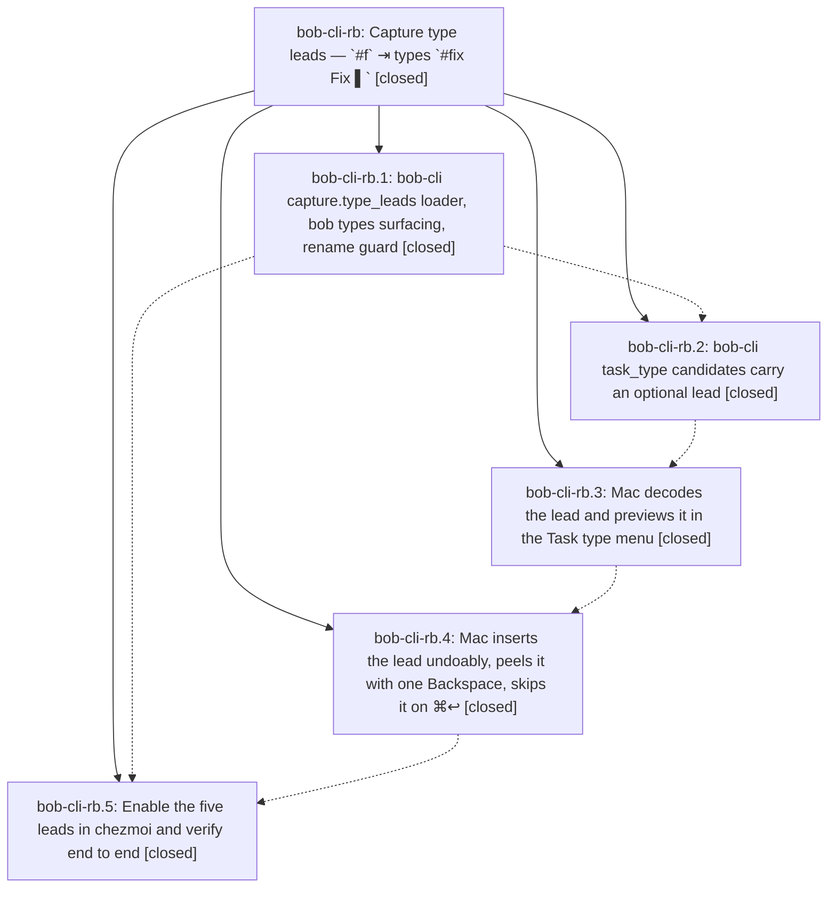

# Bead: bob-cli-rb — Capture type leads — \`#f\` ⇥ types \`#fix Fix ▌\`

[Bead Pages](../README.md) / bob-cli-rb

**Status:** ✓ closed · **Resolution:** done · **Type:** ▸ plan · **Tier:** epic
**Owner:** `bryanbugyi34@gmail.com` · **Created by:** [bbugyi200.athena.1hh](https://github.com/bobs-org/bob-cli--agents/blob/main/sessions/bbugyi200.athena.1hh.md) · **Assignee:** `bob-cli-rb.land`
**Created:** 2026-11-27 15:03:20 EST · **Closed:** 2026-11-27 21:10:26 EST
**Plan:** [202611/capture\_type\_leads.md](https://github.com/bobs-org/bob-cli--plans/blob/main/202611/capture_type_leads.md)

<!-- sase:links:start -->

## Links

| Relation | Artifact | Why |
| --- | --- | --- |
| implemented-by | [plan:202611/capture_type_leads.md][1] | derived from the plan's `bead_id:` frontmatter field |

_Plus 2 automatic references — see [Referenced By](#referenced-by)._

[1]: https://github.com/bobs-org/bob-cli--plans/blob/main/202611/capture_type_leads.md

<!-- sase:links:end -->

## Description

Accepting a configured task type from the Capture panel's `#` menu at the start of an empty new-task item also types that type's lead word (`#f` ⇥ → `#fix Fix ▌`). The menu previews the lead before you accept, one Backspace or ⌘Z removes it, and accept-and-capture never mints a one-word task. The five leads (BUILD, FIX, PLAN, READ, WRITE) come from `capture.type_leads` in the chezmoi-managed bob config.

## Notes

[2026-11-28T02:10:26Z · bob-cli-rb.land] Land verification (bob-cli-rb.land). STEP 1: All 5 phases closed. Re-read every child note and the plan against source. bob-cli 421de94d (rb.1): capture.type_leads loader in config/capture.rs with per-entry degradation, reserved-clock-key and normalized-duplicate skips, the 64-char/one-line/control checks, and the two-probe parse_for_editor validation; bob types lead field plus stale-key/invalid warnings; rename config_reference guard; docs. bd6a5fe5 (rb.2): TaskTypeLead model (skip_serializing_if); build-only lead loading (build_for_shell passes None); gates 1-4 incl. first-physical-line geometry, route-aware D0/D1 probe with Directive-span rejection; template_completion_gate strips leads; render ' · types "Fix"'; capture.md + json-outputs.md docs; 11 CLI tests covering the worked table, hidden exact, shell, write-path, and capture-related band. rb.2's fix of rb.1's probe-body bug and the YAML backslash-continuation tests is confirmed in source. bob-mac-capture 1a5723d2 (rb.3 decode/hint/footer/VoiceOver), plus 1e83e9ce/4192581e/de954c51 (rb.4): two native undo groups bound to completionDraftSnapshot and the response cursor, TypeLeadPeel arm/consume/disarm, includeLead:false on accept-and-capture, docs, hosted tests. 6c545f23 fixed rb.3's out-of-order meetings flake; macOS CI is green on run 46091145714 per the rb.4 note. chezmoi be8a4676 (rb.5) carries the five-lead capture block. Reviewer decisions (no decisions/glossary memory) honored: no memory edits. STEP 2: Commits since 421de94d (69f8aae6, 3deb0bd3, 5b2c5306, 7d48b7b2, d117d288, f0ee4357, befff97c, 31fe1637) touch prose/bank/pomodoro_close/task_blocks/tests. 7d48b7b2 only reformatted a type_leads unit test to a raw string. None conflict with or duplicate type leads, and Mac master has only epic commits since 1a5723d2. Integration edit: moved the cheap subject==new && leading gate to attach_leads' call site, dropping two params and clearing the epic's only clippy::too_many_arguments warning (task_types.rs:361). just check EXIT=0 before (11m22s) and after (9m41s) the edit. FOLLOW-UPS: rb.1 PROPOSED FOLLOW-UP (baseline clippy filter_map_bool_then/useless_format in prose/convert/inline.rs) DECLINED, already resolved on master: just check runs clippy with both lints denied and passes, after the bob-cli-qj landing commits (46885dbf 'green the canonical gate for extract and inline' et seq). No other PROPOSED FOLLOW-UP notes. The plan's out-of-scope '@route^id@ #f refused:null' was pre-tracked by the plan and needs no new task. epic-symbols: none.

## Phases

| Bead | Title | Status | Size | Created | Agents | Commits |
|---|---|---|---|---|---:|---:|
| [bob-cli-rb.1](bob-cli-rb.1.md) | bob-cli capture.type\_leads loader, bob types surfacing, rename guard | ✓ closed | medium | 2026-11-27 | 1 | 2 |
| [bob-cli-rb.2](bob-cli-rb.2.md) | bob-cli task\_type candidates carry an optional lead | ✓ closed | medium | 2026-11-27 | 1 | 2 |
| [bob-cli-rb.3](bob-cli-rb.3.md) | Mac decodes the lead and previews it in the Task type menu | ✓ closed | small | 2026-11-27 | 1 | 1 |
| [bob-cli-rb.4](bob-cli-rb.4.md) | Mac inserts the lead undoably, peels it with one Backspace, skips it on ⌘↩ | ✓ closed | medium | 2026-11-27 | 1 | 4 |
| [bob-cli-rb.5](bob-cli-rb.5.md) | Enable the five leads in chezmoi and verify end to end | ✓ closed | small | 2026-11-27 | 1 | 1 |

## Lineage

## Agents

| Agent | Bead | Commits |
|---|---|---:|
| [bbugyi200.athena.bob-cli-rb.1](https://github.com/bobs-org/bob-cli--agents/blob/main/sessions/bbugyi200.athena.bob-cli-rb.1.md) | [bob-cli-rb.1](bob-cli-rb.1.md) | 2 |
| [bbugyi200.athena.bob-cli-rb.2](https://github.com/bobs-org/bob-cli--agents/blob/main/agents/bbugyi200.athena.bob-cli-rb.2/README.md) | [bob-cli-rb.2](bob-cli-rb.2.md) | 2 |
| [bbugyi200.athena.bob-cli-rb.3](https://github.com/bobs-org/bob-cli--agents/blob/main/agents/bbugyi200.athena.bob-cli-rb.3/README.md) | [bob-cli-rb.3](bob-cli-rb.3.md) | 1 |
| [bbugyi200.athena.bob-cli-rb.4](https://github.com/bobs-org/bob-cli--agents/blob/main/sessions/bbugyi200.athena.bob-cli-rb.4.md) | [bob-cli-rb.4](bob-cli-rb.4.md) | 4 |
| [bbugyi200.athena.bob-cli-rb.5](https://github.com/bobs-org/bob-cli--agents/blob/main/sessions/bbugyi200.athena.bob-cli-rb.5.md) | [bob-cli-rb.5](bob-cli-rb.5.md) | 1 |
| [bbugyi200.athena.bob-cli-rb.land](https://github.com/bobs-org/bob-cli--agents/blob/main/agents/bbugyi200.athena.bob-cli-rb.land/README.md) | [bob-cli-rb](README.md) | 2 |

## Commits

| Repo | Commit | Subject | Bead | Committed |
|---|---|---|---|---|
| bob-cli | [`421de94`](https://github.com/bobs-org/bob-cli/commit/421de94dc381f1947e24154d181ef44b6829c86c) | feat(types): add configurable capture type leads | [bob-cli-rb.1](bob-cli-rb.1.md) | 2026-11-27 15:51:41 EST |
| bob-plugins | `bob-plugins@421de94` | feat(types): add configurable capture type leads | [bob-cli-rb.1](bob-cli-rb.1.md) | 2026-11-27 15:51:41 EST |
| bob-cli | [`bd6a5fe`](https://github.com/bobs-org/bob-cli/commit/bd6a5fe5d6a9976a5f638d371b092a29e1f5faec) | feat(capture): task\_type lead completion with eligibility gates and parser probe | [bob-cli-rb.2](bob-cli-rb.2.md) | 2026-11-27 17:18:25 EST |
| bob-plugins | `bob-plugins@bd6a5fe` | feat(capture): task\_type lead completion with eligibility gates and parser probe | [bob-cli-rb.2](bob-cli-rb.2.md) | 2026-11-27 17:18:25 EST |
| bob-mac-capture | [`bob-mac-capture@1a5723d`](https://github.com/bobs-org/bob-mac-capture/commit/1a5723d2239eb2920483e9fa6770beacdd5911d4) | feat(capture): preview task type leads | [bob-cli-rb.3](bob-cli-rb.3.md) | 2026-11-27 17:38:38 EST |
| bob-mac-capture | [`bob-mac-capture@1e83e9c`](https://github.com/bobs-org/bob-mac-capture/commit/1e83e9ce1bc1482648ed761af26175880b3c52b6) | feat(capture): insert task type leads as two native undo groups | [bob-cli-rb.4](bob-cli-rb.4.md) | 2026-11-27 18:23:44 EST |
| bob-mac-capture | [`bob-mac-capture@4192581`](https://github.com/bobs-org/bob-mac-capture/commit/4192581edaa73d079bf081a2d82c806b852cb3df) | feat(capture): insert task type leads as two native undo groups | [bob-cli-rb.4](bob-cli-rb.4.md) | 2026-11-27 19:01:25 EST |
| bob-mac-capture | [`bob-mac-capture@de954c5`](https://github.com/bobs-org/bob-mac-capture/commit/de954c51e3d38d7363e776f2bc409f9aadcc4bbe) | feat(capture): insert task type leads as two native undo groups | [bob-cli-rb.4](bob-cli-rb.4.md) | 2026-11-27 19:35:20 EST |
| bob-mac-capture | [`bob-mac-capture@6c545f2`](https://github.com/bobs-org/bob-mac-capture/commit/6c545f23be23ab47d2546d7aab419da231533fce) | test(meetings): ignore preview request order in out-of-order selection | [bob-cli-rb.4](bob-cli-rb.4.md) | 2026-11-27 20:02:57 EST |
| chezmoi | [`chezmoi@be8a467`](https://github.com/bbugyi200/dotfiles/commit/be8a467677057393a42bd39fa4bdabcf1f981201) | feat(bob): enable capture type leads for BUILD FIX PLAN READ WRITE | [bob-cli-rb.5](bob-cli-rb.5.md) | 2026-11-27 20:44:35 EST |
| bob-cli | [`49d955e`](https://github.com/bobs-org/bob-cli/commit/49d955ef618bd06b7421ef3cb9627ca180ad1f86) | refactor(capture): gate type leads on new leading markers at the call site | [bob-cli-rb](README.md) | 2026-11-27 21:12:06 EST |
| bob-plugins | `bob-plugins@49d955e` | refactor(capture): gate type leads on new leading markers at the call site | [bob-cli-rb](README.md) | 2026-11-27 21:12:06 EST |

<!-- sase:referenced-by:start -->

## Referenced By

| Relation | Artifact | Why | Uses |
| --- | --- | --- | ---: |
| read-by | [agent:bob-cli-re.2][1] | Check whether this tracks the type_leads lib test failures | 1 |
| read-by | [agent:bob-cli-re.land][2] | Confirm task status for epic landing | 1 |

[1]: https://github.com/bobs-org/bob-cli--agents/blob/main/agents/bbugyi200.athena.bob-cli-re.2/README.md
[2]: https://github.com/bobs-org/bob-cli--agents/blob/main/agents/bbugyi200.athena.bob-cli-re.land/README.md

<!-- sase:referenced-by:end -->
