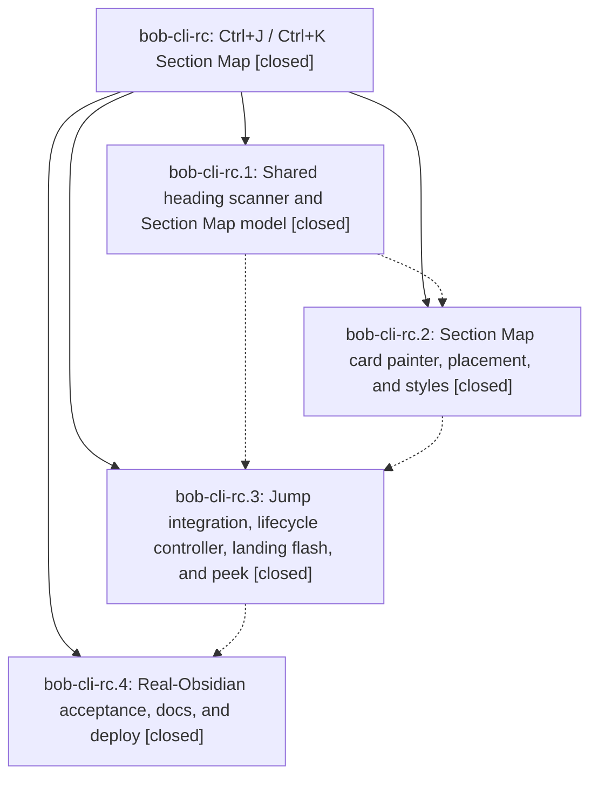

# Bead: bob-cli-rc — Ctrl+J / Ctrl+K Section Map

[Bead Pages](../README.md) / bob-cli-rc

**Status:** ✓ closed · **Resolution:** done · **Type:** ▸ plan · **Tier:** epic
**Owner:** `bryanbugyi34@gmail.com` · **Created by:** [bbugyi200.athena.1hg](https://github.com/bobs-org/bob-cli--agents/blob/main/sessions/bbugyi200.athena.1hg.md) · **Assignee:** `bob-cli-rc.land`
**Created:** 2026-11-27 15:06:05 EST · **Closed:** 2026-11-27 18:31:15 EST
**Plan:** [202611/ctrl\_jk\_section\_map.md](https://github.com/bobs-org/bob-cli--plans/blob/main/202611/ctrl_jk_section_map.md)

<!-- sase:links:start -->

## Links

| Relation | Artifact | Why |
| --- | --- | --- |
| implemented-by | [plan:202611/ctrl_jk_section_map.md][1] | derived from the plan's `bead_id:` frontmatter field |
| related | file:explicit:98f2378ffdb7a714d3749e61 | attached via sase artifact create --bead |
| related | file:explicit:9e8ff1903ad5408cdcff42fa | attached via sase artifact create --bead |
| related | file:explicit:be63725046c23ea0929e0b67 | attached via sase artifact create --bead |
| related | file:explicit:c4445cebc9af70a619e38c15 | attached via sase artifact create --bead |
| related | file:explicit:c925b6bd36a6c253ac4e251b | attached via sase artifact create --bead |
| related | file:explicit:e0b85a31cdf32d4607e53c2d | attached via sase artifact create --bead |
| related | file:explicit:f06e06e178b9a9869e5e8205 | attached via sase artifact create --bead |
| related | file:explicit:fcaf37ab1946ab7130326e16 | attached via sase artifact create --bead |

_Plus 2 automatic references — see [Referenced By](#referenced-by)._

[1]: https://github.com/bobs-org/bob-cli--plans/blob/main/202611/ctrl_jk_section_map.md

<!-- sase:links:end -->

## Description

Every successful Ctrl+J / Ctrl+K section jump in Obsidian briefly shows a passive, beautiful Section Map in the jumping pane: the note's headings, where you are, where you came from, where the next press lands, and when a press wrapped. The map is built from the same scanner and jump function the keys use, so it never disagrees with them, and it never takes focus, keys, or clicks.

## Notes

[2026-11-27T22:44:13Z · bob-cli-rc.land] LAND AUDIT / REMAINING-WORK HANDOFF (2026-11-27). Read this epic, every child rc.1-rc.4 and every note, the linked plan, governing decisions q-and-ctrl-bracket-mirror-esc and successor-jump-parks-the-walk, the five plugin commits 44425a49/d4edb022/c3729cf1/592c3c9a/dca84529, and actual scanner/model/painter/CSS/controller/lifecycle/jump/flash/registration/test/e2e source. Approved choices hold: pinned peek, passive command-scoped map, no decision or other memory edits. Source and generated bundle are coherent; focused Section Map, section-nav and offline e2e self-test run passes 46/46; build:check and docs:inventory:check pass. Phase-4 same-dispatch and body-mount fixes are present. Its 23/23 real-Obsidian report is historical phase evidence, not a fresh lander run.

EPIC STILL INCOMPLETE. Independent production-helper and Chromium probes at clean bob-plugins dca84529 found: (1) 42 headings, cursor line 20, direction -1, 800x220 pane => maxRows 5 but no current row; same at 168/180/200 heights. The card has 9 heading/gap rows and height 255px, extending below the 220px pane (file:explicit:be63725046c23ea0929e0b67). Pins/gaps and Notice nudges are not budgeted into fitting. (2) Long current label is 30px inside a fixed 24px row. (3) Jump from current index 0 to 20 reports pill transition slide although the old row is no longer painted. (4) reducedMotion:true still computes wrap badge animation bob-section-map-pop (scale). (5) throwing armSectionMapSelection aborts the jump before cursor movement; pre-jump cache/setup is outside the protection promised by jump-first/map-second. (6) controller compares plugin performance.now to event.timeStamp from all windows without a common time origin: pinned map with commandStamp 100000 and younger-window Escape stamp 100 stays pinned. (7) Acceptance gaps: randomized scanner parity has no pre-refactor oracle or generated frontmatter/fences; the e2e j-dismiss case sends Escape via normalMode after showing the card, so Escape can satisfy it, and both hotkey routes remain enabled while it claims to prove the Vim path. These remain this epic work, not follow-up task beads. A validated medium tale sase_plan_finish_section_map_landing.md repairs these bounded gaps, reruns acceptance/deploy, and finishes this epic's closeout in the coder turn without waiting for its future commit/push/CI.

INTEGRATION REVIEW. Since first epic commit, reviewed plugin 3c3333b0/64268af9 (cabinet acceptance/go-live), 9317ce32 (tree route), 061c41b8 (tree rail), and 5b34a69c (navigation matcher/footer). Preserve their shared test/build/docs registration and matcher changes. No Section Map adapter is missing; hiding stored cabinet headings is explicitly deferred scanner behavior, not a reason to change targets. bob-cli changes since epic creation through fetched origin d117d288 concern capture leads, prose links, executable test stubs, and capture block identity; none consumes this feature. Plugin origin remains dca84529. No integration source edits required in this turn; tale rechecks newer drift.

ALL PROPOSED FOLLOW-UPS TRIAGED via sase_new_task (same-type/all-type searches, last-week task sweep, all 25 active epic scopes and plausible owners). rc.1 note #1 => new large flake task bob-cli-rh, now READY, for the post-f5-mitigation viewport CPU guard recurrence; phase reports 26.9ms CPU failure then unchanged clean-base pass. Lander independently got all 37 task-link viewport-file tests passing, not a new failing sample. Its precise cause is unproved, so do not blindly raise limits. pg and f8 were declined as duplicates because they measure different API/index nodes; related history linked. rc.1 note #2 and rc.2/rc.3/rc.4 note #1 => one snooze resnooze-history mismatch already caused/owned by active bob-cli-q5 (notes #4-5 and phase q5.6). Fresh clean dca84529 focused combined run is 57/58; only snooze-add-resnooze-replaces-history fails, retaining struck 1530 / woke 15:32 row. Corroboration appended to q5; no standalone duplicate task. Evidence file:explicit:98f2378ffdb7a714d3749e61 attached to rc and rh. No proposal discarded as obsolete, and no epic-caused defect filed outside this epic.

CLOSEOUT STATE. sase bead epic-symbols bob-cli-rc lists no entries. No symvision recipe found in bob-cli or bob-plugins. Parent audit finds no parent_bead. Epic stays open and original plan status stays unfinished until the repair tale completes the concrete closeout. No just check-full run; no production source changed in this audit.

[2026-11-27T23:31:15Z · bob-cli-rc.land] Landed the Section Map repair tale and closed bob-cli-rc without waiting on this turn's commit/push/CI.

Repairs in bob-plugins 2.107.18: clamp directional windowing so the current section always paints; fitted placement plus compact fallback keep the card inside the pane including two-line current labels; pill crossfades when either endpoint is missing from either painted window; wrap badge is still under both host and prefers-reduced-motion; jump-first/map-second try/catch keeps navigation when map prep/cache fails; activity dismissal uses dispatch identity plus same-window timestamp provenance and host-window scheduling for pop-outs. Internal model API unchanged. peek_lifetime=pinned and section_map_record=no hold. No memory edits.

Acceptance: independent pre-epic scanner oracle registered; focused Section Map + landing-flash + e2e self-test 78/78; Chromium preview green; real-Obsidian e2e 29/29 with no skips (insert-mode hotkeys.json route and normal-mode Vim defineEx+noremap route proven independently; Vim-only moved one heading via real CDP Ctrl+J with JSON bindings cleared). Deployed bob-navigation-hotkeys 2.107.18 to ~/bob; vault manifest/main.js/styles.css SHA-256 match the source tree. Plugin gate: build:check and docs:inventory:check pass; unit 10446 pass / 1 fail snooze-add-resnooze-replaces-history in test-snooze-model-vectors.cjs (existing bob-cli-q5, corroborated, no duplicate); perf 28/28. No just check-full. No just symvision recipe in bob-cli or bob-plugins. sase bead epic-symbols bob-cli-rc is empty.

Drift: fast-forwarded bob-plugins origin 28b13c4e (ledger-tools 1.174.0 property-card floor) and kept both version/test-list edits. bob-cli origin f0ee4357 (pomodoro Next refs) and 7d48b7b2 (prose extract/inline) have no Section Map consumer.

Follow-ups unchanged: bob-cli-rh READY viewport CPU flake (do not blindly raise budgets); bob-cli-q5 owns the snooze history mismatch. Empty-note peek Notice can still be visible in later e2e screenshots (harness order); the map itself is correct. Evidence: file:explicit:c4445cebc9af70a619e38c15 (e2e report), file:explicit:fcaf37ab1946ab7130326e16 (e2e shots), file:explicit:c925b6bd36a6c253ac4e251b (preview scenes), file:explicit:e0b85a31cdf32d4607e53c2d (jump card), file:explicit:f06e06e178b9a9869e5e8205 (short split), file:explicit:9e8ff1903ad5408cdcff42fa (reduced-motion wrap). Parent_id absent; original phases rc.1–rc.4 already closed. Plan 202611/ctrl_jk_section_map.md marked done.

## Phases

| Bead | Title | Status | Size | Created | Agents | Commits |
|---|---|---|---|---|---:|---:|
| [bob-cli-rc.1](bob-cli-rc.1.md) | Shared heading scanner and Section Map model | ✓ closed | medium | 2026-11-27 | 1 | 2 |
| [bob-cli-rc.2](bob-cli-rc.2.md) | Section Map card painter, placement, and styles | ✓ closed | medium | 2026-11-27 | 1 | 1 |
| [bob-cli-rc.3](bob-cli-rc.3.md) | Jump integration, lifecycle controller, landing flash, and peek | ✓ closed | medium | 2026-11-27 | 1 | 1 |
| [bob-cli-rc.4](bob-cli-rc.4.md) | Real-Obsidian acceptance, docs, and deploy | ✓ closed | medium | 2026-11-27 | 1 | 1 |

## Lineage

## Agents

| Agent | Bead | Commits |
|---|---|---:|
| [bbugyi200.athena.bob-cli-rc.1](https://github.com/bobs-org/bob-cli--agents/blob/main/sessions/bbugyi200.athena.bob-cli-rc.1.md) | [bob-cli-rc.1](bob-cli-rc.1.md) | 2 |
| [bbugyi200.athena.bob-cli-rc.2](https://github.com/bobs-org/bob-cli--agents/blob/main/agents/bbugyi200.athena.bob-cli-rc.2/README.md) | [bob-cli-rc.2](bob-cli-rc.2.md) | 1 |
| [bbugyi200.athena.bob-cli-rc.3](https://github.com/bobs-org/bob-cli--agents/blob/main/agents/bbugyi200.athena.bob-cli-rc.3/README.md) | [bob-cli-rc.3](bob-cli-rc.3.md) | 1 |
| [bbugyi200.athena.bob-cli-rc.4](https://github.com/bobs-org/bob-cli--agents/blob/main/agents/bbugyi200.athena.bob-cli-rc.4/README.md) | [bob-cli-rc.4](bob-cli-rc.4.md) | 1 |
| [bbugyi200.athena.bob-cli-rc.land](https://github.com/bobs-org/bob-cli--agents/blob/main/sessions/bbugyi200.athena.bob-cli-rc.land.md) | [bob-cli-rc](README.md) | 1 |

## Commits

| Repo | Commit | Subject | Bead | Committed |
|---|---|---|---|---|
| bob-plugins | [`bob-plugins@44425a4`](https://github.com/bobs-org/bob-plugins/commit/44425a4929a93d170b1ed0845d7ded3b5ef9adf3) | feat(navigation): add shared Section Map model | [bob-cli-rc.1](bob-cli-rc.1.md) | 2026-11-27 15:24:25 EST |
| bob-plugins | [`bob-plugins@d4edb02`](https://github.com/bobs-org/bob-plugins/commit/d4edb022697087d994ded538800a77a00063af2a) | fix(navigation): refresh the Section Map bundle for single-heading notes | [bob-cli-rc.1](bob-cli-rc.1.md) | 2026-11-27 15:45:38 EST |
| bob-plugins | [`bob-plugins@c3729cf`](https://github.com/bobs-org/bob-plugins/commit/c3729cf1c922035293769732fea81c2e970936f7) | feat(navigation): add Section Map card painter, placement, and styles | [bob-cli-rc.2](bob-cli-rc.2.md) | 2026-11-27 16:20:19 EST |
| bob-plugins | [`bob-plugins@592c3c9`](https://github.com/bobs-org/bob-plugins/commit/592c3c9afbad50b95af1bda7029158da15923931) | feat(navigation): wire Section Map lifecycle, jump, and pinned peek | [bob-cli-rc.3](bob-cli-rc.3.md) | 2026-11-27 16:53:20 EST |
| bob-plugins | [`bob-plugins@dca8452`](https://github.com/bobs-org/bob-plugins/commit/dca84529724c2fbbf8336a516e5e281fd1cfd286) | feat(navigation): prove the Section Map in real Obsidian and ship 2.107.17 | [bob-cli-rc.4](bob-cli-rc.4.md) | 2026-11-27 17:29:53 EST |
| bob-plugins | [`bob-plugins@c15f9fa`](https://github.com/bobs-org/bob-plugins/commit/c15f9fa98de2d3c27dd96ecd206f58ec42b2ad3b) | feat(navigation): finish Section Map landing and ship 2.107.18 | [bob-cli-rc](README.md) | 2026-11-27 18:33:07 EST |

<!-- sase:referenced-by:start -->

## Referenced By

| Relation | Artifact | Why | Uses |
| --- | --- | --- | ---: |
| read-by | [agent:bob-cli-qq.10.land][1] | Check Section Map epic scope for absorbed-heading interaction with cabinets | 1 |
| read-by | [agent:bob-cli-rc.2][2] | parent epic status and notes | 1 |

[1]: https://github.com/bobs-org/bob-cli--agents/blob/main/agents/bbugyi200.athena.bob-cli-qq.10.land/README.md
[2]: https://github.com/bobs-org/bob-cli--agents/blob/main/agents/bbugyi200.athena.bob-cli-rc.2/README.md

<!-- sase:referenced-by:end -->
