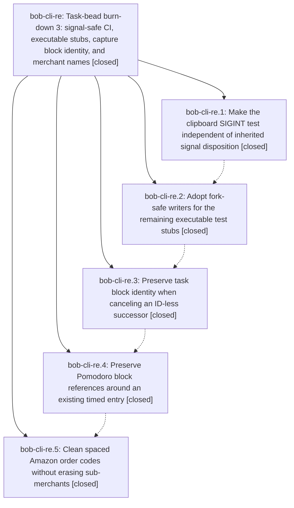

# Bead: bob-cli-re — Task-bead burn-down 3: signal-safe CI, executable stubs, capture block identity, and merchant names

[Bead Pages](../README.md) / bob-cli-re

**Status:** ✓ closed · **Resolution:** done · **Type:** ▸ plan · **Tier:** epic
**Owner:** `bryanbugyi34@gmail.com` · **Created by:** [bbugyi200.athena.bob-cli-r8.land](https://github.com/bobs-org/bob-cli--agents/blob/main/sessions/bbugyi200.athena.bob-cli-r8.land.md) · **Assignee:** `bob-cli-re.land`
**Created:** 2026-11-27 15:31:18 EST · **Closed:** 2026-11-27 18:53:08 EST
**Plan:** [202611/task\_bead\_burndown\_3.md](https://github.com/bobs-org/bob-cli--plans/blob/main/202611/task_bead_burndown_3.md)

<!-- sase:links:start -->

## Links

| Relation | Artifact | Why |
| --- | --- | --- |
| implemented-by | [plan:202611/task_bead_burndown_3.md][1] | derived from the plan's `bead_id:` frontmatter field |

_Plus 2 automatic references — see [Referenced By](#referenced-by)._

[1]: https://github.com/bobs-org/bob-cli--plans/blob/main/202611/task_bead_burndown_3.md

<!-- sase:links:end -->

## Description

Close five verified task beads by repairing the clipboard CI signal harness, executable-stub races, two capture block-reference panics, and spaced merchant order-code cleaning; then triage and continue the task-bead burn-down.

## Notes

[2026-11-27T20:38:01Z · bryanbugyi34@gmail.com] I think three rounds are enough for now. The Lander agent should not create a new epic unless issues were caused by this work or one of the previous rounds.

[2026-11-27T23:53:08Z · bob-cli-re.land] Landing verification (bob-cli-re.land, HEAD befff97c). STEP 1: Reviewed all five phases, their notes, and actual commits. re.1 chezmoi 378cb6c9 resets inherited SIGINT to SIG_DFL via a command -p python3 exec wrapper in run_doctor, keeping real INT/TERM injection and restore/no-write assertions; exact-SHA chezmoi CI run 46066702313 on 378cb6c9 = success; bob-cli-rd closed. re.2 69f8aae6 ports Spotify fake curl, Gmail worker fake bob, and git-hook writers to native::test_stub::write_executable_stub, adds tests/exec_stub (scratch payload + child cp) for gmail/gcal/gkeep binaries, and tests/cli uses support::write_executable; audit finds no remaining in-process writer of an executed stub (gog.rs make_executable fakes are resolution-only; desktop_notify fake is never run). One cosmetic change: the Gmail worker fake is now 0755, not 0700. bob-cli-5l closed. re.3 d117d288 adds TaskBlockTracker::track_successor_post_pass (same-indent ordinal forwarding, block-id fallback, no title lookup). The worker left bob-cli-oh open, so the lander re-ran the bead's exact debug repro: exit 0, no panic, dry-run mutation-free, Cancel Log under Alpha, Beta recovered at deps.md:4, task_blocks match the written bytes. Closed bob-cli-oh. re.4 f0ee4357 remaps existing Next identities through drain-then-insert and pins them via locate_next_headline against the filed scan; WORK time and child are kept; the debug assert stays and nothing is swallowed. bob-cli-qa closed. re.5 befff97c adds a peekable WORD* CODE walk reusing is_short_digit_code; sub-merchants, glued, masked, and fallback cases stay covered, with no journal migration. bob-cli-qx closed. Decisions honored: no Cargo.toml or CHANGELOG edits, no CLI/JSON contract change, successor/close-selection semantics unchanged. just check ToolRun 3e3363c1bc5be7ca25a74629f5b91edc exits 0 on befff97c. STEP 2: Non-epic commits since start (46885dbf, 421de94d, 3deb0bd3, 5b2c5306, bd6a5fe5, 31fe1637, 7d48b7b2: prose, type leads, and memory docs) touch none of task_blocks, pomodoro_past/close, bank naming, or stub writers, and add no new executable-stub writers. No integration change was needed. FOLLOW-UPS: four PROPOSED FOLLOW-UPs (re.2 #1 and #2, re.3 #1, re.4 #1) all reported base-tree just check failures: type-lead config/capture.rs and themes tests (bob-cli-rb) and prose relocate/inline/extract tests (bob-cli-qj). Declined, no task filed: they are resolved on master by 7d48b7b2 (bob-cli-qj.5.1 landing, including the type_leads raw-string test fix), and the fresh just check above is green. CHAIN: per Bryan's epic note #1 (three rounds are enough; no new epic unless caused by this work or a previous round), no next burn-down epic was planned. An open-task sweep found no remaining task caused by this or a prior round. Epic symbols: none.

## Phases

| Bead | Title | Status | Size | Created | Agents | Commits |
|---|---|---|---|---|---:|---:|
| [bob-cli-re.1](bob-cli-re.1.md) | Make the clipboard SIGINT test independent of inherited signal disposition | ✓ closed | small | 2026-11-27 | 1 | 1 |
| [bob-cli-re.2](bob-cli-re.2.md) | Adopt fork-safe writers for the remaining executable test stubs | ✓ closed | medium | 2026-11-27 | 1 | 1 |
| [bob-cli-re.3](bob-cli-re.3.md) | Preserve task block identity when canceling an ID-less successor | ✓ closed | medium | 2026-11-27 | 1 | 1 |
| [bob-cli-re.4](bob-cli-re.4.md) | Preserve Pomodoro block references around an existing timed entry | ✓ closed | medium | 2026-11-27 | 1 | 1 |
| [bob-cli-re.5](bob-cli-re.5.md) | Clean spaced Amazon order codes without erasing sub-merchants | ✓ closed | small | 2026-11-27 | 1 | 1 |

## Lineage

## Agents

| Agent | Bead | Commits |
|---|---|---:|
| [bbugyi200.athena.bob-cli-re.1](https://github.com/bobs-org/bob-cli--agents/blob/main/sessions/bbugyi200.athena.bob-cli-re.1.md) | [bob-cli-re.1](bob-cli-re.1.md) | 1 |
| [bbugyi200.athena.bob-cli-re.2](https://github.com/bobs-org/bob-cli--agents/blob/main/agents/bbugyi200.athena.bob-cli-re.2/README.md) | [bob-cli-re.2](bob-cli-re.2.md) | 1 |
| [bbugyi200.athena.bob-cli-re.3](https://github.com/bobs-org/bob-cli--agents/blob/main/agents/bbugyi200.athena.bob-cli-re.3/README.md) | [bob-cli-re.3](bob-cli-re.3.md) | 1 |
| [bbugyi200.athena.bob-cli-re.4](https://github.com/bobs-org/bob-cli--agents/blob/main/agents/bbugyi200.athena.bob-cli-re.4/README.md) | [bob-cli-re.4](bob-cli-re.4.md) | 1 |
| [bbugyi200.athena.bob-cli-re.5](https://github.com/bobs-org/bob-cli--agents/blob/main/agents/bbugyi200.athena.bob-cli-re.5/README.md) | [bob-cli-re.5](bob-cli-re.5.md) | 1 |
| [bbugyi200.athena.bob-cli-re.land](https://github.com/bobs-org/bob-cli--agents/blob/main/agents/bbugyi200.athena.bob-cli-re.land/README.md) | [bob-cli-re](README.md) | 1 |

## Commits

| Repo | Commit | Subject | Bead | Committed |
|---|---|---|---|---|
| chezmoi | [`chezmoi@378cb6c`](https://github.com/bbugyi200/dotfiles/commit/378cb6c9e56064a53d57a722d68c02a924b3e23b) | fix(tests): reset inherited SIGINT in clipboard test runner | [bob-cli-re.1](bob-cli-re.1.md) | 2026-11-27 15:53:47 EST |
| bob-cli | [`69f8aae`](https://github.com/bobs-org/bob-cli/commit/69f8aae63cdf25cf926461f0d96a1156de1997e5) | fix(tests): eliminate ETXTBSY races via child-cp executable stubs | [bob-cli-re.2](bob-cli-re.2.md) | 2026-11-27 16:56:03 EST |
| bob-cli | [`d117d28`](https://github.com/bobs-org/bob-cli/commit/d117d28838ac4b75e7a3bb7b1de45b6117e0d4da) | fix(capture): preserve ID-less task blocks across successor closes | [bob-cli-re.3](bob-cli-re.3.md) | 2026-11-27 17:33:48 EST |
| bob-cli | [`f0ee435`](https://github.com/bobs-org/bob-cli/commit/f0ee43574e93287b89a1874415327c79d68df2a3) | fix(capture): pin Pomodoro Next refs after recording a timed entry | [bob-cli-re.4](bob-cli-re.4.md) | 2026-11-27 18:09:51 EST |
| bob-cli | [`befff97`](https://github.com/bobs-org/bob-cli/commit/befff97c0ab276059b129ba52bf01174b405c5a9) | fix(bank): strip spaced Amazon processor order codes | [bob-cli-re.5](bob-cli-re.5.md) | 2026-11-27 18:35:11 EST |
| bob-cli--plans | [`bob-cli--plans@0ac76d7`](https://github.com/bobs-org/bob-cli--plans/commit/0ac76d77b39fdec18d00d171df4b3074eed60559) | chore(plans): mark task-bead burn-down 3 plan done after bob-cli-re landing | [bob-cli-re](README.md) | 2026-11-27 18:54:05 EST |

<!-- sase:referenced-by:start -->

## Referenced By

| Relation | Artifact | Why | Uses |
| --- | --- | --- | ---: |
| read-by | [agent:bob-cli-re.4][1] | Need epic DECISIONS and parent context for timed-entry-close | 1 |
| read-by | [agent:bob-cli-re.5][2] | Need parent epic DECISIONS and overall scope for phase 5 | 1 |

[1]: https://github.com/bobs-org/bob-cli--agents/blob/main/agents/bbugyi200.athena.bob-cli-re.4/README.md
[2]: https://github.com/bobs-org/bob-cli--agents/blob/main/agents/bbugyi200.athena.bob-cli-re.5/README.md

<!-- sase:referenced-by:end -->
