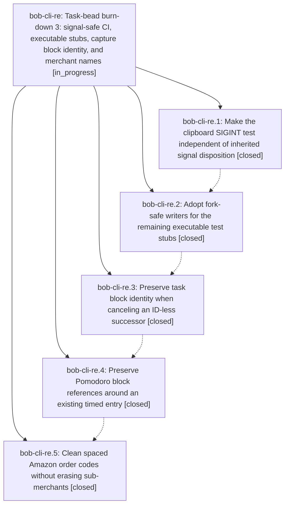

# Bead: bob-cli-re — Task-bead burn-down 3: signal-safe CI, executable stubs, capture block identity, and merchant names

[Bead Pages](../README.md) / bob-cli-re

**Status:** ◐ in_progress · **Type:** ▸ plan · **Tier:** epic
**Owner:** `bryanbugyi34@gmail.com` · **Created by:** [bbugyi200.athena.bob-cli-r8.land](https://github.com/bobs-org/bob-cli--agents/blob/main/sessions/bbugyi200.athena.bob-cli-r8.land.md) · **Assignee:** `bob-cli-re.land`
**Created:** 2026-11-27 15:31:18 EST
**Plan:** [202611/task\_bead\_burndown\_3.md](https://github.com/bobs-org/bob-cli--plans/blob/main/202611/task_bead_burndown_3.md)

<!-- sase:links:start -->

## Links

| Relation | Artifact | Why |
| --- | --- | --- |
| implemented-by | [plan:202611/task_bead_burndown_3.md][1] | derived from the plan's `bead_id:` frontmatter field |

_Plus 1 automatic references — see [Referenced By](#referenced-by)._

[1]: https://github.com/bobs-org/bob-cli--plans/blob/main/202611/task_bead_burndown_3.md

<!-- sase:links:end -->

## Description

Close five verified task beads by repairing the clipboard CI signal harness, executable-stub races, two capture block-reference panics, and spaced merchant order-code cleaning; then triage and continue the task-bead burn-down.

## Notes

[2026-11-27T20:38:01Z · bryanbugyi34@gmail.com] I think three rounds are enough for now. The Lander agent should not create a new epic unless issues were caused by this work or one of the previous rounds.

## Phases

| Bead | Title | Status | Size | Created | Agents | Commits |
|---|---|---|---|---|---:|---:|
| [bob-cli-re.1](bob-cli-re.1.md) | Make the clipboard SIGINT test independent of inherited signal disposition | ✓ closed | small | 2026-11-27 | 1 | 0 |
| [bob-cli-re.2](bob-cli-re.2.md) | Adopt fork-safe writers for the remaining executable test stubs | ✓ closed | medium | 2026-11-27 | 1 | 1 |
| [bob-cli-re.3](bob-cli-re.3.md) | Preserve task block identity when canceling an ID-less successor | ✓ closed | medium | 2026-11-27 | 1 | 1 |
| [bob-cli-re.4](bob-cli-re.4.md) | Preserve Pomodoro block references around an existing timed entry | ✓ closed | medium | 2026-11-27 | 1 | 1 |
| [bob-cli-re.5](bob-cli-re.5.md) | Clean spaced Amazon order codes without erasing sub-merchants | ✓ closed | small | 2026-11-27 | 1 | 1 |

## Lineage

## Agents

| Agent | Bead | Commits |
|---|---|---:|
| [bbugyi200.athena.bob-cli-re.1](https://github.com/bobs-org/bob-cli--agents/blob/main/sessions/bbugyi200.athena.bob-cli-re.1.md) | [bob-cli-re.1](bob-cli-re.1.md) | 0 |
| [bbugyi200.athena.bob-cli-re.2](https://github.com/bobs-org/bob-cli--agents/blob/main/agents/bbugyi200.athena.bob-cli-re.2/README.md) | [bob-cli-re.2](bob-cli-re.2.md) | 1 |
| [bbugyi200.athena.bob-cli-re.3](https://github.com/bobs-org/bob-cli--agents/blob/main/agents/bbugyi200.athena.bob-cli-re.3/README.md) | [bob-cli-re.3](bob-cli-re.3.md) | 1 |
| [bbugyi200.athena.bob-cli-re.4](https://github.com/bobs-org/bob-cli--agents/blob/main/agents/bbugyi200.athena.bob-cli-re.4/README.md) | [bob-cli-re.4](bob-cli-re.4.md) | 1 |
| [bbugyi200.athena.bob-cli-re.5](https://github.com/bobs-org/bob-cli--agents/blob/main/agents/bbugyi200.athena.bob-cli-re.5/README.md) | [bob-cli-re.5](bob-cli-re.5.md) | 1 |
| [bbugyi200.athena.bob-cli-re.land](https://github.com/bobs-org/bob-cli--agents/blob/main/agents/bbugyi200.athena.bob-cli-re.land/README.md) | [bob-cli-re](README.md) | 0 |

## Commits

| Repo | Commit | Subject | Bead | Committed |
|---|---|---|---|---|
| bob-cli | [`69f8aae`](https://github.com/bobs-org/bob-cli/commit/69f8aae63cdf25cf926461f0d96a1156de1997e5) | fix(tests): eliminate ETXTBSY races via child-cp executable stubs | [bob-cli-re.2](bob-cli-re.2.md) | 2026-11-27 16:56:03 EST |
| bob-cli | [`d117d28`](https://github.com/bobs-org/bob-cli/commit/d117d28838ac4b75e7a3bb7b1de45b6117e0d4da) | fix(capture): preserve ID-less task blocks across successor closes | [bob-cli-re.3](bob-cli-re.3.md) | 2026-11-27 17:33:48 EST |
| bob-cli | [`f0ee435`](https://github.com/bobs-org/bob-cli/commit/f0ee43574e93287b89a1874415327c79d68df2a3) | fix(capture): pin Pomodoro Next refs after recording a timed entry | [bob-cli-re.4](bob-cli-re.4.md) | 2026-11-27 18:09:51 EST |
| bob-cli | [`befff97`](https://github.com/bobs-org/bob-cli/commit/befff97c0ab276059b129ba52bf01174b405c5a9) | fix(bank): strip spaced Amazon processor order codes | [bob-cli-re.5](bob-cli-re.5.md) | 2026-11-27 18:35:11 EST |

<!-- sase:referenced-by:start -->

## Referenced By

| Relation | Artifact | Why | Uses |
| --- | --- | --- | ---: |
| read-by | [agent:bob-cli-re.4][1] | Need epic DECISIONS and parent context for timed-entry-close | 1 |

[1]: https://github.com/bobs-org/bob-cli--agents/blob/main/agents/bbugyi200.athena.bob-cli-re.4/README.md

<!-- sase:referenced-by:end -->
