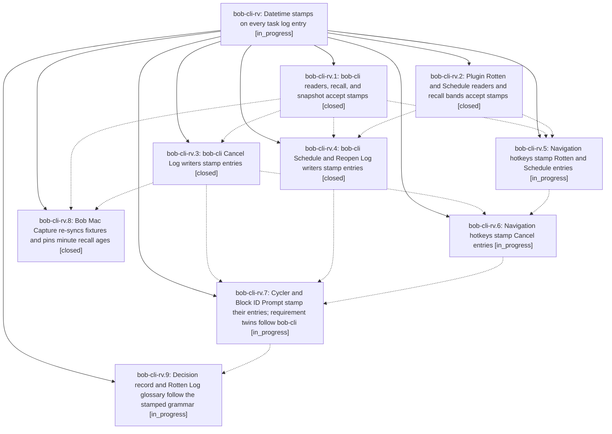

# Bead: bob-cli-rv — Datetime stamps on every task log entry

[Bead Pages](../README.md) / bob-cli-rv

**Status:** ◐ in_progress · **Type:** ▸ plan · **Tier:** epic
**Owner:** `bryanbugyi34@gmail.com` · **Created by:** [bbugyi200.athena.1ho](https://github.com/bobs-org/bob-cli--agents/blob/main/sessions/bbugyi200.athena.1ho.md) · **Assignee:** `bob-cli-rv.land`
**Created:** 2026-11-28 08:22:26 EST
**Plan:** [202611/task\_log\_datetime\_stamps.md](https://github.com/bobs-org/bob-cli--plans/blob/main/202611/task_log_datetime_stamps.md)

<!-- sase:links:start -->

## Links

| Relation | Artifact | Why |
| --- | --- | --- |
| implemented-by | [plan:202611/task_log_datetime_stamps.md][1] | derived from the plan's `bead_id:` frontmatter field |

_Plus 1 automatic references — see [Referenced By](#referenced-by)._

[1]: https://github.com/bobs-org/bob-cli--plans/blob/main/202611/task_log_datetime_stamps.md

<!-- sase:links:end -->

## Description

Every new Schedule, Rotten, Cancel, and Reopen Log entry, from every bob-cli and plugin writer, carries one `YYYY-MM-DD HH:MM` stamp of the minute it was written, exactly as Work Log entries already do. Older date-only entries stay valid and untouched, and every reader, recall band, and display handles both forms.

## Phases

| Bead | Title | Status | Size | Created | Agents | Commits |
|---|---|---|---|---|---:|---:|
| [bob-cli-rv.1](bob-cli-rv.1.md) | bob-cli readers, recall, and snapshot accept stamps | ✓ closed | medium | 2026-11-28 | 1 | 1 |
| [bob-cli-rv.2](bob-cli-rv.2.md) | Plugin Rotten and Schedule readers and recall bands accept stamps | ✓ closed | medium | 2026-11-28 | 1 | 1 |
| [bob-cli-rv.3](bob-cli-rv.3.md) | bob-cli Cancel Log writers stamp entries | ✓ closed | medium | 2026-11-28 | 1 | 0 |
| [bob-cli-rv.4](bob-cli-rv.4.md) | bob-cli Schedule and Reopen Log writers stamp entries | ✓ closed | medium | 2026-11-28 | 1 | 0 |
| [bob-cli-rv.5](bob-cli-rv.5.md) | Navigation hotkeys stamp Rotten and Schedule entries | ◐ in_progress | medium | 2026-11-28 | 1 | 2 |
| [bob-cli-rv.6](bob-cli-rv.6.md) | Navigation hotkeys stamp Cancel entries | ◐ in_progress | medium | 2026-11-28 | 1 | 0 |
| [bob-cli-rv.7](bob-cli-rv.7.md) | Cycler and Block ID Prompt stamp their entries; requirement twins follow bob-cli | ◐ in_progress | medium | 2026-11-28 | 1 | 0 |
| [bob-cli-rv.8](bob-cli-rv.8.md) | Bob Mac Capture re-syncs fixtures and pins minute recall ages | ✓ closed | small | 2026-11-28 | 1 | 0 |
| [bob-cli-rv.9](bob-cli-rv.9.md) | Decision record and Rotten Log glossary follow the stamped grammar | ◐ in_progress | small | 2026-11-28 | 1 | 0 |

## Lineage

## Agents

| Agent | Bead | Commits |
|---|---|---:|
| [bbugyi200.athena.bob-cli-rv.1](https://github.com/bobs-org/bob-cli--agents/blob/main/sessions/bbugyi200.athena.bob-cli-rv.1.md) | [bob-cli-rv.1](bob-cli-rv.1.md) | 1 |
| [bbugyi200.athena.bob-cli-rv.2](https://github.com/bobs-org/bob-cli--agents/blob/main/agents/bbugyi200.athena.bob-cli-rv.2/README.md) | [bob-cli-rv.2](bob-cli-rv.2.md) | 1 |
| [bbugyi200.athena.bob-cli-rv.3](https://github.com/bobs-org/bob-cli--agents/blob/main/sessions/bbugyi200.athena.bob-cli-rv.3.md) | [bob-cli-rv.3](bob-cli-rv.3.md) | 0 |
| [bbugyi200.athena.bob-cli-rv.4](https://github.com/bobs-org/bob-cli--agents/blob/main/agents/bbugyi200.athena.bob-cli-rv.4/README.md) | [bob-cli-rv.4](bob-cli-rv.4.md) | 0 |
| [bbugyi200.athena.bob-cli-rv.5](https://github.com/bobs-org/bob-cli--agents/blob/main/sessions/bbugyi200.athena.bob-cli-rv.5.md) | [bob-cli-rv.5](bob-cli-rv.5.md) | 2 |
| [bbugyi200.athena.bob-cli-rv.6](https://github.com/bobs-org/bob-cli--agents/blob/main/agents/bbugyi200.athena.bob-cli-rv.6/README.md) | [bob-cli-rv.6](bob-cli-rv.6.md) | 0 |
| [bbugyi200.athena.bob-cli-rv.7](https://github.com/bobs-org/bob-cli--agents/blob/main/agents/bbugyi200.athena.bob-cli-rv.7/README.md) | [bob-cli-rv.7](bob-cli-rv.7.md) | 0 |
| [bbugyi200.athena.bob-cli-rv.8](https://github.com/bobs-org/bob-cli--agents/blob/main/sessions/bbugyi200.athena.bob-cli-rv.8.md) | [bob-cli-rv.8](bob-cli-rv.8.md) | 0 |
| [bbugyi200.athena.bob-cli-rv.9](https://github.com/bobs-org/bob-cli--agents/blob/main/agents/bbugyi200.athena.bob-cli-rv.9/README.md) | [bob-cli-rv.9](bob-cli-rv.9.md) | 0 |
| [bbugyi200.athena.bob-cli-rv.land](https://github.com/bobs-org/bob-cli--agents/blob/main/agents/bbugyi200.athena.bob-cli-rv.land/README.md) | [bob-cli-rv](README.md) | 0 |

## Commits

| Repo | Commit | Subject | Bead | Committed |
|---|---|---|---|---|
| bob-plugins | [`bob-plugins@d55ba76`](https://github.com/bobs-org/bob-plugins/commit/d55ba7601f39d3f6526a26ae42c59e6cbc306aa5) | feat(plugins): accept stamped Rotten and Schedule entries in readers and recall bands | [bob-cli-rv.2](bob-cli-rv.2.md) | 2026-11-28 08:49:58 EST |
| bob-cli | [`08165ed`](https://github.com/bobs-org/bob-cli/commit/08165ed9cafa838a079eb5ca18acead319f9fcc8) | feat(logs)!: accept stamped task-log readers | [bob-cli-rv.1](bob-cli-rv.1.md) | 2026-11-28 08:51:29 EST |
| bob-plugins | [`bob-plugins@9c4e777`](https://github.com/bobs-org/bob-plugins/commit/9c4e7775da5596a5fc04444138b4c14bb92ddb3f) | feat(navigation): stamp Rotten and Schedule logs | [bob-cli-rv.5](bob-cli-rv.5.md) | 2026-11-28 09:47:26 EST |
| bob-plugins | [`bob-plugins@4838be0`](https://github.com/bobs-org/bob-plugins/commit/4838be03b74647d633cb1c5c81bc0438aebdab1b) | fix(navigation): share commit stamps across log writers | [bob-cli-rv.5](bob-cli-rv.5.md) | 2026-11-28 10:41:42 EST |

<!-- sase:referenced-by:start -->

## Referenced By

| Relation | Artifact | Why | Uses |
| --- | --- | --- | ---: |
| read-by | [agent:bob-cli-rv.2][1] | epic context for plugin-readers | 1 |

[1]: https://github.com/bobs-org/bob-cli--agents/blob/main/agents/bbugyi200.athena.bob-cli-rv.2/README.md

<!-- sase:referenced-by:end -->
